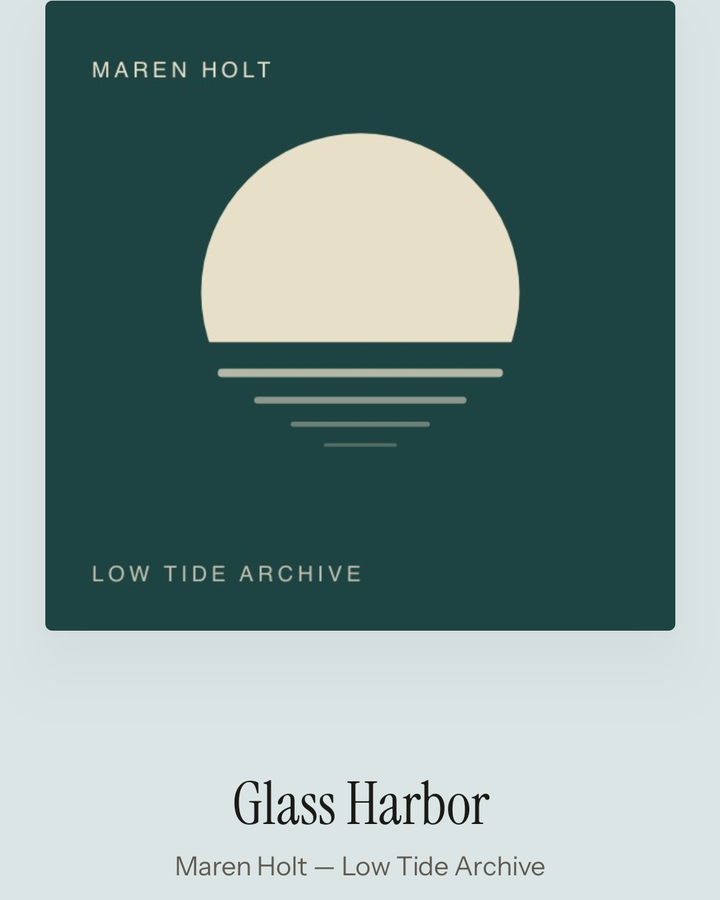
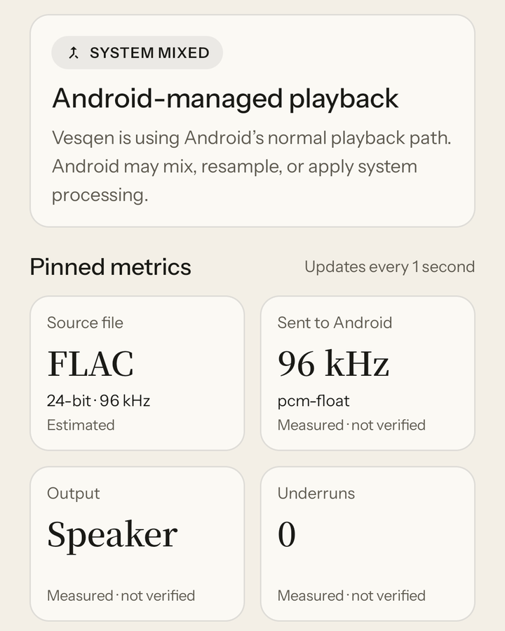
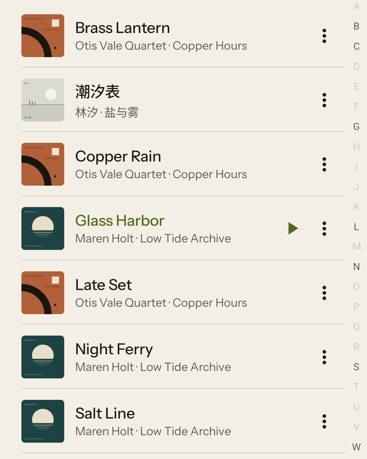

<p align="center">
  <picture>
    <source media="(prefers-color-scheme: dark)" srcset="docs/brand/assets/vesqen-mark-inverse.svg">
    
  </picture>
</p>

<h1 align="center">Vesqen</h1>

<p align="center"><strong>An offline music player for Android. Every track comes with liner notes.</strong></p>

<p align="center">
  <a href="https://github.com/Sumire-no-kai/Vesqen/releases/latest"></a>
  <a href="app/build.gradle.kts"></a>
  <a href="https://github.com/Sumire-no-kai/Vesqen/actions/workflows/android.yml"></a>
  <a href="LICENSE"></a>
</p>

<p align="center">
  <a href="https://vesqen.sumirenokai.com">Website</a> ·
  <a href="https://github.com/Sumire-no-kai/Vesqen/releases/latest">Download</a> ·
  <a href="https://vesqen.sumirenokai.com/changelog/">Changelog</a> ·
  <a href="https://vesqen.sumirenokai.com/status/">Known issues and plans</a> ·
  <a href="https://vesqen.sumirenokai.com/privacy/">Privacy policy</a> ·
  <a href="https://vesqen.sumirenokai.com/support/">Support</a>
</p>

<p align="center"><strong>English</strong> · <a href="README.zh-CN.md">简体中文</a></p>

Vesqen is an offline music player for Android. It plays the music stored on your phone and needs no account. While a track plays, Vesqen records each step from the file to your headphones, and the Chain page shows where every value came from and how it was obtained.

> **Current version:** `1.1.0`, released on October 31, 2026 on [GitHub Releases](https://github.com/Sumire-no-kai/Vesqen/releases/tag/v1.1.0). The Google Play version is in a closed test and will get the same version once Google approves it. Read the [known limitations](#known-limitations) before relying on strict USB output.

## Features

<p align="center">
  
  
  
</p>

- **Your library.** Finds music through Android's media library and in folders you add. Browse by song, album, artist, folder, genre or playlist, keep favorites, and edit a queue that is still there next time.
- **Formats.** Lossless FLAC, ALAC, WAV and AIFF, plus MP3, AAC, Ogg Vorbis and Opus, as far as your phone's decoders support them.
- **Background playback** with controls in the notification and on the lock screen.
- **The Chain page** shows the source file, the decoder, what AudioTrack and Android's mixer report, and the output route. Each value says whether it was measured, derived or estimated, and when it was observed. On Android 13 and later it also shows the Bluetooth codec, sample rate and bit depth Android reports.
- **Strict USB output** (Android 14 and later) asks Android for its official bit-perfect USB mode when a compatible DAC is connected. If the conditions can't be kept, Vesqen stops playback and tells you why. It doesn't switch to system output on its own.
- **Output verification records** can be imported. `BIT-PERFECT VERIFIED` appears only when a record signed by Vesqen's verification issuer matches the exact app build, phone and ROM, DAC, source format and output format.
- **Updates.** The GitHub version checks for new versions at most once a day, downloads only when you ask, verifies the file's SHA-256 and signature, and installs after Android asks you to confirm.
- **Device reports.** If something goes wrong, you can build a report of your phone, Android version and output path, see all of it, and then share, email or upload it.
- **Languages:** English, Simplified Chinese, Traditional Chinese and Japanese.

## Output states

| State | Meaning |
| --- | --- |
| `SYSTEM MIXED` | Android's normal playback path. Android may mix, resample or apply system effects. |
| `BIT-PERFECT AVAILABLE` | The connected USB DAC advertises a matching bit-perfect mixer profile. Strict output isn't active yet. |
| `BIT-PERFECT REQUESTED` | Vesqen is preparing strict USB output and checking the mixer and the route. |
| `BIT-PERFECT ACTIVE` | Android reports that the AudioTrack, the mixer preference and the route match the file. This is evidence from the Android side, not an external measurement. |
| `BIT-PERFECT VERIFIED` | A signed record from an external measurement matches this exact setup. |
| `STRICT OUTPUT STOPPED` | Strict output couldn't be kept, so playback stopped. |

A state is never promoted to a stronger one. An active path is not called verified, and a lossless file is not called bit-perfect.

## Download and install

- **GitHub Releases:** each [release](https://github.com/Sumire-no-kai/Vesqen/releases) has a signed APK and its SHA-256. The [Support page](https://vesqen.sumirenokai.com/support/#install-title) explains each install step. The application signing certificate SHA-256 is
  `74:3E:96:FC:B7:1D:C5:81:88:49:68:19:A0:01:A2:7C:D8:8D:90:91:62:C5:AE:92:9C:87:BF:A2:9A:B8:62:93`.
  You can check it with `apksigner verify --print-certs`. GitHub and Google Play builds use the same signing key, so an update from either source keeps your library.
- **Google Play:** in a closed test; the public listing follows once Google approves it. The Play version is updated by Google Play, and the GitHub version updates itself.
- **Requirements:** Android 9.0 or later. Strict USB output needs Android 14 or later and a compatible USB DAC. Android 8.0 and 8.1 can keep using 1.0.0-beta.3.

## Price

Vesqen 1.x is free. Library, playback and the Chain page stay free. Pro features such as strict USB output are free until 2.0; from 2.0 you can try them free for 7 days and then unlock them with a one-time purchase. There is no subscription and no advertising.

## Plans

There are no dates, and the order may change with feedback. Details and progress are in [issue #163](https://github.com/Sumire-no-kai/Vesqen/issues/163) and the [milestones](https://github.com/Sumire-no-kai/Vesqen/milestones).

- **2.0:** Vesqen's own USB output, so phones without Android's official bit-perfect path can still play strictly (in development; we can't promise it yet); strict USB output that keeps each source's format, including 16-bit sources sent through a 24-bit path; sample-by-sample checks with real DACs and external equipment for the first `BIT-PERFECT VERIFIED` record; Pro features with a 7-day free trial and a one-time purchase.

## Privacy

Playback and your library never use the network, and your library, playlists and play counts stay in the app's private storage on your phone. Since 1.0.0-beta.2 the app uses the network for three things, each of which you can turn off: usage statistics at most once a day with no ID attached (in the EU, EEA, UK, mainland China and South Korea, only if you agree), device reports you choose to upload, and, in the GitHub version, update checks. The [privacy policy](https://vesqen.sumirenokai.com/privacy/) ([中文](https://vesqen.sumirenokai.com/zh/privacy/)) lists what each one sends and how long it is kept. It is also inside the app, under Settings → Privacy policy.

## Known limitations

- No phone and DAC combination has been verified bit-perfect yet, so no `BIT-PERFECT VERIFIED` record exists.
- Strict USB output hasn't been confirmed with a real DAC yet. Many phones don't offer Android's bit-perfect path, even on Android 14 and later; none of the Android 14+ phones tested so far (vivo and iQOO, on Android 15 and 16) do. On those phones strict mode stops and tells you why. Treat every combination as unverified.
- Android 13 and earlier don't provide the official bit-perfect mixer API, so strict USB output isn't available there.
- Even on phones that do offer the bit-perfect path, strict USB output currently stops for most files: Vesqen hands Android floating-point audio, and USB DACs' bit-perfect formats are integer. This is being fixed together with Vesqen's own USB output, planned for 2.0.
- In strict USB mode, there is a short gap between tracks, even on gapless albums.
- Same-name `.lrc` lyrics files are read only in folders added with Add music folder, not for songs that Vesqen finds through Android's media library.
- If Vesqen's library data is damaged and has to be rebuilt, folders added with Add music folder have to be added again.
- Bluetooth is never bit-perfect. The Chain page can say that Vesqen's part left the audio unchanged; the phone still re-encodes it for Bluetooth.
- If Android stops Vesqen in the background, the queue comes back when you open the app again. Resuming straight from headphone buttons doesn't work on the phones we tested, which pass those buttons only to music apps on a list built into the system. On Android 13 and later, the Play button in the notification shade and on the lock screen can't restart it either.
- On vivo phones, Vesqen's playback controls show on the lock screen only after you turn on Lock screen notifications for Vesqen in the phone's notification settings.
- Some phone makers' systems pause music on their own. On our vivo test phone, the system paused Vesqen about three minutes after the media volume was turned all the way down with the volume keys.
- Long listening and interruptions passed with wired headphones (8 hours on Android 9), with the screen off (4 hours on Android 15), for incoming calls (on an Android 16 emulator), for unplugging wired headphones and for disconnecting Bluetooth headphones (on Android 15).
- Vesqen doesn't move its data to a new phone. Favorites, playlists and settings stay on the old phone.
- Vesqen hasn't been tested on foldables, and its smoothness at high refresh rates hasn't been measured. TalkBack was checked on an Android 16 emulator, not yet on a phone.

Each release lists its own limitations in the release notes, and the [changelog](https://vesqen.sumirenokai.com/changelog/) summarizes every version.

## Feedback and support

- **Questions and problems:** email vesqen@sumirenokai.com, in English or Chinese.
- **Discussions:** ask questions, share your phone and DAC setup, or suggest ideas in [GitHub Discussions](https://github.com/Sumire-no-kai/Vesqen/discussions).
- **Bugs and ideas:** [open an issue](https://github.com/Sumire-no-kai/Vesqen/issues/new/choose). Include the app version, phone model, Android version, DAC or headphones and the file format. For output problems, a screenshot of the Chain page helps. You don't need to turn on any logging.
- **Security issues:** follow [SECURITY.md](SECURITY.md) and please don't report them in public.
- **Support development:** if Vesqen is useful to you, you can support its development on [Buy Me a Coffee](https://buymeacoffee.com/edward_lee). It is voluntary and doesn't unlock any features.

## Building from source

You need JDK 25 and Android SDK Platform 36. The Gradle wrapper provides Gradle 9.5.0 and Android Gradle Plugin 9.3.2. `minSdk` is 28, `compileSdk` and `targetSdk` are 36, and the application ID is `io.github.sumirenokai.vesqen`.

```bash
./gradlew :app:testDebugUnitTest :app:lintDebug :app:assembleDebug
```

On Windows, use `.\gradlew.bat` instead. Debug APKs are written to `app/build/outputs/apk/github/debug/` and `app/build/outputs/apk/play/debug/`, one per build flavor (see [versioning](docs/VERSIONING.md#build-flavors-and-channels)).

For previews and scrolling checks, use the Profile build. It isn't debuggable, it uses Release's R8 optimization, and it is signed with the local debug key:

```bash
./gradlew :app:installProfile
```

Keep `app/build/outputs/mapping/<variant>/mapping.txt` with any optimized APK so crash traces can be decoded. Release signing uses the maintainer's keys, which never enter the repository ([release signing](docs/RELEASE_SIGNING.md)). Versions come from [`version.properties`](version.properties) ([versioning](docs/VERSIONING.md)).

## Documentation

- Product: [PRODUCT.md](PRODUCT.md), [requirements](docs/PRD.md), [milestone overview](docs/ROADMAP.md)
- Design: [DESIGN.md](DESIGN.md), [visual identity](docs/brand/VISUAL_IDENTITY.md), [redesign direction](docs/redesign/README.md)
- Engineering: [architecture review](docs/ARCHITECTURE_REVIEW.md), [engineering casebook](docs/ENGINEERING_CASEBOOK.md), [development log](docs/DEVELOPMENT_LOG.md)
- Releases: [release roadmap and schedule](docs/LAUNCH_BACKLOG.md), [beta checklist](docs/M4_BETA_RELEASE.md), [device acceptance](docs/M4_DEVICE_ACCEPTANCE.md)

## Contributing and license

Read [CONTRIBUTING.md](CONTRIBUTING.md) before proposing changes. Vesqen is developed by Sumire Studio and released under the [Apache License 2.0](LICENSE).

Vesqen is developed with the help of AI coding assistants (Codex and Claude Code). Contributions made with AI tools are welcome too; as with any change, you are responsible for reviewing and testing what you submit.
