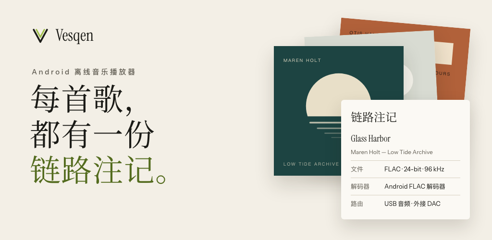

# Vesqen

[](https://github.com/Sumire-no-kai/Vesqen/actions/workflows/android.yml)
[](https://github.com/Sumire-no-kai/Vesqen/releases)
[-3DDC84?logo=android&logoColor=white)](app/build.gradle.kts)
[](LICENSE)

[English](README.md) · **简体中文**



Vesqen 是一款 Android 离线音乐播放器，无需注册账号即可播放手机中的本地音乐。播放时，它会记录音频从文件到耳机经过的每个环节；链路页上的每个数值都注明来源和获取方式。

[官网](https://vesqen.sumirenokai.com/zh/) · [下载](https://github.com/Sumire-no-kai/Vesqen/releases/latest) · [更新日志](https://vesqen.sumirenokai.com/zh/changelog/) · [已知问题与计划](https://vesqen.sumirenokai.com/zh/status/) · [隐私政策](https://vesqen.sumirenokai.com/zh/privacy/) · [支持](https://vesqen.sumirenokai.com/zh/support/)

> **当前版本：** 首个正式版 `1.0.0`，2026 年 10 月 25 日在 [GitHub Releases](https://github.com/Sumire-no-kai/Vesqen/releases/tag/v1.0.0) 发布。Google Play 版正在封闭测试，获得 Google 批准后将上架同一版本。使用严格 USB 输出前，请先阅读[已知限制](#已知限制)。

## 功能

- **曲库**：通过 Android 媒体库查找音乐，也可以自行添加文件夹。支持按歌曲、专辑、艺术家、文件夹、流派和歌单浏览，支持收藏；播放队列可以编辑，下次打开时仍会保留。
- **格式**：无损格式 FLAC、ALAC、WAV、AIFF，以及 MP3、AAC、Ogg Vorbis、Opus，具体以手机解码器的支持为准。
- **后台播放**：可在通知栏和锁屏上直接控制。
- **链路页**：显示源文件、解码器、AudioTrack 和 Android 混音器（mixer）报告的信息，以及输出路由。每个数值均标明是实测、推导还是估算，以及观测时间。在 Android 13 及以上版本中，还会显示系统报告的蓝牙编码、采样率和位深。
- **严格 USB 输出**（Android 14 及以上）：连接兼容的 DAC 时，向 Android 请求官方的 bit-perfect USB 模式。条件无法满足时，Vesqen 会停止播放并说明原因，不会自动切换回系统输出。
- **输出验证记录**：支持导入验证记录。只有由 Vesqen 验证签发方签名，且与应用版本、手机和系统、DAC、源格式、输出格式完全一致的记录，才会使链路页显示 `BIT-PERFECT VERIFIED`。
- **应用更新**：GitHub 版每天最多检查一次新版本，仅在你同意后下载，并核对文件的 SHA-256 和签名，安装时由 Android 请你确认。
- **设备报告**：遇到问题时，可以生成一份包含手机型号、Android 版本和输出路径的报告，查看完整内容后再选择分享、发送邮件或上传。
- **界面语言**：English、简体中文、繁體中文、日本語。

## 输出状态

| 状态 | 含义 |
| --- | --- |
| `SYSTEM MIXED` | Android 的常规播放路径，系统可能进行混音、重采样或添加系统音效。 |
| `BIT-PERFECT AVAILABLE` | 已连接的 USB DAC 提供匹配的 bit-perfect 混音配置，严格输出尚未启用。 |
| `BIT-PERFECT REQUESTED` | Vesqen 正在准备严格 USB 输出，并核对混音器和路由。 |
| `BIT-PERFECT ACTIVE` | Android 报告的 AudioTrack、混音器设置和路由均与文件一致。这是来自 Android 端的证据，并非外部测量结果。 |
| `BIT-PERFECT VERIFIED` | 一份来自外部测量的签名记录，与当前设备和格式的组合完全一致。 |
| 严格输出已停止 | 严格输出的条件无法满足，播放已停止。 |

状态仅依据证据显示，不会向更高等级提升：处于 ACTIVE 的路径不会被称为已验证，无损文件也不会被称为 bit-perfect。

## 下载与安装

- **GitHub Releases**：每个[版本](https://github.com/Sumire-no-kai/Vesqen/releases)均附有签名的 APK 及其 SHA-256，详细安装步骤请参阅官网[支持页面](https://vesqen.sumirenokai.com/zh/support/#install-title)。应用签名证书的 SHA-256 为
  `74:3E:96:FC:B7:1D:C5:81:88:49:68:19:A0:01:A2:7C:D8:8D:90:91:62:C5:AE:92:9C:87:BF:A2:9A:B8:62:93`，
  可使用 `apksigner verify --print-certs` 核对。GitHub 版和 Google Play 版使用同一签名密钥，通过任一渠道更新都会保留你的曲库。
- **Google Play**：正在进行封闭测试，获得 Google 批准后将公开上架。Play 版由 Google Play 负责更新，GitHub 版由应用自行更新。
- **系统要求**：Android 9.0 及以上。严格 USB 输出需要 Android 14 及以上版本和兼容的 USB DAC。Android 8.0 和 8.1 可继续使用 1.0.0-beta.3。

## 价格

Vesqen 1.x 免费。曲库、播放和链路功能永久免费。严格 USB 输出等高级功能在 2.0 之前免费使用；自 2.0 起提供 7 天免费试用，之后可一次性买断。不提供订阅，也没有广告。

## 计划

不注明具体日期，先后顺序可能根据反馈调整。详细内容和进展请参阅 [issue #163](https://github.com/Sumire-no-kai/Vesqen/issues/163) 和各[里程碑](https://github.com/Sumire-no-kai/Vesqen/milestones)。

- **下一个更新版本（1.0.1）**：随机播放时，“下一首播放”和“添加到队列”将插入正确位置；在已添加的文件夹中重命名或移动文件后，保留收藏、播放次数和歌单位置；文字按钮的可点击区域补足 48 dp；修正 Android 13 和 14 上部分蓝牙编码的名称。
- **2.0 之前**：改进 Android 重建媒体库后的匹配，无法匹配的旧记录先行保留，由你选择归属；为高级功能和高级链路视图使用更清晰的中文名称。
- **2.0**：Vesqen 自研的 USB 输出，使未开放官方 bit-perfect 通路的手机也能实现严格直出（正在开发，目前尚无法保证）；严格 USB 输出保持每种音源的格式，包括将 16 位音源补零后送入 24 位通道；使用真实的 DAC 和外部测量设备进行逐样本验证，形成首条 `BIT-PERFECT VERIFIED` 记录；高级功能提供 7 天免费试用，之后可一次性买断。

## 隐私

播放和曲库从不使用网络，曲库、歌单和播放次数均保存在应用的私有存储中，仅存在于你的手机上。自 1.0.0-beta.2 起，应用会在以下三种情况下使用网络，每一项均可关闭：每天最多一次、不包含任何标识符的使用统计（在欧盟、欧洲经济区、英国、中国大陆和韩国，仅在你同意后发送）；你自行选择上传的设备报告；以及 GitHub 版的更新检查。[隐私政策](https://vesqen.sumirenokai.com/zh/privacy/)（[English](https://vesqen.sumirenokai.com/privacy/)）列明了每一项发送的内容和保留期限，在应用的“设置 → 隐私政策”中也可查看。

## 已知限制

- 目前尚无任何手机和 DAC 的组合通过 bit-perfect 验证，因此还没有 `BIT-PERFECT VERIFIED` 记录。
- 严格 USB 输出尚未在真实的 DAC 上得到确认。许多手机即使运行 Android 14 及以上版本，也未开放 Android 的 bit-perfect 通路；目前测试过的 Android 14 及以上手机（vivo 和 iQOO，Android 15 和 16）均未开放。在这些手机上，严格模式会停止播放并说明原因。请将所有组合视为未经验证。
- Android 13 及以下版本没有官方的 bit-perfect 混音接口，因此无法使用严格 USB 输出。
- 即使手机开放了 bit-perfect 通路，目前播放大多数文件时严格 USB 输出也会停止：Vesqen 交给 Android 的是浮点音频，而 USB DAC 的 bit-perfect 格式为整数。该问题将与计划在 2.0 推出的 Vesqen 自研 USB 输出一并解决。
- 严格 USB 模式下切换曲目时会有短暂间隔，无缝专辑也不例外。
- 开启随机播放时，“下一首播放”和“添加到队列”会将歌曲插入随机顺序中的任意位置。计划在下一个更新版本中修复。
- 在通过“添加音乐文件夹”加入的文件夹中，若将歌曲文件重命名或移至该文件夹内的其他位置，下次扫描时 Vesqen 会将其视为新歌曲，原有的收藏、播放次数和歌单位置将会丢失。计划在下一个更新版本中修复。
- 蓝牙无法实现 bit-perfect。链路页可以说明 Vesqen 这一环节未改动音频，但手机仍会为蓝牙传输重新编码。
- Vesqen 在后台被系统停止后，重新打开应用即可恢复播放队列。我们测试过的手机仅将耳机按键发送给系统内置名单中的音乐应用，因此暂时无法直接通过耳机按键恢复播放；在 Android 13 及以上版本中，通知栏和锁屏上的播放按钮也无法使其恢复。
- 在 vivo 手机上，需要在系统的通知设置中为 Vesqen 开启“锁屏通知”，锁屏上才会显示 Vesqen 的播放控件。
- 部分手机厂商的系统会自行暂停音乐。例如在我们的 vivo 测试机上，使用音量键将媒体音量调至 0 约三分钟后，系统暂停了 Vesqen。
- 长时间播放和中断测试：接有线耳机播放 8 小时（Android 9）、关屏播放 4 小时（Android 15）、来电（Android 16 模拟器）、拔出有线耳机和断开蓝牙耳机（Android 15）均已通过。
- Vesqen 不支持将数据迁移至新手机，收藏、歌单和设置会保留在原手机上。
- 尚未在折叠屏上测试，高刷新率下的流畅度也尚未测量。TalkBack 已在 Android 16 模拟器上检查，尚未在真机上测试。

每个版本的发布说明都会列出当时的限制，各版本的主要变化汇总在[更新日志](https://vesqen.sumirenokai.com/zh/changelog/)中。

## 反馈与支持

- **问题与疑问**：请发送邮件至 vesqen@sumirenokai.com，中文或英文均可。
- **错误报告与建议**：请[新建 issue](https://github.com/Sumire-no-kai/Vesqen/issues/new/choose)，并注明应用版本、手机型号、Android 版本、DAC 或耳机，以及文件格式。如为输出相关问题，请附上链路页截图。无需开启任何日志功能。
- **安全问题**：请按照 [SECURITY.md](SECURITY.md) 的方式私下报告，切勿公开发布。
- **支持开发**：如果 Vesqen 对你有所帮助，欢迎通过 [Buy Me a Coffee](https://buymeacoffee.com/edward_lee) 支持开发。赞助完全自愿，不会解锁任何功能。

## 从源码构建

需要 JDK 25 和 Android SDK Platform 36。Gradle Wrapper 会使用 Gradle 9.5.0 和 Android Gradle Plugin 9.3.2。`minSdk` 为 28，`compileSdk` 和 `targetSdk` 为 36，应用 ID 为 `io.github.sumirenokai.vesqen`。

```bash
./gradlew :app:testDebugUnitTest :app:lintDebug :app:assembleDebug
```

在 Windows 上请改用 `.\gradlew.bat`。Debug 安装包按构建变体分别输出到 `app/build/outputs/apk/github/debug/` 和 `app/build/outputs/apk/play/debug/`（参阅[版本管理](docs/VERSIONING.md#build-flavors-and-channels)）。

日常预览和滑动性能检查请使用 Profile 构建：它不可调试，使用与 Release 相同的 R8 优化，并使用本机的调试密钥签名。

```bash
./gradlew :app:installProfile
```

每个经过优化的安装包都需保留对应的 `app/build/outputs/mapping/<variant>/mapping.txt`，以便还原崩溃堆栈。正式发布使用维护者的签名密钥，密钥不会进入仓库（[发布签名](docs/RELEASE_SIGNING.md)）。版本号来自 [`version.properties`](version.properties)（[版本规则](docs/VERSIONING.md)）。

## 文档

- 产品：[PRODUCT.md](PRODUCT.md)、[需求文档](docs/PRD.md)、[里程碑概览](docs/ROADMAP.md)
- 设计：[DESIGN.md](DESIGN.md)、[视觉识别](docs/brand/VISUAL_IDENTITY.md)、[重设计方向](docs/redesign/README.md)
- 工程：[架构审查](docs/ARCHITECTURE_REVIEW.md)、[工程案例](docs/ENGINEERING_CASEBOOK.md)、[开发日志](docs/DEVELOPMENT_LOG.md)
- 发布：[发布路线与排期](docs/LAUNCH_BACKLOG.md)、[测试版检查表](docs/M4_BETA_RELEASE.md)、[设备验收](docs/M4_DEVICE_ACCEPTANCE.md)

## 参与贡献与许可证

提出修改前请先阅读 [CONTRIBUTING.md](CONTRIBUTING.md)。Vesqen 由 Sumire Studio 开发，采用 [Apache License 2.0](LICENSE) 发布。
