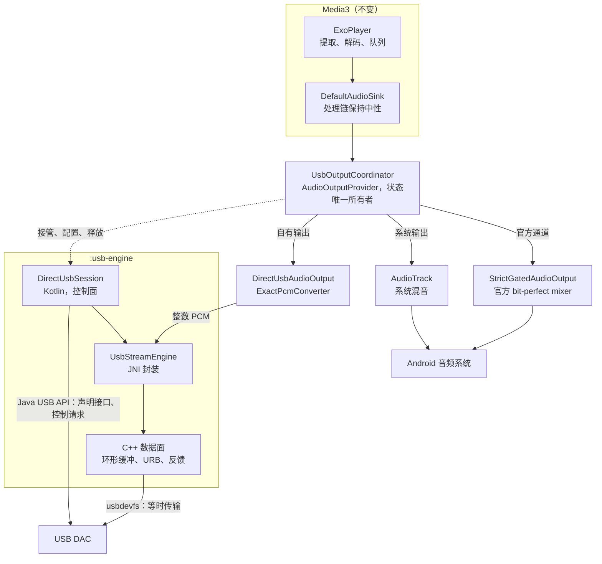
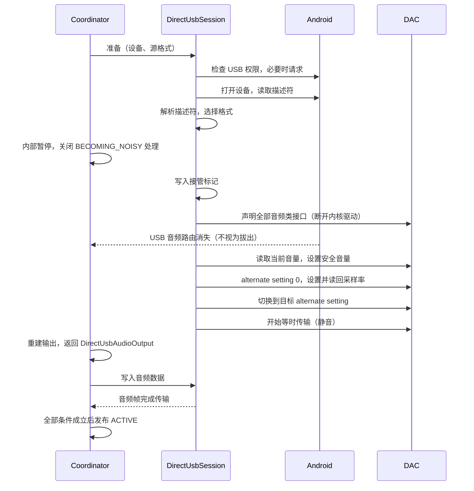
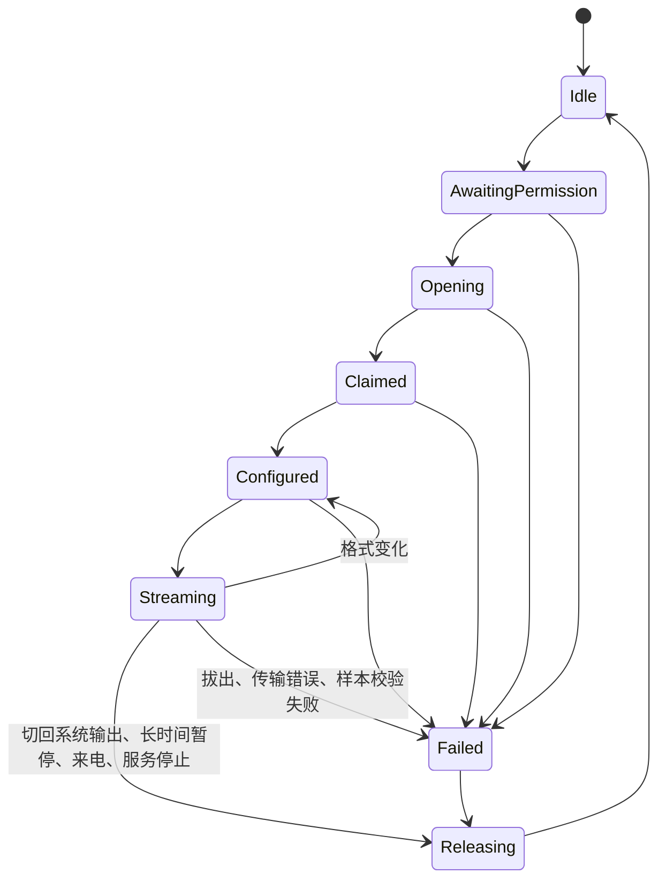
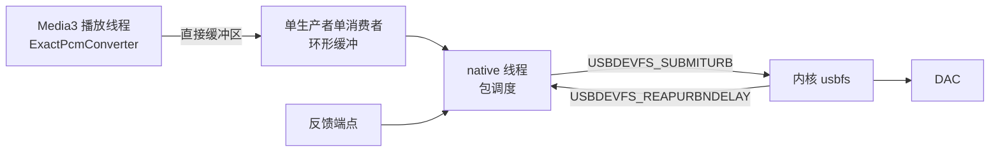

# M7 架构设计：Vesqen 自有 USB 输出

2026-11-02。阶段、决定和验收见 [M7 开发清单](M7_IMPLEMENTATION_PLAN.md)，范围以 [PRD 的 M7 章节](PRD.md) 为准。本文是开工前的设计，目前没有对应代码。标为"待实测"的内容由 M7-1 和 M7-2 验证；实测结论与本文不符时，先更新本文，再继续实现。

## 设计约束

1. 送到 DAC 的样本值须与解码结果一致。无法证明一致时停止输出，不回退到系统混音。
2. 提取、解码、队列和媒体会话继续由 Media3 负责。M7 只替换解码后的输出端，不自定义 `AudioSink`，也不进行 M6 的内核替换。
3. 官方通道可用时优先使用官方通道。
4. `UsbOutputCoordinator` 仍是严格输出状态的唯一所有者。界面、`PlaybackSnapshot` 和 `PlaybackTelemetry` 读取同一份状态。
5. 普通播放不加载 native 库，也不调用 USB Host API。
6. USB 设备提供的数据一律视为不可信输入。描述符在 Kotlin 中解析，native 层只接收校验过的配置。

## 总体结构



运行时分为三个部分：

| 部分 | 运行位置 | 内容 |
| --- | --- | --- |
| 控制面 | Kotlin，专用单线程 `usb-control` | USB 权限、打开设备、解析描述符、声明接口、`setInterface()`、采样率和音量的控制请求。这些都可以使用 Java API。 |
| 格式转换 | Kotlin，Media3 播放线程 | 把 Media3 交来的 PCM 转为 DAC 格式，并校验样本值是否精确。 |
| 数据面 | C++，专用 native 线程，不附加到 JVM | 环形缓冲、等时 URB 的提交和回收、反馈、欠载计数。Java API 不支持等时传输，这一部分只能在 native 实现。 |

数据面线程不附加到 JVM，因此不受 GC 暂停影响。

## 组件

| 组件 | 位置 | 职责 |
| --- | --- | --- |
| `UsbOutputStrategyResolver` | `:app`，修改 | 纯策略判断。结果增加路径：官方通道或自有输出。 |
| `UsbOutputCoordinator` | `:app`，修改 | 模式、generation、状态发布和失败关闭。自有路径的细节委托给 `DirectUsbSession`，不继续把逻辑堆入这个类。修改前先补单元测试（M7-0）。 |
| `DirectUsbAudioOutput` | `:app`，新增 | 实现 Media3 的 `AudioOutput`。 |
| `ExactPcmConverter` | `:app`，新增 | 精确转换和校验。官方路径的修复（#71 2026-10-23）也使用它。 |
| `UacDescriptorParser` | `:usb-engine`，新增 | 把原始描述符解析为 `UsbAudioCapabilities`。纯函数，不依赖 Android。 |
| `DirectFormatSelector` | `:usb-engine`，新增 | 按源格式选择 alternate setting。纯函数。 |
| `UacControlClient` | `:usb-engine`，新增 | UAC1 和 UAC2 的采样率、音量控制请求。经小型接口访问 USB，可以用假实现测试。 |
| `DirectUsbSession` | `:usb-engine`，新增 | 从接管到释放的状态机。生命周期长于单个 `AudioOutput`。 |
| `UsbStreamEngine` | `:usb-engine`，新增 | JNI 封装。第一次需要时才调用 `System.loadLibrary`；加载失败按失败关闭。 |
| native core | `:usb-engine`，新增 | 环形缓冲、包调度和反馈换算。不依赖 Android，可在主机上测试。 |
| native transport | `:usb-engine`，新增 | usbdevfs 的 `ioctl` 调用，不引入 libusb（D2）。 |

依赖方向为 `:app` → `:usb-engine`。`:usb-engine` 不依赖 Media3，USB 协议的细节也不进入 `:app`。

## 接入 Media3

`UsbOutputCoordinator` 继续继承 `ForwardingAudioOutputProvider`。自有路径下，下列三个方法都由 Coordinator 作答：

- `getFormatSupport()` 和 `getOutputConfig()`：接管后系统路由已变为手机扬声器，`AudioTrack` 的实现会按扬声器能力作答，可能错误地拒绝高采样率，因此须依据已选定的 DAC 格式作答。
- `getAudioOutput()`：计划有效时返回 `DirectUsbAudioOutput`。计划过期或失败时沿用现有的 `pendingStrictOutput()` 和 `mutedFailureOutput()`。

`DirectUsbAudioOutput` 的行为：

| 方法 | 行为 |
| --- | --- |
| `write()` | 转换后写入环形缓冲，缓冲已满时返回 `false`；会话失败时抛出不可恢复的 `WriteException`。 |
| `play()`、`pause()` | 切换数据面读取缓冲或填充静音。 |
| `flush()` | 丢弃缓冲和在途 URB，位置归零。 |
| `stop()` | 标记流结束，排空后填充静音。 |
| `release()` | 只解除与会话的绑定，不释放 USB 接口。 |
| `getPositionUs()` | 已完成 URB 的帧数，加上单调时钟插值。 |
| `getBufferSizeInFrames()` | 环形缓冲容量。 |
| `canReuseAudioOutput()` | 使用默认实现：配置相同才复用。同格式曲目连续播放依赖这一点。 |
| `setVolume()`、`setPlaybackParameters()` | 严格模式下只接受中性值，现有的 `enforceNeutralProcessing()` 继续生效。 |
| offload、音效和首选设备相关方法 | 不支持，不产生任何作用。 |

### 样本精确转换

Vesqen 开启了浮点输出，FLAC、ALAC 和高解析度音源到达输出端时是 float PCM（#71 2026-10-23）。转换规则如下：

| 源位深 | 输出端可能收到 | 处理 |
| --- | --- | --- |
| 16 位 | int16 或 float | float 乘以 2^15 还原 |
| 24 位 | int24 或 float | float 乘以 2^23 还原 |
| 32 位 | 仅接受 int32 | float 的有效位只有 24 位，无法还原，因此拒绝 |

- 每个 float 样本还原后必须是整数，且在该位深的取值范围内，否则按 `PCM_NOT_EXACT` 失败关闭。元数据位深有误时，这项校验同样能够发现。
- 整数按 UAC 规定左对齐放入 subslot，低位补零。16 位放入 24 位格式时，状态须写明"已补零"（#65）。
- 不做重采样、抖动或截断。
- 最高 192 kHz 双声道约为每秒 38 万个样本，在 Media3 播放线程上处理没有压力。

## 路径选择

路径按 USB 连接选择，不按曲目切换：

1. 模式为系统输出时，不进入严格路径。
2. API 34 及以上，且 `getSupportedMixerAttributes()` 含有 bit-perfect 配置时，使用官方通道。此后如果格式不匹配，按现有规则失败关闭，不临时切换到自有输出，以免同一队列反复接管和释放 DAC。
3. 其余情况使用自有输出，条件为 `vesqen.directUsb` 构建开关已开启、设备支持 USB Host，且只连接了一台 USB 音频输出设备。连接多台时按 `DIRECT_DEVICE_AMBIGUOUS` 失败关闭，第一版不提供选择界面。
4. 描述符不受支持或没有匹配格式时，失败关闭并说明原因。

选择结果在该连接期间缓存，因为接管后 `AudioDeviceInfo` 会消失，无法再次查询。拔出后清除缓存。

现有的严格模式开关只看官方 API 是否可用（`OfficialMixerApiSupport`），API 34 以下无法开启。M7 改为判断"官方通道或自有输出是否可用"，官方 API 的说明文字保留。

`vesqen.directUsb` 的做法与 `vesqen.premiumEnforced` 相同，由构建配置决定。M7 合入 `master` 后默认关闭，到 2.0.0-beta.1 时开启。

## 接管与释放





设计要点：

- **声明全部音频类接口。** 向接口发送控制请求前，内核要求已声明该接口（`check_ctrlrecip`），因此 AudioControl 和 AudioStreaming 接口都须声明。HID 接口不声明，DAC 上的按键继续由系统处理。
- **`BECOMING_NOISY`。** AOSP 把 USB 设备列入该广播的设备集合，而 `PlaybackService` 开启了 `setHandleAudioBecomingNoisy(true)`。接管导致路由消失时，Media3 会自行暂停。因此接管前关闭这项处理，释放后恢复。此期间的真实拔出由 `ACTION_USB_DEVICE_DETACHED` 和 URB 的 `ENODEV` 判断。
- **路由监听。** 自有路径下 `selectedDevice` 为空，`onAudioDevicesRemoved()` 不会触发失败关闭，官方路径的逻辑不需要改动。
- **会话的生命周期长于 `AudioOutput`。** 格式变化时 Media3 会释放旧输出、创建新输出，会话保持接管状态，只重新配置 alternate setting 和采样率。
- **释放时机。** 切回系统输出、暂停超过 30 秒（默认值，待实测）、来电等暂时失去音频焦点、服务停止、发生失败。短暂暂停时持续发送静音，避免切换带来的爆音。
- **释放顺序。** 停止数据面、切回 alternate setting 0、恢复接管前的音量、释放全部接口、关闭连接、清除接管标记、恢复 `BECOMING_NOISY` 处理。Android 的 `releaseInterface()` 成功后会请求内核重新连接驱动。
- **进程异常退出。** 内核关闭文件描述符时只释放接口（`usbdev_release`），不会重新绑定驱动，DAC 可能需要重新插拔才能被系统使用。下次启动时如果发现接管标记，且设备仍连接并有权限，就重新声明再释放一次，由 `releaseInterface()` 触发重新连接（待实测）。

## 数据面



初始参数如下，由 M7-2 实测后调整：

| 项 | 全速（1 ms） | 高速（125 µs） |
| --- | --- | --- |
| 单个 URB 的包数 | 32，约 32 ms | 128，约 16 ms（内核上限为 128 包） |
| 同时在途 URB | 4 | 6 |
| 在途音频 | 约 128 ms | 约 96 ms |
| 环形缓冲 | 约 500 ms | 约 500 ms |

- **包长。** 用定点累加器计算每包帧数，结果不超过 `wMaxPacketSize`，并按帧对齐。自适应和同步端点使用标称速率，异步端点按反馈调整。任何情况下都不重采样。
- **反馈。** UAC1 和 UAC2 的传输机制相同，全速和高速的反馈格式不同（D3）。反馈值须在标称速率附近，持续超出范围时按 `FEEDBACK_OUT_OF_RANGE` 失败关闭。隐式反馈的设备第一版不支持，按 `FEEDBACK_UNSUPPORTED` 失败关闭。
- **欠载。** 缓冲为空时填充静音并计数，同时触发 `onUnderrun()`，链路页显示次数。欠载不改写样本。
- **错误。** `ENODEV` 视为拔出。其他传输错误连续超过阈值时，按 `USB_TRANSFER_FAILED` 失败关闭。
- **线程优先级。** 请求 `THREAD_PRIORITY_URGENT_AUDIO` 级别，普通应用无法使用 `SCHED_FIFO`。实际是否生效由 M7-2 核实。
- **与 Kotlin 的通信。** native 线程不回调 JVM，只发布原子计数和错误状态。Kotlin 在 `write()` 和 `getPositionUs()` 中读取；会话存在期间，另由 `usb-control` 每 250 ms 读取一次，以便在暂停时也能发现拔出。

JNI 接口保持很小：`create(fd, config)`、`start()`、`write(directBuffer, offset, size)`、`setRunning()`、`flush()`、`markEndOfStream()`、`readStats(long[])`、`destroy()`。文件描述符由 `UsbDeviceConnection` 持有，native 只是借用，因此必须先 `destroy()` 再关闭连接。

## 音量

按 D4：

- 从输出流的终端沿描述符拓扑找到 Feature Unit，读取当前值、最小值、最大值和步长。
- 第一个样本发出之前，先把音量降到约 -30 dB（设备范围不足时取下限）。此后按 VID/PID 在本机记住设置。释放时恢复接管前的音量。
- 音量键经 Media3 接收：交给 `MediaSession` 的 Player 在自有输出期间报告 `DeviceInfo.PLAYBACK_TYPE_REMOTE`，Media3 随后调用 `setPlaybackToRemote()`（已核对 1.11.0 源码）。其他模式仍报告本地播放。vivo ROM 上的行为待实测。
- 没有 Feature Unit 的 DAC，每款设备第一次使用时说明输出为满幅，用户确认后以固定音量播放，会话音量控制类型为固定。不使用软件音量。
- 直出时系统音量和系统的音量安全提示都不起作用，因此安全起始音量由 Vesqen 负责。

## USB 权限

- 只有用户操作才弹出系统授权框。服务启动和恢复队列时没有权限，只显示状态（沿用 #34 的规则）。拒绝授权时报告 `USB_PERMISSION_DENIED`。
- 用户关闭麦克风访问时，系统会拒绝带麦克风输入的设备的 USB 权限。应用无法区分这种情况和普通拒绝，因此失败说明须同时提到这一可能。
- 按 D8，清单声明 `UsbAttachActivity`，带 `USB_DEVICE_ATTACHED` 过滤器（`<usb-device class="1" />`，系统也会匹配接口类别，因此复合设备同样适用）。它默认禁用，用户开启严格模式时启用，切回系统输出时禁用，未开启严格模式的用户插入 DAC 时不受打扰。
- 用户选择"始终使用"后，系统在插入时直接授权并启动这个 Activity。它不显示界面，也不读取任何参数，立即结束；重新判定由现有的 `onAudioDevicesAdded()` 触发。
- 带麦克风输入的 DAC 是例外：应用没有录音权限时，系统不显示"始终使用"（`UsbPermissionActivity`），这类设备每次插入都须授权一次。Vesqen 不为此申请录音权限。

## 状态与失败原因

`UsbOutputPhase` 不变。`UsbOutputStatus` 增加 `path`（`OFFICIAL_MIXER` 或 `DIRECT_USB_HOST`）。Session Bundle 中没有这个字段时按官方通道读取，以兼容进程内外版本不一致的情况。`ACTIVE` 的条件见 [M7 开发清单的声明边界](M7_IMPLEMENTATION_PLAN.md#声明边界)。

失败原因沿用官方路径的机制（`usb_failure_*`，目前 21 条），不另建展示方式（#71 2026-11-02）。每个环节对应的取值：

| 环节 | 新增 | 复用现有 |
| --- | --- | --- |
| USB Host 权限 | `USB_PERMISSION_DENIED` | `USB_HOST_UNAVAILABLE` |
| 设备枚举与生命周期 | `DIRECT_DEVICE_AMBIGUOUS`、`USB_OPEN_FAILED`、`INTERFACE_CLAIM_FAILED` | `NO_USB_AUDIO_DEVICE`、`DEVICE_DISCONNECTED` |
| UAC 版本与接口、endpoint | `DESCRIPTOR_UNSUPPORTED` | |
| 格式协商 | `NO_MATCHING_DIRECT_FORMAT`、`SAMPLE_RATE_SET_FAILED`、`SAMPLE_RATE_READBACK_MISMATCH` | `SOURCE_FORMAT_UNKNOWN`、`SOURCE_FORMAT_UNSUPPORTED` |
| 传输与缓冲 | `USB_TRANSFER_FAILED`、`PCM_NOT_EXACT` | |
| 时钟与反馈 | `FEEDBACK_UNSUPPORTED`、`FEEDBACK_OUT_OF_RANGE` | |
| 设备组合不在支持范围内 | `DEVICE_NOT_SUPPORTED` | |
| 引擎 | `USB_ENGINE_UNAVAILABLE` | |
| 无法确定环节 | | `PLATFORM_ERROR`，说明中写明无法确定 |

兼容性要求：

- 新的失败原因和路径字段进入设备报告时，须先更新 `contracts/device-report/vocabulary.json` 并部署服务端，再发布应用。
- `OutputVerificationRecord` 增加路径字段，官方通道的验证记录不能证明自有输出，反之亦然。没有该字段的旧记录按官方通道处理。

## 安全与隐私

- 描述符解析使用带边界检查的 Kotlin 代码。长度异常或拓扑不完整时报告 `DESCRIPTOR_UNSUPPORTED`，不崩溃。
- native 层再次校验配置：包长不超过 `wMaxPacketSize`，反馈值限制在范围内，`actual_length` 不超过缓冲区。
- `UsbAttachActivity` 必须导出才能接收系统启动，因此不读取 Intent，不显示界面，也不执行其他操作。
- 不新增网络传输。使用统计已经发送 `bitPerfectMixer`，设备报告的音频能力部分已经包含 VID/PID 和接口协议（D7）。
- 本机新增保存：按 VID/PID 记录的音量和固定音量确认，以及接管标记。隐私政策须在 2.0 发布前写明。

## 测试

| 层 | 方式 | 重点 |
| --- | --- | --- |
| 描述符解析和格式选择 | JVM 单元测试，使用真实 DAC 的描述符样本 | 格式解析、畸形输入、不支持的结构 |
| `ExactPcmConverter` | JVM 单元测试 | 全部 16 位取值和 24 位边界值经 float 还原后一致；非整数样本被拒绝 |
| `UacControlClient`、`DirectUsbSession` | JVM 单元测试，使用假 USB 传输 | 每一步失败后都会释放接口；状态转换；过期回调 |
| `UsbOutputStrategyResolver`、`UsbOutputCoordinator` | JVM 单元测试，使用假会话 | 路径选择、generation、失败路径不出现错误的 `ACTIVE` |
| native core | 主机上的 C++ 单元测试，使用假传输 | **各种反馈序列下，所有包的载荷按顺序拼接后与输入逐字节一致** |
| 真机 | `docs/M7_DEVICE_ACCEPTANCE.md` | 见下一节；只有外部逐样本比对才能得到 `VERIFIED` |

## 仓库布局

```text
usb-engine/
  build.gradle.kts              Android 库、CMake、固定 ndkVersion
  src/main/java/.../usb/
    descriptor/                 UacDescriptorParser、UsbAudioCapabilities、DirectFormatSelector
    control/                    UacControlClient
    session/                    DirectUsbSession
    engine/                     UsbStreamEngine
  src/main/cpp/
    core/                       环形缓冲、包调度、反馈（不依赖 Android）
    transport/                  usbdevfs
    jni/                        JNI 入口
    test/                       主机单元测试
  src/test/                     JVM 测试和描述符样本
app/src/main/java/.../playback/
  DirectUsbAudioOutput.kt       新增
  ExactPcmConverter.kt          新增
  UsbOutputCoordinator.kt       修改
  UsbOutputStrategyResolver.kt  修改
  UsbOutputState.kt             修改
app/src/debug/                  M7-1 的描述符读取入口和 M7-2 的技术验证入口
```

构建按 D5：不设 `abiFilters`，沿用现有的四种 ABI；NDK 版本固定（本机现有 30.0.16248370），CI 安装同一版本。

## 待实测的设计假设

| 假设 | 阶段 | 不成立时 |
| --- | --- | --- |
| iQOO 的 ROM 允许强制声明接口并提交等时 URB | M7-2 | G1 不通过，由所有者重新评估范围 |
| 关闭 `BECOMING_NOISY` 处理后，接管不会导致暂停 | M7-2 | 接管完成后再恢复播放 |
| 释放接口后系统恢复使用该设备 | M7-2 | G1 不通过 |
| 进程被结束后可以经重新声明和释放恢复驱动 | M7-2 | 在说明中提示重新插拔 |
| 接管期间没有系统音频，息屏后 ROM 不会冻结进程 | M7-2，息屏播放 30 分钟 | 评估另开一条送往手机扬声器的静音 `AudioTrack`，它不接触 USB 数据 |
| 高优先级和当前缓冲参数足以避免欠载 | M7-2 | 增大 URB 数量和环形缓冲 |
| Activity 禁用时插入 DAC 不出现询问；启用后授权框提供"始终使用"，选择后下次插入自动授权 | M7-2 | 不声明过滤器，改为每次插入后由系统授权框询问一次 |
| JBL Flip 7 的 UAC 版本、反馈方式和 Feature Unit | M7-1 | 影响开发顺序，不影响 D3 的范围 |
| 音量键能经远程音量接口到达 Vesqen（vivo ROM） | M7-5 | 只在应用内和 DAC 上调节音量，并在说明中写明 |
