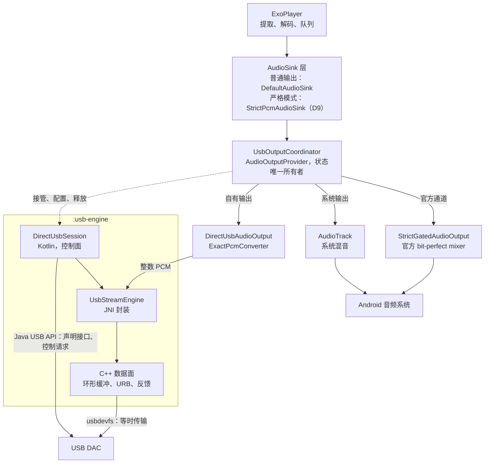
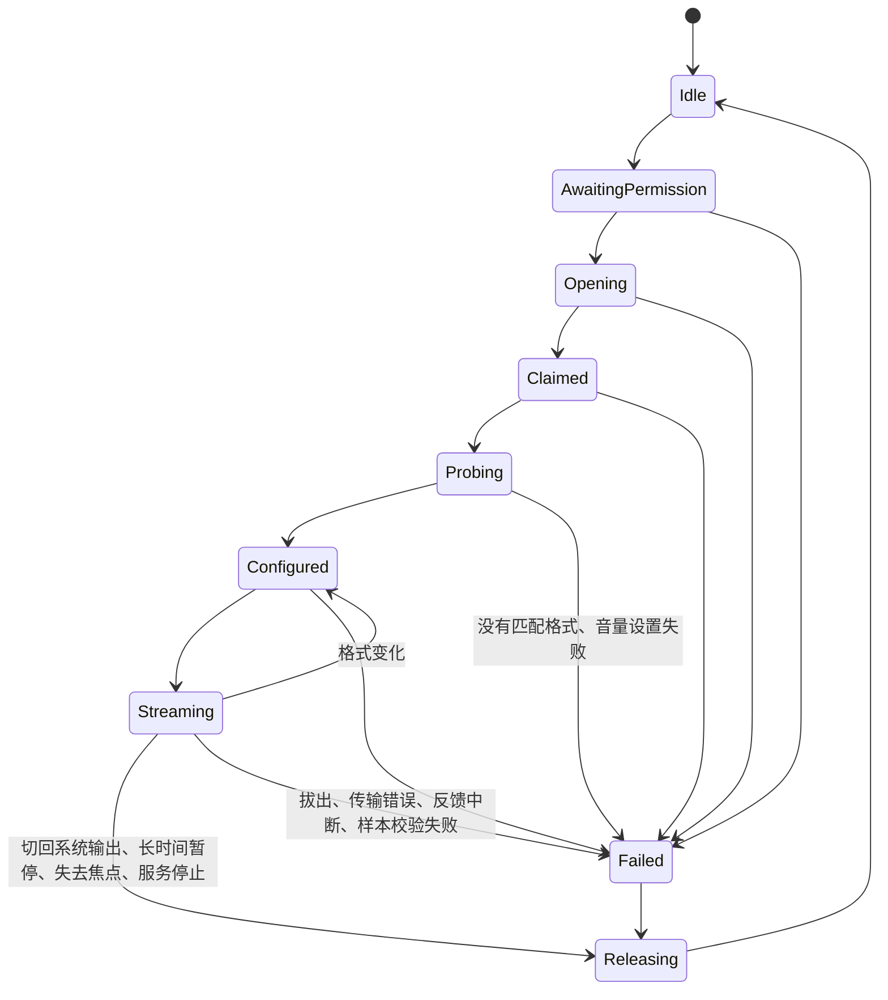
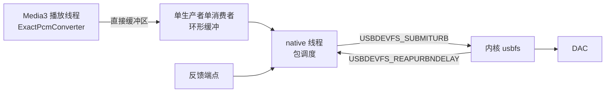

# M7 架构设计：Vesqen 自有 USB 输出

2026-11-02 首版，同日按[架构审查](M7_USB_ARCHITECTURE_REVIEW.md)和[二次审查](M7_USB_ARCHITECTURE_REVIEW_2.md)修订。阶段、决定和验收见 [M7 开发清单](M7_IMPLEMENTATION_PLAN.md)，范围以 [PRD 的 M7 章节](PRD.md) 为准。本文是开工前的设计，目前没有对应代码。标为"待实测"的内容由捕获测试、M7-1 和 M7-2 验证；实测结论与本文不符时，先更新本文，再继续实现。

## 设计约束

1. 严格模式下送到 DAC 的样本值须与原文件的无损 PCM 一致。无法证明时停止输出，不回退到系统混音。
2. 提取、解码、队列和媒体会话继续由 Media3 负责，普通输出继续使用 `DefaultAudioSink`。严格模式在 Sink 这一层使用范围受限的实现（见"样本完整性"），但不修改 Media3 源码，也不进行 M6 的内核替换。
3. 官方通道可用时优先使用官方通道。
4. `UsbOutputCoordinator` 仍是严格输出状态的唯一所有者。所有触发来源都进入同一个判定流程，界面、`PlaybackSnapshot` 和 `PlaybackTelemetry` 读取同一份状态。
5. 普通播放不加载 native 库，也不调用 USB Host API。
6. USB 设备提供的数据一律视为不可信输入。描述符在 Kotlin 中解析，native 层只接收校验过的配置。
7. Media3 播放线程上不得执行没有上限的等待，包括控制请求和线程 join。

## 总体结构



运行时分为三个部分：

| 部分 | 运行位置 | 内容 |
| --- | --- | --- |
| 控制面 | Kotlin，专用单线程 `usb-control` | USB 权限、打开设备、解析描述符、声明接口、`setInterface()`、时钟和音量的控制请求。这些都可以使用 Java API。 |
| 格式转换 | Kotlin，Media3 播放线程 | 把 Media3 交来的 PCM 转为 DAC 格式并校验。 |
| 数据面 | C++，专用 native 线程，不附加到 JVM | 环形缓冲、等时 URB 的提交和回收、反馈、逐包错误和计数。Java API 不支持等时传输，这一部分只能在 native 实现。 |

数据面线程不附加到 JVM，因此不受 GC 暂停影响。

## 组件

| 组件 | 位置 | 职责 |
| --- | --- | --- |
| `StrictPcmAudioSink` | `:app`，新增（D9） | 严格模式下把 PCM 不经处理写入 `AudioOutput`，避开 Media3 的淡入（见"样本完整性"）。普通输出仍使用 `DefaultAudioSink`，由一个按模式选择的外层切换，切换只发生在现有的 `stop()` 加 `prepare()` 重建时。 |
| `UsbOutputStrategyResolver` | `:app`，修改 | 纯策略判断。结果增加路径：官方通道或自有输出。 |
| `UsbOutputCoordinator` | `:app`，修改 | 模式、generation、统一判定、状态发布和失败关闭。自有路径的细节委托给 `DirectUsbSession`，不继续把逻辑堆入这个类。修改前先补单元测试（M7-0）。 |
| `DirectUsbAudioOutput` | `:app`，新增 | 实现 Media3 的 `AudioOutput`。 |
| `ExactPcmConverter` | `:app`，新增 | 转换和校验。官方路径的修复（#71 2026-10-23）也使用它。 |
| `UsbAttachActivity` | `:app`，新增 | 接收系统的 USB 插入事件（D8），不显示界面。 |
| `UacDescriptorParser` | `:usb-engine`，新增 | 把原始描述符解析为静态能力 `UsbAudioTopology`。纯函数，不依赖 Android。 |
| `UacControlClient` | `:usb-engine`，新增 | UAC1 和 UAC2 各自的时钟、音量控制请求，带边界检查和超时。经小型接口访问 USB，可以用假实现测试。 |
| `StreamingPlanner` | `:usb-engine`，新增 | 按静态能力、运行时能力和源格式确定 `StreamingPlan`。纯函数。 |
| `DirectUsbSession` | `:usb-engine`，新增 | 从接管到释放的状态机和清理记录。生命周期长于单个 `AudioOutput`。一个会话只接管一次，再次接管时新建会话。USB 连接经 `UsbLink` 访问，原生数据流经 `UsbStream` 访问，测试中都可以用假实现。 |
| `UsbStreamEngine` | `:usb-engine`，新增 | JNI 封装。第一次需要时才调用 `System.loadLibrary`；加载失败按失败关闭，并带上加载器给出的原因（`Creation.LibraryUnavailable`）。 |
| native core | `:usb-engine`，新增 | 环形缓冲、包调度、反馈换算和计数。不依赖 Android，可在主机上测试。 |
| native transport | `:usb-engine`，新增 | usbdevfs 的 `ioctl` 调用，不引入 libusb（D2）。 |

依赖方向为 `:app` → `:usb-engine`。`:usb-engine` 不依赖 Media3，USB 协议的细节也不进入 `:app`。

## 样本完整性

Media3 1.11.0 的 `DefaultAudioSink` 会对写入帧数不足 20 ms 的 PCM 做线性淡入（`maybeRampUpVolume()`）。它只判断是否为 PCM 和已写入帧数，没有开关。每次新建输出或 flush 后计数归零。Media3 1.11.1 和上游 main 分支仍然如此。淡入发生在 `AudioOutput` 之前，输出端无法还原。

捕获测试（`Media3PcmCaptureDeviceTest`）放在 `androidTest`，把 `AudioOutput.write()` 收到的内容保存到内存，与参考 PCM 逐字节比较，不需要 DAC。它只验证到交给输出端的数据，不代表 DAC 收到的内容。音源为 16 位和 24 位的 WAV 与 FLAC。2026-11-02 测得的现状：

- 起播、seek、重新 prepare 和格式切换后，前 20 ms 被改动（44.1、48、96 kHz 分别为 882、960、1920 帧），之后逐字节一致。
- 同格式切歌不淡入，不丢帧。源位深不同但解码后都是 float 且采样率相同的曲目，同样复用输出。
- 16 位 WAV 淡入后仍是整数，能够通过整数校验。

两个方案都做了原型，跑同一套用例（首帧、seek、重新 prepare、同格式切歌、混合位深、连续格式切换、短于 20 ms 的曲目、部分写入、播放进度、流结束）。模拟器（Android 16，Codec2）连续 5 轮、Honor（Android 9，OMX）连续 2 轮都通过。Android 9 把 24 位 FLAC 解码成 16 位（D10 会拒绝这种情况），所以 Honor 上这部分没有做字节比较，24 位 FLAC 的比较结果来自模拟器。两个方案的差别在通过之外：


| 项 | A：静音前导 | B：严格 PCM Sink |
| --- | --- | --- |
| 做法 | 用 `ForwardingAudioSink` 包装 `DefaultAudioSink`，每段输出之前送入 20 ms 数字静音，淡入只作用在静音上 | 实现范围受限的 `AudioSink`，PCM 不经处理写入 `AudioOutput` |
| 送到输出的内容 | 每次起播、seek 和格式切换多出 20 ms 静音 | 只有源数据 |
| 24 位 WAV | 先转为 float，再由 `ExactPcmConverter` 还原 | int24 直通 |
| 输出卡住 | `DefaultAudioSink` 在内部 flush 并重建，包装层看不到，重建后的真实样本被淡入（已实测）；须保证严格输出永不报告卡住 | 不经过这条路径 |
| 格式切换 | 须在外层预判内部 flush，预判必须与 `canReuseAudioOutput()` 一致 | 直接询问 `canReuseAudioOutput()` |
| 时间轴 | `DefaultAudioSink` 的帧含前导，输出位置也须计入前导，歌曲进度由外层换算 | 只有一条时间轴 |
| encoder delay | 裁剪落在前导上，源文件的延迟帧留在输出里（已实测），只能拒绝 | 不裁剪，拒绝 |
| 依赖 | 依赖 Media3 的内部行为，变化时只有测试能发现 | 依赖公开的 `AudioSink` 接口，变化时编译报错 |
| 时钟、流结束、格式切换 | 由 Media3 实现 | 自己实现，已由同一套用例覆盖 |
| 原型代码量 | 约 60 行 | 约 180 行，另需按模式选择 Sink 的外层 |

**2026-11-02 所有者决定采用方案 B（D9）。** 代价是代码更多，而且时钟和流结束要自己负责。换来的是严格模式的正确性不再依赖 Media3 的内部行为，也不向输出插入任何额外内容。普通输出继续使用 `DefaultAudioSink`。原型目前在调试代码中，捕获测试和 M7-2 的完整链路使用同一份，M7-4 移入产品代码。

不采用的做法：修改 Media3 源码；在输出端反向增益（第一帧已被乘以零，无法还原）；`setAudioProcessors()`（这个入口的处理器只在 int16 路径上执行，float 路径不经过它们）。

这个测试保留为 Media3 升级时的回归测试。已发布版本受到的影响和处理见开发清单的 M7-0。完整的方法和数据见[捕获测试报告](MEDIA3_FADE_IN_STUDY.zh-CN.md)。

## 接入 Media3

`UsbOutputCoordinator` 继续继承 `ForwardingAudioOutputProvider`。自有路径下，下列三个方法都由 Coordinator 作答：

- `getFormatSupport()` 和 `getOutputConfig()`：接管后内核声卡已不存在，系统路由却可能仍指向该设备（见"接管与释放"的设计要点），`AudioTrack` 的实现不能反映实际能力，因此须依据已选定的 `StreamingPlan` 作答。
- `getAudioOutput()`：计划有效时返回 `DirectUsbAudioOutput`。计划过期或失败时沿用现有的 `pendingStrictOutput()` 和 `mutedFailureOutput()`。

`DirectUsbAudioOutput` 的行为：

| 方法 | 行为 |
| --- | --- |
| `write()` | 转换后写入环形缓冲。缓冲已满或上一个输出尚未退休完成时返回 `false`；会话失败或本输出已退休时抛出不可恢复的 `WriteException`。 |
| `play()`、`pause()` | 切换数据面读取缓冲或填充静音。 |
| `flush()` | Media3 1.11 不调用这个方法，它不承载任何协议。 |
| `stop()` | 标记流结束，媒体帧全部处理后填充静音。 |
| `release()` | 幂等。结束这个输出的数据世代（见"输出退休与销毁"），不释放 USB 接口。`Listener.onReleased()` 恰好调用一次。 |
| `isStalled()` | 始终返回 `false`。`DefaultAudioSink` 遇到卡住的输出会自行 flush 并重建，传输停滞改由数据面报告并失败关闭。 |
| `getPositionUs()` | 只统计媒体帧（见"媒体时钟"）。 |
| `getBufferSizeInFrames()` | 环形缓冲容量。 |
| `canReuseAudioOutput()` | 使用默认实现：配置相同才复用。同格式曲目连续播放依赖这一点。 |
| `setVolume()` | 用户音量由现有的 `enforceNeutralProcessing()` 固定为 1。其他值只可能来自音频焦点的 duck 系数，记录后忽略，不缩放 PCM（见"音频焦点"）。 |
| `setPlaybackParameters()` | 只接受默认值。 |
| offload、音效和首选设备相关方法 | 不支持，不产生任何作用。 |

## 格式与承诺

严格输出承诺保持的是**原文件的无损 PCM**。解码器产生的 PCM 精度低于源文件时拒绝播放，不靠补零提升声明。

计划分别持有四层格式，并绑定到同一个 epoch：

| 层 | 来源 |
| --- | --- |
| `SourceFormat` | 文件元数据：曲库经 `TelemetrySourceFacts` 放进 `MediaItem` 的编码、位深、采样率和声道 |
| `DecodedPcmFormat` | 解码器实际输出（现有的 `onDecoderOutputFormat`，#72） |
| `SinkInputFormat` | `AudioOutputProvider.OutputConfig` |
| `UsbWireFormat` | 所选 alternate setting 的 subslot、位深和声道 |

第一版的范围：

| 音源 | 处理 |
| --- | --- |
| 16 位无损 | 支持。解码输出可以是 int16、int24、int32 或 float，每个样本都须落在 16 位格点上。 |
| 24 位无损 | 支持。解码输出须为 int24、int32 或 float，每个样本都须落在 24 位格点上；int16 按 `DECODER_PRECISION_LOST` 拒绝。 |
| 20 位、32 位、浮点 WAV | 拒绝。开启 float 输出时高精度整数会被转为 float，32 位无法保持；这些格式第一版不做专门路径。 |
| 有损格式、位深未知 | 拒绝，沿用现有规则。 |
| encoder delay 或 padding 不为 0 | 拒绝。严格模式不裁剪样本。WAV 和 FLAC 不受影响，ALAC 文件待用真实文件确认。 |

Android 9 上的 OMX 解码器只输出 int16（现有的 `keepIntegerPcmForOmx()`，#107 的保护，不能为 M7 移除），这些设备上的 24 位音源会被拒绝并说明原因。

转换规则：

- N 是源文件的位深，不是 DAC 设置的位深。float 样本乘以 2^(N-1) 还原为 N 位整数，结果须为整数且在取值范围内；更宽的整数样本在 N 位以下须全为 0。否则按 `PCM_NOT_EXACT` 失败关闭。只按 DAC 的位深检查时，16 位音源送到 24 位设置，解码器改动过的低位就会混过去（2026-11-06 修正）。
- 这项校验是必要条件，不足以证明样本未被改动：已截断的数据和被淡入的整数样本都能通过。样本未改动由捕获测试、解码格式判断和外部验证共同支撑。
- 整数按 UAC 规定左对齐放入 subslot，低位补零。16 位放入 24 位格式时，状态须写明"已补零"（#65）。
- 不做重采样、抖动或截断。

实现（2026-11-06）：`DirectUsbFormatGate` 在 Media3 配置输出时依次检查源信息是否齐全、编码是否无损、位深是否为 16 或 24、encoder delay 和 padding 是否为 0、解码输出的采样率和声道是否与源一致、解码精度是否不低于源，以及 DAC 设置能否原样承载，任何一项不满足就带原因拒绝，之后才打开输出。`ExactPcmConverter` 在播放中逐个样本检查源位深的格点。

两首曲目解码成相同的 PCM 时，Sink 沿用同一个输出和 USB 会话。Sink 在上一首最后一块数据写完之后、下一首第一块数据写入之前调用 `DirectUsbAudioOutput.canReuseAudioOutput()`，输出在这时改用下一首配置时被接受的源位深，所以每首都从自己的首帧起按自己的格点检查，上一首的尾帧仍按上一首的规则送出。下一首的配置被拒绝时不沿用输出（#282，2026-11-06）。

M7-4 要注意：Media3 会在当前曲目播完前为下一首配置输出，所以服务层提供的源信息必须对应正在配置的那一首，而不是当前播放的那一首。对应错了的后果是失败关闭，不会输出改动过的样本：把 24 位当成 16 位会让样本校验失败；反过来，16 位样本本来就落在 24 位格点上。
- 最高 192 kHz 双声道约为每秒 38 万个样本，在 Media3 播放线程上处理没有压力。

## 路径选择

路径按 USB 连接选择，不按曲目切换：

1. 模式为系统输出时，不进入严格路径。
2. API 34 及以上，且 `getSupportedMixerAttributes()` 含有 bit-perfect 配置时，使用官方通道。此后如果格式不匹配，按现有规则失败关闭，不临时切换到自有输出，以免同一队列反复接管和释放 DAC。代价是设备只暴露少量官方格式时，自有输出的更多格式不会被利用，这一点如实说明。
3. 其余情况使用自有输出，条件为 `vesqen.directUsb` 构建开关已开启、设备支持 USB Host，且只连接了一台 USB 音频输出设备。连接多台时按 `DIRECT_DEVICE_AMBIGUOUS` 失败关闭，第一版不提供选择界面。Android 还没有为设备建立音频路由、但 USB Host 已经列出音频类设备时，同样检查自有输出；两者都没有时才按没有设备说明（#293）。
4. 描述符不受支持或没有匹配格式时，失败关闭并说明原因。

选择结果在该连接期间缓存，因为接管后 `AudioDeviceInfo` 会消失，无法再次查询。拔出后清除缓存。

现有的严格模式开关只看官方 API 是否可用（`OfficialMixerApiSupport`），API 34 以下无法开启。M7 改为判断"官方通道或自有输出是否可用"，官方 API 的说明文字保留。

`vesqen.directUsb` 的做法与 `vesqen.premiumEnforced` 相同，由构建配置决定。M7 合入 `master` 后默认关闭，到 2.0.0-beta.1 时开启。

## 统一判定

所有 USB 和焦点事件都进入 Coordinator 的同一个幂等流程 `reconcile()`。它用 `UsbManager.deviceList` 和 `hasPermission()` 重新确认事实，不信任事件本身携带的设备参数。

入口：服务启动、模式切换、用户播放、USB 权限结果、`ACTION_USB_DEVICE_ATTACHED` 和 `ACTION_USB_DEVICE_DETACHED` 广播、`UsbAttachActivity` 的信号、`onAudioDevicesAdded()`、`onPlaybackSuppressionReasonChanged()`、暂停超时。

接管须同时满足：严格模式；用户有播放意图（`playWhenReady`）；`playbackSuppressionReason` 为 none；只有一台 USB 音频设备；已有 USB 权限。

- 路由增加只更新设备事实，不能单独触发接管。
- `reconcile()` 不改变 `playWhenReady`，也不启动服务或后台播放。
- 状态中保存 `releaseCause`，用于说明 DAC 为何已被归还。

### 4a 的实现（2026-11-07）

M7-4 的第一步只接入自有输出，全部放在构建开关 `vesqen.directUsb` 后面：debug 和 deviceTest 构建默认开启，release 和 profile 构建在 2.0.0-beta.1 之前关闭。

- **组件。** `AndroidDirectUsbRoute`（`:app` 的 `playback` 包）负责一台设备从检查到释放的全过程：只接受一台 USB 音频设备，检查权限，读描述符并规划，接管和释放 `DirectUsbSession`，监听拔出。`SelectingAudioSink` 平时使用 `DefaultAudioSink`，路由在流传输时改用 `StrictPcmAudioSink`。它在 `reset()` 和 `configure()` 时重新选择：Media3 只为已启用的渲染器重置 Sink，重建如果发生在渲染器启用之前，到达 Sink 的只是一次 `configure()`（2026-11-07 在 iQOO 上发现）。
- **路径选择。** 每次尝试开始时决定，按 USB 连接而不按曲目：Android 为该设备提供 bit-perfect 混音器时走官方通道，否则走自有输出；若官方混音器在自有接管完成前才出现，先取消该次接管，确认 USB 请求和接口已归还，再按当时可用的路由重新选择（#298）。自有输出一旦开始播放，后来增加的系统路由不会打断它。官方通道的代码和行为不变，仍使用 `DefaultAudioSink`（#286）。
- **规划。** 按源文件的采样率，选设备在该采样率下支持的最深位深。不同位深的曲目因此共用 DAC 的设置，16 位样本在低位补零（#65），连续播放时不必重新配置 DAC。
- **源信息。** Media3 在 `AudioSinkConfig` 中带有 timeline 和 period，`StrictPcmAudioSink` 在配置时交给路由，路由据此找到正在配置的那一项，读取它的 extras。
- **接管与状态。** 用户有播放意图时才接管：先暂停，接管成功后以 `stop()` 加 `prepare()` 重建播放器并恢复播放。当前 period 的输出已实际交付媒体帧、且仍有播放意图时才进入 `ACTIVE`；创建输出和预填充不算交付，停止、清空或替换队列后撤销 `ACTIVE`。输出回调绑定 period 和输出实例，旧实例的状态或源格式错误不能影响后继实例（#292、#308、#309）。自然切歌复用同一输出时，上一首的尾部仍在环形缓冲区中送出，最长约 0.5 秒，下一首的首帧送达后两首才交接；Media3 切换当前项与送达位置越过边界前后相差几毫秒，先后顺序不定，两种顺序下都保持 `ACTIVE`（#314 A1）。下一首的头几帧丢失、没有任何一帧送达时，上一首处理完即撤销，下一首不沿用上一首的送达。用户发起的 seek 和删除在主线程上同步作废旧输出；播放线程随后补报的 seek 调整不再作废，因为 seek 之后新建的输出可能已经先登记（#314 A4）；暂停时退回 `APPLYING`，设备保留（D14 的释放时机在 4c 实现）；自然切歌不重建。
- **权限。** 只在用户操作（切换模式、按播放）时请求；服务启动、恢复队列和 USB 插入时没有权限，只报告缺少权限。
- **释放。** 失败、切回系统输出和服务关闭时释放设备。释放后 Android 会重新显示该设备的路由，这个事件不再触发接管，直到真正的 USB 插入事件。
- **失败原因。** 暂时使用现有的失败类别（设备报告的词表也用它们），具体原因写在 decision code 中，例如 `direct_usb.permission_required`、`direct_usb.no_matching_direct_format`。专门的失败类别、四种语言的说明和报告词表放在 4d，届时先确认上传内容的变化。
- **4a 尚未处理。** 播放中采样率变化时重新配置 DAC（4c；目前在配置时拒绝，播放器报错后失败关闭）；暂停的释放时机和息屏保活（4c）；焦点、来电、进程异常退出后的恢复和 `UsbAttachActivity`（4b）；界面文字（4d）；链路页上自有输出的实际数据（M7-5）。

## 音频焦点

继续使用 Media3 的自动焦点管理（`setAudioAttributes(..., true)`），不另建 `AudioFocusRequest`，以免出现两个焦点所有者。

**不能只依赖焦点（2026-11-04 在 iQOO 9 上实测）。** 接 USB 设备时，系统不向焦点持有者发送丢失事件：焦点栈中所有持有者的 `loss` 都是 `none`，同一应用内和跨应用都如此，被抢占的应用继续播放。下表的流程只在系统发出事件时才会发生。接管期间还须监听系统的通话状态（`AudioManager` 的模式），否则来电时 Vesqen 不会释放设备，而系统可能把通话声音送往已不存在的声卡。这一点和手机扬声器上的行为都还没有实测，方案在 M7-4 确定。

| 事件 | Media3 的表现 | 自有路径的处理 |
| --- | --- | --- |
| 长期失去焦点 | `playWhenReady` 变为 false | 立即释放 DAC，其他应用可以使用。 |
| 暂时失去焦点（来电、语音助手） | `playWhenReady` 不变，`playbackSuppressionReason` 变为暂时失去焦点 | 经 `onPlaybackSuppressionReasonChanged()` 释放 DAC，`releaseCause` 记为暂时失去焦点。路由变化（包括系统重新添加 USB 路由）不满足接管条件，不会被抢回。 |
| 重新获得焦点 | `playbackSuppressionReason` 恢复为 none | `reconcile()` 重新接管，沿用现有的 `stop()` 加 `prepare()` 重建输出，然后恢复播放。在途的音频已被取消，因此不续用旧 epoch。 |
| 可以压低音量（duck） | Android 8 起通常由系统在混音器中处理（现有 `AppSegmentAssessment` 的注释，2026-10-04 决定）；自有输出没有 `AudioTrack`，系统无从作用 | 继续播放，样本不变，`ACTIVE` 不变。如果 duck 系数到达 `setVolume()`，记录后忽略（待实测）。 |

duck 时不暂停的原因：通知音通常只请求 duck，它们不影响 DAC 上的样本，每条通知都暂停音乐过于打扰。接管期间这些声音通常听不到（见"接管与释放"的设计要点）。

官方路径的现有行为不同：`StrictGatedAudioOutput.setVolume()` 收到非 1 的音量时立即关闭写入门、把底层音量设为 0，并按 `PROCESSING_NOT_NEUTRAL` 失败关闭。这段保护不改动。duck 系数是否真的会到达官方路径，由 M7-4 实测；官方路径的失败关闭和自有路径的 D11 分开测试。

## 控制请求

M7-1 只读取静态描述符，输出拓扑、接口、端点和控制能力，运行时数值明确标为 unknown。向接口发送控制请求前内核要求已声明接口（`check_ctrlrecip`），因此运行时能力只能在接管后取得，随后才能最终确定 `StreamingPlan`。

UAC1 和 UAC2 使用各自的请求流程：

| 项 | UAC1 | UAC2 |
| --- | --- | --- |
| 采样率列表 | 静态描述符（Format Type） | 运行时：Clock Source 的 `GET_RANGE` |
| 时钟选择 | 没有 | Clock Selector 的 `GET_CUR`、Clock Valid（可读时） |
| 设置采样率 | 端点支持时用端点 `SET_CUR` | 控制可写时用 Clock Source 的 `SET_CUR` |
| 读回 | 端点支持时用 `GET_CUR` | Clock Source 的 `GET_CUR` |
| 音量范围和当前值 | Feature Unit 的 `GET_MIN`、`GET_MAX`、`GET_RES`、`GET_CUR` | Feature Unit 的 `GET_RANGE`、`GET_CUR` |

- 固定频率或只读的时钟不发送 `SET`，读回值等于目标采样率就通过。规范允许这类时钟不支持 `SET`，一律要求设置成功会误拒绝合法设备。
- 读回不一致时按 `SAMPLE_RATE_READBACK_MISMATCH` 失败关闭。
- "不支持"和"未知"分开报告。设备不支持读回时显示为不可用，不得推定。
- 所有请求都在 `usb-control` 线程执行，带超时（默认 500 ms）和响应长度检查。

## 接管与释放




设计要点：

- **声明全部音频类接口。** AudioControl 和 AudioStreaming 接口都须声明。HID 接口不声明，DAC 上的按键继续由系统处理。
- **接管时系统路由不变（2026-11-04 在 iQOO 9 上实测，其他 ROM 待确认）。** 声明接口后内核声卡立即消失，`AudioManager` 和 `UsbAlsaManager` 却仍然列出该设备，已打开和新打开的 `AudioTrack` 都继续路由到 USB，进度照常前进，声音却没有去处。由此得出三条规则：不得用路由或 `AudioTrack` 的进度判断设备是否可用或是否出声；接管期间不得回退到系统输出，否则界面显示正在播放，实际没有声音；其他应用和通知的声音在接管期间会被吞没，只有系统策略同时包含扬声器的音频流（iQOO 上为响铃和闹钟）还可能从手机发声。这一点须在第一次使用时、设置和用户文档中明确告知（M7-5），具体去向以设备验收的实测结果为准。
- **`BECOMING_NOISY`。** AOSP 把 USB 设备列入该广播的设备集合，而 `PlaybackService` 开启了 `setHandleAudioBecomingNoisy(true)`。如果 ROM 在接管时移除路由，Media3 会自行暂停。iQOO 9 不移除路由，但其他 ROM 没有实测，因此接管前仍关闭这项处理，释放后恢复。此期间的真实拔出由 `ACTION_USB_DEVICE_DETACHED` 和 URB 的 `ENODEV` 判断。
- **路由监听。** 自有路径下 `selectedDevice` 为空，`onAudioDevicesRemoved()` 不会触发失败关闭，官方路径的逻辑不需要改动。
- **会话的生命周期长于 `AudioOutput`。** 格式变化时 Media3 会释放旧输出、创建新输出，会话保持接管状态，只重新配置时钟和 alternate setting。设置采样率和切换 alternate setting 的先后顺序按协议版本处理，由 M7-2 实测确认。
- **切回系统输出（#306）。** 先停止播放器并等待自研会话确认释放，再重建系统播放。等待期间保留最新的播放或暂停意图；模式变化和服务关闭使旧回调失效。释放或音量恢复失败时保持失败状态，显示已有的恢复原因。
- **释放时机。** 切回系统输出、失去音频焦点、服务停止、发生失败时释放。暂停按 D14（2026-11-06）：亮屏时最多保留 30 秒，期间如果 `AudioPlaybackCallback` 显示有其他播放活动，就提前释放；已经息屏时暂停，或暂停期间转为息屏，立即释放，因为 iQOO 9 没有保活措施时最快约 5 至 6 秒就冻结进程，30 秒的定时器保证不了一定能归还 DAC。普通应用看到的播放信息经过匿名化，只能当作提前释放的信号，不能据此识别是哪个应用或它要用哪个设备。正在播放时不因其他播放活动释放，真正的焦点丢失仍按 D11 处理。这些策略属于掌握播放状态的服务层（M7-4），原生引擎只提供安全释放。短暂暂停时持续发送静音，避免切换带来的爆音。
- **释放顺序。** 停止接收旧 epoch 的数据、停止重新提交、取消并回收全部在途 URB、native 确认静止、切回 alternate setting 0、恢复接管前的音量、释放全部接口、关闭连接、清除接管标记、恢复 `BECOMING_NOISY` 处理。Android 的 `releaseInterface()` 成功后会请求内核重新连接驱动。
- **清理记录和安全屏障。** 清理步骤分两类。恢复音量这类步骤失败时，写入清理记录并继续，保留第一个失败原因。native 静止是安全屏障：确认全部在途 URB 都已回收之前，不得销毁 native 资源、关闭文件描述符、释放接口或开始下一次接管（见"输出退休与销毁"）。**只有确认全部接口都已释放，才清除接管标记。**标记由应用持有。重建播放服务时，旧会话仍负责完成在途清理；新的接管请求不能覆盖原记录。如果接口释放失败且原连接仍在，后续接管会被拒绝，直到完成恢复或原设备被拔出（#289）。
- **进程异常退出。** 内核关闭文件描述符时只释放接口（`usbdev_release`），不会重新绑定驱动，DAC 在重新插拔前不能被系统使用。下次启动时如果发现接管标记，且设备仍连接并有权限，就重新声明再释放一次，由 `releaseInterface()` 触发重新连接（2026-11-04 在 iQOO 9 上确认：声卡节点在释放的同一时刻重建）。硬件音量会停留在接管时的值，内核不会恢复。因此接管标记须同时保存 `UsbDevice.getDeviceId()` 和接管前的音量（读取后更新标记）；恢复时设备 ID 相同才写回音量，设备重新插入后 ID 会变，不写回。启动时的恢复完成之前（4b），同一连接的下一次接管会接手上一个进程留下的标记，沿用其中保存的接管前音量，释放时写回这个音量；本进程尚未归还全部接口的标记，以及另一台仍连接设备的标记，仍然拒绝接管。接口已归还但音量恢复失败时，保留原值，允许同一连接在后续接管中重试恢复（#307）。

## 数据面



### StreamingPlan

包调度不能只按 UAC 版本或 `bcdUSB` 推定，`StreamingPlan` 显式持有下列内容：

| 字段 | 来源 |
| --- | --- |
| 实际总线速度 | `USBDEVFS_GET_SPEED` |
| 服务间隔 | 速度和 `bInterval`：高速为 125 µs 乘以 2^(bInterval-1) |
| 每间隔最大载荷 | `wMaxPacketSize` 的低 11 位。第 11、12 位表示的高速多事务结构第一版明确拒绝；最高 192 kHz / 24 位双声道不需要它。 |
| 同步类型和反馈 | 端点描述符。反馈的单位、更新周期和有效期。 |
| 线路格式 | alternate setting、subslot、位深、声道、采样率 |

URB 的大小按时长计算：每个约 16 到 32 ms，不超过内核上限的 128 包，在途音频约 100 ms。环形缓冲约 500 ms。初始参数由 M7-2 实测后调整。

| 速度 | bInterval | 服务间隔 | 每个 URB | 在途 |
| --- | --- | --- | --- | --- |
| 全速 | 1 | 1 ms | 32 包，32 ms | 3 个，约 96 ms |
| 高速 | 1 | 125 µs | 128 包，16 ms | 6 个，约 96 ms |
| 高速 | 4 | 1 ms | 32 包，32 ms | 3 个，约 96 ms |

### 包长和反馈

- 用定点累加器计算每个服务间隔的帧数，结果不超过每间隔最大载荷，并按帧对齐。自适应和同步端点使用标称速率，异步端点按反馈调整。任何情况下都不重采样。
- UAC1 和 UAC2 的传输机制相同。全速和高速的反馈格式不同，反馈值须换算为"每个实际服务间隔的帧数"。
- 反馈的更新周期按版本计算。UAC1 是 2^`bRefresh` ms，`bRefresh` 的合法范围是 1 到 9。UAC2 没有这个字段，周期由 `bInterval` 决定。
- 反馈端点分两处检查。`streamingBlockers` 只凭描述符判断方向、传输类型、用途、最小包长（3 字节）、多事务、`bInterval` 的范围、UAC1 的 `bRefresh` 和地址引用。`StreamingPlan` 知道实际速度，再判断高速下的反馈包长（全速 3 字节，高速 4 字节）和 `bInterval` 对应的实际间隔。UAC1 规范要求 `bInterval` 为 1，这一条也留给 `StreamingPlan`，因为数据端点已经按同样的方式处理。
- 隐式反馈的设备第一版不支持，按 `FEEDBACK_UNSUPPORTED` 失败关闭。

### 媒体时钟

静音也占 USB 帧，但没有消费歌曲。`DefaultAudioSink` 用写入帧数和 `getPositionUs()` 比较来判断是否还有待播放数据，因此 USB 总帧数不能直接作为播放进度。分开统计：

| 计数 | 含义 | 用途 |
| --- | --- | --- |
| `mediaFramesWritten` | 写入环形缓冲的媒体帧 | 流结束判断 |
| `mediaFramesSubmitted` | 已放入在途 URB 的媒体帧 | 插值的上界 |
| `mediaFramesProcessed` | 所在 URB 已完成的媒体帧，不论包是否成功 | `getPositionUs()` 和流结束 |
| `mediaFramesDelivered` | 包成功且 `actual_length` 完整的媒体帧 | 诊断 |
| `mediaFramesLost` | 包失败或 `actual_length` 不足的媒体帧 | 连续性 |
| `silenceFramesInserted` | 预填充、暂停和欠载时补入的静音帧 | 诊断 |
| `usbFramesDelivered` | USB 总帧 | 诊断 |

- `getPositionUs()` 等于 `mediaFramesProcessed` 加单调时钟插值，插值不超过 `mediaFramesSubmitted`。
- 数据面自行补入的静音不计入。暂停和欠载时位置不增长。
- 流结束等待全部媒体帧处理完成。丢失的帧不会让流结束一直等下去，也不算作成功交付；最后一个包失败时，流正常结束，连续性记为中断。
- 每个 `AudioOutput` 有独立的 epoch，计数从 0 开始。会话可以跨输出存活，但旧 epoch 的完成记录只回收，不计入新输出。原生层另外累计整个会话的已交付帧、丢失帧、欠载次数和失败包数；在旧 epoch 退休期间完成的包也计入这些总数，不要求接管层在 epoch 切换前读到最后一次快照（#296）。
- USB 交付不等于 DAC 已经呈现，DAC 内部的缓冲延迟无法测量。Audio Proof 只说明 USB 交付的时刻，不把它写成呈现时刻。

### 错误和连续性

等时 URB 的总状态不能代替逐包状态，一次成功的回收不代表所有包都成功。

| 情况 | 判定 | 处理 |
| --- | --- | --- |
| 单包失败或 `actual_length` 不足，URB 总体完成 | 逐包检查 `status` 和 `actual_length` | 这些帧计入 `mediaFramesLost`，同样计入 `mediaFramesProcessed`，标记本次流不连续。时间窗内超过阈值（默认值待实测）时按 `USB_TRANSFER_FAILED` 失败关闭。 |
| 反馈中断 | 超过有效期没有有效反馈 | 按 `FEEDBACK_TIMEOUT` 失败关闭。 |
| 反馈异常 | 持续超出标称速率附近的范围 | 按 `FEEDBACK_OUT_OF_RANGE` 失败关闭。 |
| 欠载 | 环形缓冲为空 | 填充静音、计数、标记本次流不连续，触发 `onUnderrun()`。 |
| 主动取消 | 由输出退休或停止发起 | 不算错误，也不推进任何媒体计数。 |
| 设备消失 | `ENODEV` | 按 `DEVICE_DISCONNECTED` 失败关闭。 |

路径声明和流的连续性分开表达。`ACTIVE` 说明路径按原值传输；`streamContinuity` 说明本次流是否连续完整，链路页显示欠载和传输错误的次数。插入静音或丢包后不得写成完整的逐样本一致流，已有的签名验证记录也不能替代本次流的错误证据。

### 线程和通信

- 只有 native 线程操作传输队列。每个外部调用都带 epoch，只有最新的 epoch 生效；外部调用和流线程从检查 epoch 到提交 URB 的一段共用一把短锁，所以 `retireOutput()` 返回之后，旧输出的数据不会再被提交。流线程等待 URB 时不持有这把锁。退休完成后流线程发布已确认的 epoch，这就是完成确认（2026-11-06 实现）。
- native 线程不回调 JVM，只发布原子计数和错误状态。Kotlin 在 `write()` 和 `getPositionUs()` 中读取；会话存在期间，另由 `usb-control` 每 250 ms 读取一次，以便在暂停时也能发现拔出。
- 线程请求 `THREAD_PRIORITY_URGENT_AUDIO` 级别，普通应用无法使用 `SCHED_FIFO`。实际是否生效由 M7-2 核实。
- JNI 接口保持很小：`create(fd, plan)`、`start()`、`write(epoch, directBuffer, offset, size)`、`setRunning(epoch, running)`、`retireOutput()`（返回下一个输出的 epoch）、`markEndOfStream(epoch)`、`readStats(long[])`、`destroy()`。`readStats()` 同时给出计数所属的 epoch 和最新的 epoch，计数重置期间 epoch 为 -1。

### 输出退休与销毁

- **输出退休。** Media3 通过 `release()` 结束一个输出，不调用 `AudioOutput.flush()`。`release()` 立即返回：旧写入口失效，开始新的 epoch，旧数据不再提交。native 取消并回收全部在途 URB、清空环形缓冲后确认。
- **新输出等待确认。** 确认之前，新输出的 `write()` 返回 `false`，格式重配和首个媒体包都排在确认之后。这一约束由会话保证，不依赖 Media3 等待。超过上限（默认 1 秒）仍未确认时失败关闭。
- **切换生效点。** 确认点就是切换生效点。取消之前已经送出的数据无法撤回，不作这样的声明：在途队列的容量（全速下 3 × 32 ms）只说明最多还有多少旧数据在路上，不能据此承诺旧声音立刻消失（D14）。
- **seek 立即取消（D14）。** 用户拖到新位置后立即停止提交旧音频，取消并回收在途 URB，不补静音过渡；JBL Flip 7 上是否有咔声留给真机试听。自然播到下一首且 DAC 的输出配置不变时，沿用现有输出，上一首的尾音照常播完。
- **流结束与 seek。** 正常流结束时 Sink 先等待 `hasPendingData()` 为 `false` 再释放，此时已没有媒体帧；seek 时 `release()` 丢弃尚未送出的部分。两者使用同一协议。
- **`DISCARDURB` 之后仍须回收。** 被取消的 URB 仍会进入回收路径，停止线程不等于 URB 结构和缓冲区已经可以释放。native 确认静止的条件是所有在途 URB 都已回收。
- **句柄生命周期。** 一把小锁只保护关闭标记、句柄摘除和短 JNI 调用（`write()`、`readStats()`、`setRunning()`、`retireOutput()`），这些调用看到关闭标记后立即返回。取消、回收和销毁的等待都在锁外的 `usb-control` 线程上进行，因此播放线程不会因回收而阻塞。
- **文件描述符。** 由 `UsbDeviceConnection` 持有，native 只是借用，因此必须先 `destroy()` 再关闭连接。
- `usb-control` 上的等待都有上限，`destroy()` 不在播放线程上执行。

确认超时时各资源的归属：

| 情况 | 处理 |
| --- | --- |
| 回收确认超时 | 停止新输出，失败关闭。会话继续持有 native 句柄、URB 缓冲、文件描述符和接口，不销毁也不关闭，回收完成后再继续清理。超时不等于已回收。 |
| 设备拔出 | URB 以错误完成，回收后按正常顺序清理。 |
| 一直无法确认 | 不允许下一次接管，状态保持失败，接管标记保留。这些资源只在进程退出时由内核回收，下次启动时按"进程异常退出"恢复。 |

## 息屏保活

iQOO 9 的 ROM 在接管期间息屏 23 秒后冻结应用，USB 数据随之停止。前台服务、唤醒锁、媒体会话和电池优化豁免都不能阻止，系统路径的播放不受影响。记录见[设备验收](M7_DEVICE_ACCEPTANCE.md) 2026-11-05。

应对方法是另开一条送往手机扬声器的 `AudioTrack`：

- 它不接触 USB 数据，严格输出的样本不变。
- 必须用 `setPreferredDevice()` 指定扬声器，否则会路由到已不存在的 USB 声卡。
- 写入 22 kHz -20 dBFS，再用 `AudioTrack.setVolume()` 把增益降到 -80 dB。所有者在最大音量下贴近试听，只有底噪，没有蜂鸣。
- 增益不能为 0。ROM 看音轨音量之前写入的数据，但把音量为 0 的音轨按无声处理。写入电平也不能太低：22 kHz 在 -25 dBFS 通过，-30 dBFS 被冻结。
- 选 22 kHz 是为了限制出错时的后果。增益失效时，22 kHz -20 dBFS 只是贴近才能听到的微弱鸣叫，1 kHz 则是明显的蜂鸣。

代价和限制：

- 扬声器功放保持开启，贴近手机扬声器能听到底噪。扬声器音量 1 格和 15 格都有，降低音量不能消除。如果采用，要向用户写明这个代价。
- 被冻结期间 native 线程停止，丢失、欠载和失败包计数都不会增加（2026-11-06 独立复核）。判断是否断流要同时比较交付时长与经过时间，M7-4 的检测不能只看这些计数。
- 这依赖 ROM 未公开的行为，判断方式是从实测推断的，系统更新后可能改变。其他 ROM 没有测试。
- 所有者的规则：只在正在播放且息屏时使用，亮屏时不用。现有实测从起播就开着音轨，息屏时才启动和暂停期间的行为还要在 M7-4 验证。
- 开启方式按[开发清单](M7_IMPLEMENTATION_PLAN.md)的 D13（2026-11-06）：保活音轨是设置中的开关，默认关闭，并写明底噪。

另一个办法是 vivo 系统设置中的“允许后台高耗电”。打开后不需要保活音轨，息屏 30 分钟没有被冻结，也没有底噪，但需要用户手动打开一次。安卓标准的电池优化豁免没有这个作用。按 D13，在 vivo 系手机上第一次使用时引导用户打开它，并向用户说明两种办法的区别。能否从应用直接打开这个设置页尚未确认。

## 音量

按 D4：

- 从输出流的终端沿描述符拓扑查找所选路径上的 Feature Unit。**只有确认存在可写的 Volume Control 才使用硬件音量**，可以是主声道，也可以是全部逻辑声道。
- 分为三种情况：

| 情况 | 路径 |
| --- | --- |
| 有可写的 Volume Control | 使用硬件音量 |
| 没有 Feature Unit，或只有静音控制，或音量只读 | 每款设备第一次使用时说明输出为满幅，用户确认后以固定音量播放，会话音量控制类型为固定 |
| 控制可写，但读取、设置或读回失败 | 按 `VOLUME_CONTROL_FAILED` 失败关闭，不得以未知音量播放 |

- 第一个样本发出之前设置起始音量并读回。起始音量规则：同一次 USB 连接内恢复之前的设置；重新插入后取"记忆值"和约 -30 dB 中较低的一个（设备范围不足时取下限）。
- -30 dB 是相对增益，不代表对所有 DAC、耳机和功放都安全。按 VID/PID 保存的值只是偏好，它识别的是型号，不能证明是同一台设备或同一副耳机。
- 释放时恢复接管前的音量，前提是仍为同一接管会话且音频数据已停止。恢复失败记入清理记录，保留原音量和静音值。接口已全部归还时，同一连接的下一次接管可以沿用这些值并重试恢复；接口未归还或设备身份不同仍阻止接管（#307）。
- 音量键经 Media3 接收：交给 `MediaSession` 的 Player 在自有输出期间报告 `DeviceInfo.PLAYBACK_TYPE_REMOTE`，Media3 随后调用 `setPlaybackToRemote()`（已核对 1.11.0 源码）。其他模式仍报告本地播放。vivo ROM 上的行为待实测。
- 不使用软件音量。直出时系统音量和系统的音量安全提示都不起作用（2026-11-04 在 iQOO 9 上确认），因此起始音量由 Vesqen 负责。
- 自有输出时提供应用内音量条（2026-11-04 所有者决定），调节 DAC 的硬件音量，范围和步长按设备实际报告，并显示当前音量。音量键失效时用户仍可调节。没有可写 Volume Control 的设备不显示音量条。
- 音量条和音量键的实现（2026-11-10，位置、音量键的处理方式和文案经所有者确认）：
  - **位置。** "正在播放"页播放按钮下方一行，只在自有输出持有 DAC 时出现。数值以 dB 显示，单位与链路页一致。横屏高度不足 360 dp 或字号很大时不显示这一行，音量键仍然可用。
  - **设置。** `DirectUsbSession.setVolume()` 在 `usb-control` 线程上写入不高于请求值的设备档位并读回，界面显示和记忆的都是读回值。设备拒绝写入时音量不变，继续播放；写入后读不回时音量未知，按 `VOLUME_CONTROL_FAILED` 失败关闭。拖动时同一时刻只有一个请求在途，只保留最新的一个等待。音量键按"上一次请求的音量"累加，设备对最新请求的读回到达后再以读回值为准，因此连按或按住时每一下都算数。
  - **起始音量。** 同一次 USB 连接内（设备 ID、VID、PID 都相同）恢复用户上次设置的音量，这个值只保存在进程内。重新插入或进程重启后，取按 VID/PID 保存的值和约 -30 dB 中较低的一个。释放时仍然写回接管前的音量。
  - **音量键。** Vesqen 在前台时由 `MainActivity.dispatchKeyEvent()` 接收，每按一下约 2 dB（取设备步长的整数倍），显示 Vesqen 自己的音量浮层，不交给系统。Vesqen 不在前台时，媒体会话的 Player（`DeviceVolumeSessionPlayer`）报告远程播放，音量以"按键次数"为单位上报，系统的按键经 Media3 的 `VolumeProviderCompat` 到达同一个入口。ExoPlayer 默认不提供设备音量命令，这个 Player 在自有输出期间补上，否则会话的音量类型为固定，系统不交付按键。对话框和底部面板有自己的窗口，其中的按键也走这条路。

## USB 权限

- 只有用户操作才弹出系统授权框。服务启动和恢复队列时没有权限，只显示状态（沿用 #34 的规则）。拒绝授权时报告 `USB_PERMISSION_DENIED`。
- 用户关闭麦克风访问时，系统会拒绝带麦克风输入的设备的 USB 权限。应用无法区分这种情况和普通拒绝，因此失败说明须同时提到这一可能。
- 按 D8，清单声明 `UsbAttachActivity`，带 `USB_DEVICE_ATTACHED` 过滤器（`<usb-device class="1" />`，系统也会匹配接口类别，因此复合设备同样适用）。它默认禁用，用户开启严格模式时启用，切回系统输出时禁用，未开启严格模式的用户插入 DAC 时不受打扰。
- 用户选择"始终使用"后，系统在插入时直接授权并启动这个 Activity。它不显示界面，也不读取 Intent 中的设备参数，发出重新判定的信号后立即结束。路由增加可能早于授权，也可能根本不发生，因此不能依赖 `onAudioDevicesAdded()` 感知授权完成。没有运行中的服务时不需要处理，服务启动时会重新判定。
- 带麦克风输入的 DAC 是例外：应用没有录音权限时，系统不显示"始终使用"（`UsbPermissionActivity`），这类设备每次插入都须授权一次。Vesqen 不为此申请录音权限。

## 状态与失败原因

`UsbOutputPhase` 不变。`UsbOutputStatus` 增加 `path`（`OFFICIAL_MIXER` 或 `DIRECT_USB_HOST`）和 `streamContinuity`。Session Bundle 中没有这些字段时，按官方通道读取，以兼容进程内外版本不一致的情况。`ACTIVE` 的条件见 [M7 开发清单的声明边界](M7_IMPLEMENTATION_PLAN.md#声明边界)。

失败原因沿用官方路径的机制（`usb_failure_*`，目前 21 条），不另建展示方式（#71 2026-11-02）。每个环节对应的取值：

| 环节 | 新增 | 复用现有 |
| --- | --- | --- |
| USB Host 权限 | `USB_PERMISSION_DENIED` | `USB_HOST_UNAVAILABLE` |
| 设备枚举与生命周期 | `DIRECT_DEVICE_AMBIGUOUS`、`USB_OPEN_FAILED`、`INTERFACE_CLAIM_FAILED` | `NO_USB_AUDIO_DEVICE`、`DEVICE_DISCONNECTED` |
| UAC 版本与接口、endpoint | `DESCRIPTOR_UNSUPPORTED` | |
| 格式协商 | `NO_MATCHING_DIRECT_FORMAT`、`SAMPLE_RATE_SET_FAILED`、`SAMPLE_RATE_READBACK_MISMATCH`、`DECODER_PRECISION_LOST` | `SOURCE_FORMAT_UNKNOWN`、`SOURCE_FORMAT_UNSUPPORTED` |
| 音量 | `VOLUME_CONTROL_FAILED` | |
| 传输与缓冲 | `USB_TRANSFER_FAILED`、`PCM_NOT_EXACT` | |
| 时钟与反馈 | `FEEDBACK_UNSUPPORTED`、`FEEDBACK_TIMEOUT`、`FEEDBACK_OUT_OF_RANGE` | |
| 设备组合不在支持范围内 | `DEVICE_NOT_SUPPORTED` | |
| 引擎 | `USB_ENGINE_UNAVAILABLE` | |
| 无法确定环节 | | `PLATFORM_ERROR`，说明中写明无法确定 |

兼容性要求：

- 新的失败原因和字段进入设备报告时，须先更新 `contracts/device-report/vocabulary.json` 并部署服务端，再发布应用。
- `OutputVerificationRecord` 增加路径字段，官方通道的验证记录不能证明自有输出，反之亦然。没有该字段的旧记录按官方通道处理。

## 安全与隐私

- 描述符解析使用带边界检查的 Kotlin 代码。长度异常或拓扑不完整时报告 `DESCRIPTOR_UNSUPPORTED`，不崩溃。控制请求的响应同样检查长度和取值范围。
- native 层再次校验配置：包长不超过每间隔最大载荷，反馈值限制在范围内，`actual_length` 不超过缓冲区。
- `UsbAttachActivity` 必须导出才能接收系统启动，因此不读取 Intent 中的设备参数，不显示界面，除发出重新判定的信号外不执行其他操作。
- 不新增网络传输。使用统计已经发送 `bitPerfectMixer`，设备报告的音频能力部分已经包含 VID/PID 和接口协议（D7）。
- 本机新增保存：按 VID/PID 记录的音量偏好和固定音量确认，以及接管标记（含本次连接的设备 ID 和接管前音量，不含序列号）。隐私政策须在 2.0 发布前写明。

## 测试

| 层 | 方式 | 重点 |
| --- | --- | --- |
| Media3 到 PCM | `androidTest`，假的 `AudioOutputProvider`，不需要 DAC | 见"捕获测试"；普通输出和严格模式分别验证 |
| 描述符解析和 `StreamingPlanner` | JVM 单元测试，使用真实 DAC 的描述符样本 | 静态解析、运行时数值 unknown、畸形输入、`bInterval` 大于 1、多事务结构被拒绝 |
| `ExactPcmConverter` | JVM 单元测试 | 全部 16 位取值和 24 位边界值经 float 还原后一致；非整数样本被拒绝；错误元数据；已截断的合法格点；真实的解码器到 Sink 输入组合 |
| `UacControlClient` | JVM 单元测试，使用假 USB 传输 | UAC1 和 UAC2 的请求流程；固定时钟；只读音量；设置和读回失败 |
| `DirectUsbSession` | JVM 单元测试，使用假 USB 传输 | 可继续的清理失败和安全屏障分开；回收确认超时、拔出时各资源的归属；接管标记的保留和清除；状态转换；过期回调 |
| `DirectUsbAudioOutput` | 真实的 Sink 加假传输 | 环形缓冲和 URB 都有数据时 seek、重建：新世代获准写入前，旧世代已停止提交并完成回收，旧数据不混入新世代；`release()` 幂等，`onReleased()` 恰好一次 |
| `UsbOutputCoordinator` | JVM 单元测试（Robolectric）。现有状态机已有 `UsbOutputCoordinatorTest`，M7-4 起增加假会话 | 路径选择、generation、`reconcile()` 的全部入口、失去焦点后路由重新出现不被抢回、失败路径不出现错误的 `ACTIVE` |
| native core | 主机上的 C++ 单元测试，使用假传输 | **各种反馈序列下，所有媒体包的载荷按顺序拼接后与输入逐字节一致**；媒体时钟（先传 5 秒静音、暂停 10 秒、欠载、流结束、seek 时 URB 在途、同格式复用、不同格式重建）；取消和回收的故障注入；`destroy()` 与 `write()`、`readStats()` 竞争；末包失败、混合成功和失败的 URB、短包；反馈中断 |
| 真机 | [M7 设备验收](M7_DEVICE_ACCEPTANCE.md) | 见下一节；只有外部逐样本比对才能得到 `VERIFIED` |

## 仓库布局

```text
usb-engine/
  build.gradle.kts              Android 库、CMake、固定 ndkVersion
  src/main/java/.../usb/
    descriptor/                 UacDescriptorParser、UsbAudioTopology
    control/                    UacControlClient
    plan/                       StreamingPlanner、StreamingPlan
    session/                    DirectUsbSession、清理记录
    engine/                     UsbStreamEngine
  src/main/cpp/
    core/                       环形缓冲、包调度、反馈、计数（不依赖 Android）
    transport/                  usbdevfs
    jni/                        JNI 入口
    test/                       主机单元测试
  src/test/                     JVM 测试和描述符样本
app/src/main/java/.../playback/
  DirectUsbAudioOutput.kt       新增
  ExactPcmConverter.kt          新增
  UsbAttachActivity.kt          新增
  StrictPcmAudioSink.kt         新增（D9）
  UsbOutputCoordinator.kt       修改
  UsbOutputStrategyResolver.kt  修改
  UsbOutputState.kt             修改
app/src/androidTest/            Media3 到 PCM 的捕获测试
app/src/debug/                  M7-1 的描述符读取入口和 M7-2 的技术验证入口
```

构建按 D5：不设 `abiFilters`，沿用现有的四种 ABI；NDK 版本固定（本机现有 30.0.16248370），CI 安装同一版本。

## 待实测的设计假设

| 假设 | 阶段 | 不成立时 |
| --- | --- | --- |
| 方案 B 的时钟和流结束在真实 USB 上与捕获测试一致 | M7-2。2026-11-04 已在 iQOO 9 × JBL Flip 7 上确认 | 修正 `StrictPcmAudioSink`，必要时重新评估方案 A |
| 真实的 ALAC 文件 encoder delay 为 0 | M7-2 | 这些文件在严格模式下被拒绝并说明原因，由所有者决定是否实现裁剪 |
| iQOO 的 ROM 允许强制声明接口并提交等时 URB | M7-2。2026-11-04 已确认：JBL Flip 7 上 16 位和 24 位都能连续传输 | G1 不通过，由所有者重新评估范围 |
| 关闭 `BECOMING_NOISY` 处理后，接管不会导致暂停 | M7-2。2026-11-04 已在 iQOO 9 上确认：接管时路由不变，没有收到这个广播 | 接管完成后再恢复播放 |
| 释放接口后系统恢复使用该设备 | M7-2。2026-11-06 已确认：其他应用经系统路径可以通过 JBL Flip 7 播放 | G1 不通过 |
| 暂时失去焦点时释放 DAC，恢复后重新接管，路由变化不会提前抢回 | M7-2。2026-11-04：释放和重新接管已通过模拟触发验证，iQOO 9 不发出真实的焦点事件（见"音频焦点"） | G1 不通过 |
| duck 不影响自有输出的样本，也不引发暂停 | M7-2。iQOO 9 不发出这个事件，未能实测 | 按实测结果修订"音频焦点" |
| 进程被结束后可以经重新声明和释放恢复驱动 | M7-2。2026-11-04 已在测试向量路径上确认，2026-11-06 在完整链路上确认，硬件音量不会恢复（见"进程异常退出"） | 在说明中提示重新插拔 |
| 接管期间没有系统音频，息屏后 ROM 不会冻结进程 | M7-2。2026-11-05 在 iQOO 9 上不成立：息屏 23 秒后被冻结，保活音轨可以避免（见"息屏保活"） | 已按"息屏保活"处理，开启方式由所有者决定 |
| 高优先级和当前缓冲参数足以避免欠载 | M7-2 | 增大 URB 数量和环形缓冲 |
| Activity 禁用时插入 DAC 不出现询问；启用后授权框提供"始终使用"，选择后下次插入自动授权 | M7-2 | 不声明过滤器，改为每次插入后由系统授权框询问一次 |
| JBL Flip 7 的 UAC 版本、反馈方式和 Feature Unit | 2026-11-03 已确认：UAC1，自适应同步，没有反馈端点，Feature Unit 有主音量和静音。2026-11-04 已确认：全速，主音量可写，范围 -60.16 至 0 dB，步长约 0.6 dB，采样率读回 48000 | 影响开发顺序，不影响 D3 的范围 |
| 音量键能经远程音量接口到达 Vesqen（vivo ROM） | 2026-11-10 已确认：iQOO 9 上亮屏时有效（应用在前台或后台）。息屏时注入的按键和实体按键都无效 | 只在应用内和 DAC 上调节音量，并在说明中写明 |
