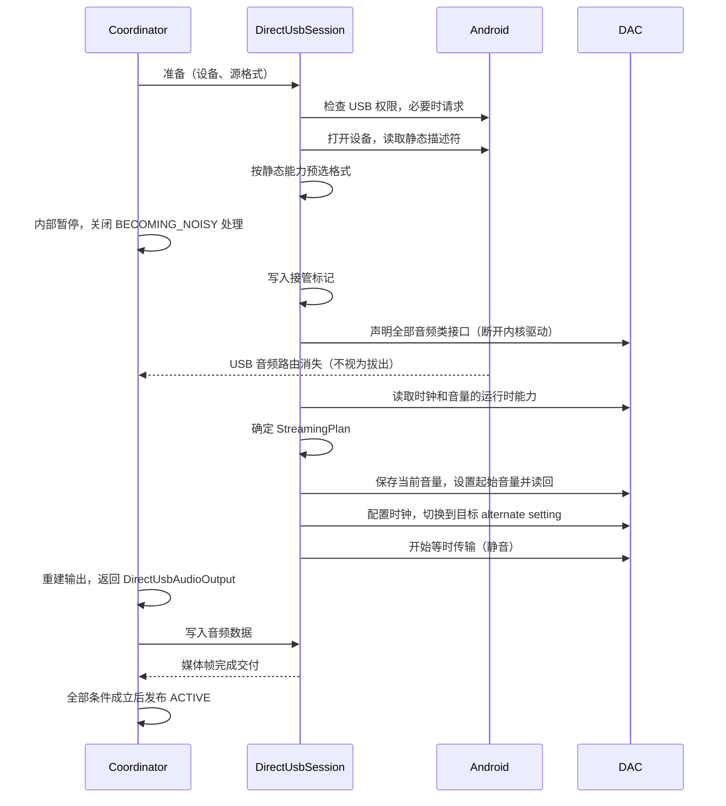
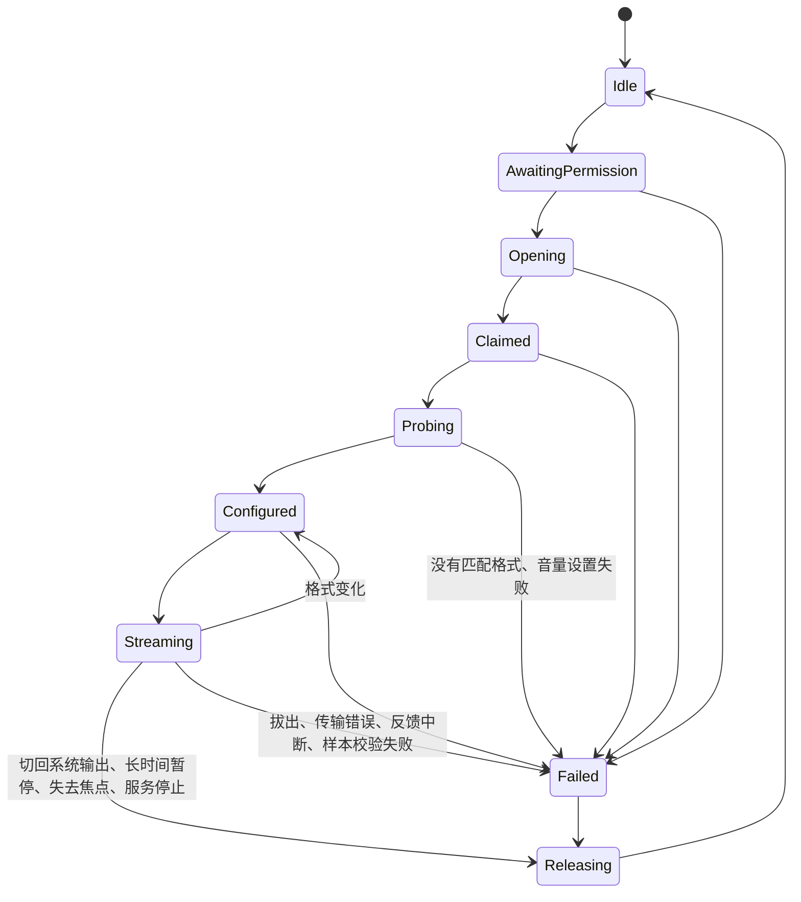
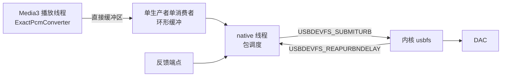

# M7 架构设计：Vesqen 自有 USB 输出

2026-11-02 首版，同日按[架构审查](M7_USB_ARCHITECTURE_REVIEW.md)修订。阶段、决定和验收见 [M7 开发清单](M7_IMPLEMENTATION_PLAN.md)，范围以 [PRD 的 M7 章节](PRD.md) 为准。本文是开工前的设计，目前没有对应代码。标为"待实测"的内容由捕获测试、M7-1 和 M7-2 验证；实测结论与本文不符时，先更新本文，再继续实现。

## 设计约束

1. 严格模式下送到 DAC 的样本值须与原文件的无损 PCM 一致。无法证明时停止输出，不回退到系统混音。
2. 提取、解码、队列和媒体会话继续由 Media3 负责，普通输出继续使用 `DefaultAudioSink`。严格模式可以在 Sink 这一层增加范围受限的实现（见"样本完整性"），但不修改 Media3 源码，也不进行 M6 的内核替换。
3. 官方通道可用时优先使用官方通道。
4. `UsbOutputCoordinator` 仍是严格输出状态的唯一所有者。所有触发来源都进入同一个判定流程，界面、`PlaybackSnapshot` 和 `PlaybackTelemetry` 读取同一份状态。
5. 普通播放不加载 native 库，也不调用 USB Host API。
6. USB 设备提供的数据一律视为不可信输入。描述符在 Kotlin 中解析，native 层只接收校验过的配置。
7. Media3 播放线程上不得执行没有上限的等待，包括控制请求和线程 join。

## 总体结构


运行时分为三个部分：

| 部分 | 运行位置 | 内容 |
| --- | --- | --- |
| 控制面 | Kotlin，专用单线程 `usb-control` | USB 权限、打开设备、解析描述符、声明接口、`setInterface()`、时钟和音量的控制请求。这些都可以使用 Java API。 |
| 格式转换 | Kotlin，Media3 播放线程 | 把 Media3 交来的 PCM 转为 DAC 格式并校验。 |
| 数据面 | C++，专用 native 线程，不附加到 JVM | 环形缓冲、等时 URB 的提交和回收、反馈、逐包错误和计数。Java API 不支持等时传输，这一部分只能在 native 实现。 |

数据面线程不附加到 JVM，因此不受 GC 暂停影响。

## 组件

| 组件 | 位置 | 职责 |
| --- | --- | --- |
| 严格模式样本保护 | `:app`，新增 | 防止 Media3 淡入改动样本。形式由捕获测试决定（见"样本完整性"）。 |
| `UsbOutputStrategyResolver` | `:app`，修改 | 纯策略判断。结果增加路径：官方通道或自有输出。 |
| `UsbOutputCoordinator` | `:app`，修改 | 模式、generation、统一判定、状态发布和失败关闭。自有路径的细节委托给 `DirectUsbSession`，不继续把逻辑堆入这个类。修改前先补单元测试（M7-0）。 |
| `DirectUsbAudioOutput` | `:app`，新增 | 实现 Media3 的 `AudioOutput`。 |
| `ExactPcmConverter` | `:app`，新增 | 转换和校验。官方路径的修复（#71 2026-10-23）也使用它。 |
| `UsbAttachActivity` | `:app`，新增 | 接收系统的 USB 插入事件（D8），不显示界面。 |
| `UacDescriptorParser` | `:usb-engine`，新增 | 把原始描述符解析为静态能力 `UsbAudioTopology`。纯函数，不依赖 Android。 |
| `UacControlClient` | `:usb-engine`，新增 | UAC1 和 UAC2 各自的时钟、音量控制请求，带边界检查和超时。经小型接口访问 USB，可以用假实现测试。 |
| `StreamingPlanner` | `:usb-engine`，新增 | 按静态能力、运行时能力和源格式确定 `StreamingPlan`。纯函数。 |
| `DirectUsbSession` | `:usb-engine`，新增 | 从接管到释放的状态机和清理记录。生命周期长于单个 `AudioOutput`。 |
| `UsbStreamEngine` | `:usb-engine`，新增 | JNI 封装。第一次需要时才调用 `System.loadLibrary`；加载失败按失败关闭。 |
| native core | `:usb-engine`，新增 | 环形缓冲、包调度、反馈换算和计数。不依赖 Android，可在主机上测试。 |
| native transport | `:usb-engine`，新增 | usbdevfs 的 `ioctl` 调用，不引入 libusb（D2）。 |

依赖方向为 `:app` → `:usb-engine`。`:usb-engine` 不依赖 Media3，USB 协议的细节也不进入 `:app`。

## 样本完整性

Media3 1.11.0 的 `DefaultAudioSink` 会对写入帧数不足 20 ms 的 PCM 做线性淡入（`maybeRampUpVolume()`）。它只判断是否为 PCM 和已写入帧数，没有开关。每次新建输出或 flush 后计数归零，因此起播、seek 和格式变化后都会发生。1.11.1 所属的上游 main 分支仍然如此。淡入发生在 `AudioOutput` 之前，输出端无法还原。

候选方案：

| 方案 | 做法 | 优点 | 风险 |
| --- | --- | --- | --- |
| A：静音前导（优先） | 用 `ForwardingAudioSink` 包装 `DefaultAudioSink`。严格模式下，在新一段输出的第一个缓冲之前先送入至少 20 ms 的数字静音，淡入只作用在静音上。 | 改动最小，继续使用 Media3 的时钟和格式切换逻辑。 | 依赖 Media3 的内部行为，升级时由捕获测试把关。 |
| B：严格 PCM Sink | 实现范围受限的 `AudioSink`（接口约 30 个方法，严格模式下多数不产生作用），不做任何处理，直接写入 `AudioOutput`。另需一个按模式选择 Sink 的外层。 | 语义完全可控，不依赖 Media3 内部行为。 | 时钟、格式切换和流结束都要自己实现，代码量较大。 |

方案 A 的已知限制：

- 不能使用 `setAudioProcessors()`。这个公开入口的处理器只在 int16 路径上执行，float 路径不经过它们。
- 格式变化且输出不能复用时，`DefaultAudioSink` 在 `handleBuffer()` 内部自行 flush，包装层看不到，因此须在 `configure()` 时按格式是否相同预判。同格式切歌不得插入静音。
- `TrimmingAudioProcessor` 位于处理链前端，encoder delay 非零时前导可能被裁掉。这种音源由捕获测试确认，不能保证时拒绝。
- 前导使播放进度提前 20 ms，由包装层扣除。

不采用的做法：修改 Media3 源码，以及在输出端反向增益（第一帧已被乘以零，无法还原）。

**捕获测试。** 放在 `androidTest`，使用 `VesqenAudioRenderersFactory` 和假的 `AudioOutputProvider`，把 `write()` 收到的内容保存到内存，与参考 PCM 逐字节比较。不需要 DAC。

- 音源：16 位和 24 位的 WAV 与 FLAC。
- 用例：首帧、seek 后首帧、重新 prepare、同格式切歌（不多插静音，不丢帧）、不同格式切歌、流结束的最后一帧。
- 顺序：先跑现状，确认淡入范围；再分别跑方案 A 和 B。
- **判定规则：方案 A 能稳定通过全部用例就采用 A，否则采用 B。**
- 这个测试保留为 Media3 升级时的回归测试。

已发布版本受到的影响和处理见开发清单的 M7-0。

## 接入 Media3

`UsbOutputCoordinator` 继续继承 `ForwardingAudioOutputProvider`。自有路径下，下列三个方法都由 Coordinator 作答：

- `getFormatSupport()` 和 `getOutputConfig()`：接管后系统路由已变为手机扬声器，`AudioTrack` 的实现会按扬声器能力作答，可能错误地拒绝高采样率，因此须依据已选定的 `StreamingPlan` 作答。
- `getAudioOutput()`：计划有效时返回 `DirectUsbAudioOutput`。计划过期或失败时沿用现有的 `pendingStrictOutput()` 和 `mutedFailureOutput()`。

`DirectUsbAudioOutput` 的行为：

| 方法 | 行为 |
| --- | --- |
| `write()` | 转换后写入环形缓冲，缓冲已满或 flush 尚未确认时返回 `false`；会话失败时抛出不可恢复的 `WriteException`。 |
| `play()`、`pause()` | 切换数据面读取缓冲或填充静音。 |
| `flush()` | 立即返回，开始新的 epoch（见"flush 与销毁"）。 |
| `stop()` | 标记流结束，媒体帧全部交付后填充静音。 |
| `release()` | 只解除与会话的绑定，不释放 USB 接口。 |
| `getPositionUs()` | 只统计媒体帧（见"媒体时钟"）。 |
| `getBufferSizeInFrames()` | 环形缓冲容量。 |
| `canReuseAudioOutput()` | 使用默认实现：配置相同才复用。同格式曲目连续播放依赖这一点。 |
| `setVolume()` | 用户音量由现有的 `enforceNeutralProcessing()` 固定为 1。其他值只可能来自音频焦点的 duck 系数，记录后忽略，不缩放 PCM（见"音频焦点"）。 |
| `setPlaybackParameters()` | 只接受默认值。 |
| offload、音效和首选设备相关方法 | 不支持，不产生任何作用。 |

## 格式与承诺

严格输出承诺保持的是**原文件的无损 PCM**。解码器产生的 PCM 精度低于源文件时拒绝播放，不靠补零提升声明。

计划分别持有四层格式，并绑定到同一个 epoch：

| 层 | 来源 |
| --- | --- |
| `SourceFormat` | 文件元数据 |
| `DecodedPcmFormat` | 解码器实际输出（现有的 `onDecoderOutputFormat`，#72） |
| `SinkInputFormat` | `AudioOutputProvider.OutputConfig` |
| `UsbWireFormat` | 所选 alternate setting 的 subslot、位深和声道 |

第一版的范围：

| 音源 | 处理 |
| --- | --- |
| 16 位无损 | 支持。解码输出可以是 int16 或 float。 |
| 24 位无损 | 支持。解码输出须为 int24 或 float；int16 按 `DECODER_PRECISION_LOST` 拒绝。 |
| 20 位、32 位、浮点 WAV | 拒绝。开启 float 输出时高精度整数会被转为 float，32 位无法保持；这些格式第一版不做专门路径。 |
| 有损格式、位深未知 | 拒绝，沿用现有规则。 |

Android 9 上的 OMX 解码器只输出 int16（现有的 `keepIntegerPcmForOmx()`，#107 的保护，不能为 M7 移除），这些设备上的 24 位音源会被拒绝并说明原因。

转换规则：

- float 样本乘以 2^(N-1) 还原为 N 位整数，结果须为整数且在取值范围内，否则按 `PCM_NOT_EXACT` 失败关闭。
- 这项校验是必要条件，不足以证明样本未被改动：已截断的数据和被淡入的整数样本都能通过。样本未改动由捕获测试、解码格式判断和外部验证共同支撑。
- 整数按 UAC 规定左对齐放入 subslot，低位补零。16 位放入 24 位格式时，状态须写明"已补零"（#65）。
- 不做重采样、抖动或截断。
- 最高 192 kHz 双声道约为每秒 38 万个样本，在 Media3 播放线程上处理没有压力。

## 路径选择

路径按 USB 连接选择，不按曲目切换：

1. 模式为系统输出时，不进入严格路径。
2. API 34 及以上，且 `getSupportedMixerAttributes()` 含有 bit-perfect 配置时，使用官方通道。此后如果格式不匹配，按现有规则失败关闭，不临时切换到自有输出，以免同一队列反复接管和释放 DAC。代价是设备只暴露少量官方格式时，自有输出的更多格式不会被利用，这一点如实说明。
3. 其余情况使用自有输出，条件为 `vesqen.directUsb` 构建开关已开启、设备支持 USB Host，且只连接了一台 USB 音频输出设备。连接多台时按 `DIRECT_DEVICE_AMBIGUOUS` 失败关闭，第一版不提供选择界面。
4. 描述符不受支持或没有匹配格式时，失败关闭并说明原因。

选择结果在该连接期间缓存，因为接管后 `AudioDeviceInfo` 会消失，无法再次查询。拔出后清除缓存。

现有的严格模式开关只看官方 API 是否可用（`OfficialMixerApiSupport`），API 34 以下无法开启。M7 改为判断"官方通道或自有输出是否可用"，官方 API 的说明文字保留。

`vesqen.directUsb` 的做法与 `vesqen.premiumEnforced` 相同，由构建配置决定。M7 合入 `master` 后默认关闭，到 2.0.0-beta.1 时开启。

## 统一判定

所有 USB 和焦点事件都进入 Coordinator 的同一个幂等流程 `reconcile()`。它用 `UsbManager.deviceList` 和 `hasPermission()` 重新确认事实，不信任事件本身携带的设备参数。

入口：服务启动、模式切换、用户播放、USB 权限结果、`ACTION_USB_DEVICE_ATTACHED` 和 `ACTION_USB_DEVICE_DETACHED` 广播、`UsbAttachActivity` 的信号、`onAudioDevicesAdded()`、`onPlaybackSuppressionReasonChanged()`、暂停超时。

接管须同时满足：严格模式；用户有播放意图（`playWhenReady`）；`playbackSuppressionReason` 为 none；只有一台 USB 音频设备；已有 USB 权限。

- 路由增加只更新设备事实，不能单独触发接管。
- `reconcile()` 不改变 `playWhenReady`，也不启动服务或后台播放。
- 状态中保存 `releaseCause`，用于说明 DAC 为何已被归还。

## 音频焦点

继续使用 Media3 的自动焦点管理（`setAudioAttributes(..., true)`），不另建 `AudioFocusRequest`，以免出现两个焦点所有者。

| 事件 | Media3 的表现 | 自有路径的处理 |
| --- | --- | --- |
| 长期失去焦点 | `playWhenReady` 变为 false | 立即释放 DAC，其他应用可以使用。 |
| 暂时失去焦点（来电、语音助手） | `playWhenReady` 不变，`playbackSuppressionReason` 变为暂时失去焦点 | 经 `onPlaybackSuppressionReasonChanged()` 释放 DAC，`releaseCause` 记为暂时失去焦点。系统重新添加 USB 路由后，因不满足接管条件，不会被抢回。 |
| 重新获得焦点 | `playbackSuppressionReason` 恢复为 none | `reconcile()` 重新接管，沿用现有的 `stop()` 加 `prepare()` 重建输出，然后恢复播放。在途的音频已被取消，因此不续用旧 epoch。 |
| 可以压低音量（duck） | Android 8 起通常由系统在混音器中处理（现有 `AppSegmentAssessment` 的注释，2026-10-04 决定）；自有输出没有 `AudioTrack`，系统无从作用 | 继续播放，样本不变，`ACTIVE` 不变。如果 duck 系数到达 `setVolume()`，记录后忽略（待实测）。 |

duck 时不暂停的原因：通知音通常只请求 duck，接管期间它们从手机扬声器输出，不影响 DAC 上的样本，每条通知都暂停音乐过于打扰。

官方路径的 `StrictGatedAudioOutput.setVolume()` 目前会把 duck 系数传给 `AudioTrack`，而 `hasNeutralProcessing()` 看不到这个系数。这一行为在 M7-4 一并核对。

## 控制请求

M7-1 只读取静态描述符，输出拓扑、接口、端点和控制能力，运行时数值明确标为 unknown。向接口发送控制请求前内核要求已声明接口（`check_ctrlrecip`），因此运行时能力只能在接管后取得，随后才能最终确定 `StreamingPlan`。

UAC1 和 UAC2 使用各自的请求流程：

| 项 | UAC1 | UAC2 |
| --- | --- | --- |
| 采样率列表 | 静态描述符（Format Type） | 运行时：Clock Source 的 `GET_RANGE` |
| 时钟选择 | 没有 | Clock Selector 的 `GET_CUR`、Clock Valid（可读时） |
| 设置采样率 | 端点支持时用端点 `SET_CUR` | 控制可写时用 Clock Source 的 `SET_CUR` |
| 读回 | 端点支持时用 `GET_CUR` | Clock Source 的 `GET_CUR` |
| 音量范围和当前值 | Feature Unit 的 `GET_MIN`、`GET_MAX`、`GET_RES`、`GET_CUR` | Feature Unit 的 `GET_RANGE`、`GET_CUR` |

- 固定频率或只读的时钟不发送 `SET`，读回值等于目标采样率就通过。规范允许这类时钟不支持 `SET`，一律要求设置成功会误拒绝合法设备。
- 读回不一致时按 `SAMPLE_RATE_READBACK_MISMATCH` 失败关闭。
- "不支持"和"未知"分开报告。设备不支持读回时显示为不可用，不得推定。
- 所有请求都在 `usb-control` 线程执行，带超时（默认 500 ms）和响应长度检查。

## 接管与释放





设计要点：

- **声明全部音频类接口。** AudioControl 和 AudioStreaming 接口都须声明。HID 接口不声明，DAC 上的按键继续由系统处理。
- **`BECOMING_NOISY`。** AOSP 把 USB 设备列入该广播的设备集合，而 `PlaybackService` 开启了 `setHandleAudioBecomingNoisy(true)`。接管导致路由消失时，Media3 会自行暂停。因此接管前关闭这项处理，释放后恢复。此期间的真实拔出由 `ACTION_USB_DEVICE_DETACHED` 和 URB 的 `ENODEV` 判断。
- **路由监听。** 自有路径下 `selectedDevice` 为空，`onAudioDevicesRemoved()` 不会触发失败关闭，官方路径的逻辑不需要改动。
- **会话的生命周期长于 `AudioOutput`。** 格式变化时 Media3 会释放旧输出、创建新输出，会话保持接管状态，只重新配置时钟和 alternate setting。设置采样率和切换 alternate setting 的先后顺序按协议版本处理，由 M7-2 实测确认。
- **释放时机。** 切回系统输出、暂停超过 30 秒（默认值，待实测）、失去音频焦点、服务停止、发生失败。短暂暂停时持续发送静音，避免切换带来的爆音。
- **释放顺序。** 停止接收旧 epoch 的数据、停止重新提交、取消并回收全部在途 URB、native 确认静止、切回 alternate setting 0、恢复接管前的音量、释放全部接口、关闭连接、清除接管标记、恢复 `BECOMING_NOISY` 处理。Android 的 `releaseInterface()` 成功后会请求内核重新连接驱动。
- **清理记录。** 每一步的结果写入清理记录，某一步失败时继续执行后续步骤，并保留第一个失败原因。**只有确认全部接口都已释放，才清除接管标记。**
- **进程异常退出。** 内核关闭文件描述符时只释放接口（`usbdev_release`），不会重新绑定驱动，DAC 可能需要重新插拔才能被系统使用。下次启动时如果发现接管标记，且设备仍连接并有权限，就重新声明再释放一次，由 `releaseInterface()` 触发重新连接（待实测）。

## 数据面



### StreamingPlan

包调度不能只按 UAC 版本或 `bcdUSB` 推定，`StreamingPlan` 显式持有下列内容：

| 字段 | 来源 |
| --- | --- |
| 实际总线速度 | `USBDEVFS_GET_SPEED` |
| 服务间隔 | 速度和 `bInterval`：高速为 125 µs 乘以 2^(bInterval-1) |
| 每间隔最大载荷 | `wMaxPacketSize` 的低 11 位。第 11、12 位表示的高速多事务结构第一版明确拒绝；最高 192 kHz / 24 位双声道不需要它。 |
| 同步类型和反馈 | 端点描述符。反馈的单位、更新周期和有效期。 |
| 线路格式 | alternate setting、subslot、位深、声道、采样率 |

URB 的大小按时长计算：每个约 16 到 32 ms，不超过内核上限的 128 包，在途音频约 100 ms。环形缓冲约 500 ms。初始参数由 M7-2 实测后调整。

| 速度 | bInterval | 服务间隔 | 每个 URB | 在途 |
| --- | --- | --- | --- | --- |
| 全速 | 1 | 1 ms | 32 包，32 ms | 3 个，约 96 ms |
| 高速 | 1 | 125 µs | 128 包，16 ms | 6 个，约 96 ms |
| 高速 | 4 | 1 ms | 32 包，32 ms | 3 个，约 96 ms |

### 包长和反馈

- 用定点累加器计算每个服务间隔的帧数，结果不超过每间隔最大载荷，并按帧对齐。自适应和同步端点使用标称速率，异步端点按反馈调整。任何情况下都不重采样。
- UAC1 和 UAC2 的传输机制相同。全速和高速的反馈格式不同，反馈值须换算为"每个实际服务间隔的帧数"。
- 隐式反馈的设备第一版不支持，按 `FEEDBACK_UNSUPPORTED` 失败关闭。

### 媒体时钟

静音也占 USB 帧，但没有消费歌曲。`DefaultAudioSink` 用写入帧数和 `getPositionUs()` 比较来判断是否还有待播放数据，因此 USB 总帧数不能直接作为播放进度。分开统计：

| 计数 | 含义 | 用途 |
| --- | --- | --- |
| `mediaFramesWritten` | 写入环形缓冲的媒体帧 | 流结束判断 |
| `mediaFramesSubmitted` | 已放入在途 URB 的媒体帧 | 插值的上界 |
| `mediaFramesDelivered` | 所在 URB 已完成的媒体帧 | `getPositionUs()` 的基础 |
| `silenceFramesInserted` | 预填充、暂停和欠载时补入的静音帧 | 诊断 |
| `usbFramesDelivered` | USB 总帧 | 诊断 |

- `getPositionUs()` 等于 `mediaFramesDelivered` 加单调时钟插值，插值不超过 `mediaFramesSubmitted`。
- 静音不计入。暂停和欠载时位置不增长。流结束只等待媒体帧交付。
- 每个 `AudioOutput` 有独立的 epoch，计数从 0 开始。会话可以跨输出存活，但旧 epoch 的完成记录只回收，不计入新输出。
- USB 交付不等于 DAC 已经呈现，DAC 内部的缓冲延迟无法测量。Audio Proof 只说明 USB 交付的时刻，不把它写成呈现时刻。

### 错误和连续性

等时 URB 的总状态不能代替逐包状态，一次成功的回收不代表所有包都成功。

| 情况 | 判定 | 处理 |
| --- | --- | --- |
| 单包失败，URB 总体完成 | 逐包检查 `status` 和 `actual_length` | 计数并标记本次流不连续。时间窗内超过阈值（默认值待实测）时按 `USB_TRANSFER_FAILED` 失败关闭。 |
| 反馈中断 | 超过有效期没有有效反馈 | 按 `FEEDBACK_TIMEOUT` 失败关闭。 |
| 反馈异常 | 持续超出标称速率附近的范围 | 按 `FEEDBACK_OUT_OF_RANGE` 失败关闭。 |
| 欠载 | 环形缓冲为空 | 填充静音、计数、标记本次流不连续，触发 `onUnderrun()`。 |
| 主动取消 | 由 flush 或停止发起 | 不算错误。 |
| 设备消失 | `ENODEV` | 按 `DEVICE_DISCONNECTED` 失败关闭。 |

路径声明和流的连续性分开表达。`ACTIVE` 说明路径按原值传输；`streamContinuity` 说明本次流是否连续完整，链路页显示欠载和传输错误的次数。插入静音或丢包后不得写成完整的逐样本一致流，已有的签名验证记录也不能替代本次流的错误证据。

### 线程和通信

- 只有 native 线程操作传输队列。控制命令经带 epoch 和完成确认的信箱传递。
- native 线程不回调 JVM，只发布原子计数和错误状态。Kotlin 在 `write()` 和 `getPositionUs()` 中读取；会话存在期间，另由 `usb-control` 每 250 ms 读取一次，以便在暂停时也能发现拔出。
- 线程请求 `THREAD_PRIORITY_URGENT_AUDIO` 级别，普通应用无法使用 `SCHED_FIFO`。实际是否生效由 M7-2 核实。
- JNI 接口保持很小：`create(fd, plan)`、`start()`、`write(directBuffer, offset, size)`、`setRunning()`、`flush(epoch)`、`markEndOfStream()`、`readStats(long[])`、`destroy()`。

### flush 与销毁

- **`flush()` 的保证。** 它在播放线程上立即返回，不等待：开始新的 epoch，此后旧 epoch 的数据不再提交。native 取消并回收全部在途 URB、清空环形缓冲后确认。确认前 `write()` 返回 `false`。超过上限（默认 1 秒）仍未确认时失败关闭。
- **`DISCARDURB` 之后仍须回收。** 被取消的 URB 仍会进入回收路径，停止线程不等于 URB 结构和缓冲区已经可以释放。native 确认静止的条件是所有在途 URB 都已回收。
- **`destroy()` 和 `write()` 互斥。** Kotlin 用一把小锁保护 native 句柄，`write()` 在锁内只做不阻塞的缓冲写入。`destroy()` 先标记关闭，再取得锁销毁，因此 `write()` 不会用到已销毁的句柄。
- **文件描述符。** 由 `UsbDeviceConnection` 持有，native 只是借用，因此必须先 `destroy()` 再关闭连接。
- `usb-control` 上的等待都有上限，`destroy()` 不在播放线程上执行。

## 音量

按 D4：

- 从输出流的终端沿描述符拓扑查找所选路径上的 Feature Unit。**只有确认存在可写的 Volume Control 才使用硬件音量**，可以是主声道，也可以是全部逻辑声道。
- 分为三种情况：

| 情况 | 路径 |
| --- | --- |
| 有可写的 Volume Control | 使用硬件音量 |
| 没有 Feature Unit，或只有静音控制，或音量只读 | 每款设备第一次使用时说明输出为满幅，用户确认后以固定音量播放，会话音量控制类型为固定 |
| 控制可写，但读取、设置或读回失败 | 按 `VOLUME_CONTROL_FAILED` 失败关闭，不得以未知音量播放 |

- 第一个样本发出之前设置起始音量并读回。起始音量规则：同一次 USB 连接内恢复之前的设置；重新插入后取"记忆值"和约 -30 dB 中较低的一个（设备范围不足时取下限）。
- -30 dB 是相对增益，不代表对所有 DAC、耳机和功放都安全。按 VID/PID 保存的值只是偏好，它识别的是型号，不能证明是同一台设备或同一副耳机。
- 释放时恢复接管前的音量，前提是仍为同一接管会话且音频数据已停止。恢复失败记入清理记录。
- 音量键经 Media3 接收：交给 `MediaSession` 的 Player 在自有输出期间报告 `DeviceInfo.PLAYBACK_TYPE_REMOTE`，Media3 随后调用 `setPlaybackToRemote()`（已核对 1.11.0 源码）。其他模式仍报告本地播放。vivo ROM 上的行为待实测。
- 不使用软件音量。直出时系统音量和系统的音量安全提示都不起作用，因此起始音量由 Vesqen 负责。

## USB 权限

- 只有用户操作才弹出系统授权框。服务启动和恢复队列时没有权限，只显示状态（沿用 #34 的规则）。拒绝授权时报告 `USB_PERMISSION_DENIED`。
- 用户关闭麦克风访问时，系统会拒绝带麦克风输入的设备的 USB 权限。应用无法区分这种情况和普通拒绝，因此失败说明须同时提到这一可能。
- 按 D8，清单声明 `UsbAttachActivity`，带 `USB_DEVICE_ATTACHED` 过滤器（`<usb-device class="1" />`，系统也会匹配接口类别，因此复合设备同样适用）。它默认禁用，用户开启严格模式时启用，切回系统输出时禁用，未开启严格模式的用户插入 DAC 时不受打扰。
- 用户选择"始终使用"后，系统在插入时直接授权并启动这个 Activity。它不显示界面，也不读取 Intent 中的设备参数，发出重新判定的信号后立即结束。路由增加可能早于授权，也可能根本不发生，因此不能依赖 `onAudioDevicesAdded()` 感知授权完成。没有运行中的服务时不需要处理，服务启动时会重新判定。
- 带麦克风输入的 DAC 是例外：应用没有录音权限时，系统不显示"始终使用"（`UsbPermissionActivity`），这类设备每次插入都须授权一次。Vesqen 不为此申请录音权限。

## 状态与失败原因

`UsbOutputPhase` 不变。`UsbOutputStatus` 增加 `path`（`OFFICIAL_MIXER` 或 `DIRECT_USB_HOST`）和 `streamContinuity`。Session Bundle 中没有这些字段时，按官方通道读取，以兼容进程内外版本不一致的情况。`ACTIVE` 的条件见 [M7 开发清单的声明边界](M7_IMPLEMENTATION_PLAN.md#声明边界)。

失败原因沿用官方路径的机制（`usb_failure_*`，目前 21 条），不另建展示方式（#71 2026-11-02）。每个环节对应的取值：

| 环节 | 新增 | 复用现有 |
| --- | --- | --- |
| USB Host 权限 | `USB_PERMISSION_DENIED` | `USB_HOST_UNAVAILABLE` |
| 设备枚举与生命周期 | `DIRECT_DEVICE_AMBIGUOUS`、`USB_OPEN_FAILED`、`INTERFACE_CLAIM_FAILED` | `NO_USB_AUDIO_DEVICE`、`DEVICE_DISCONNECTED` |
| UAC 版本与接口、endpoint | `DESCRIPTOR_UNSUPPORTED` | |
| 格式协商 | `NO_MATCHING_DIRECT_FORMAT`、`SAMPLE_RATE_SET_FAILED`、`SAMPLE_RATE_READBACK_MISMATCH`、`DECODER_PRECISION_LOST` | `SOURCE_FORMAT_UNKNOWN`、`SOURCE_FORMAT_UNSUPPORTED` |
| 音量 | `VOLUME_CONTROL_FAILED` | |
| 传输与缓冲 | `USB_TRANSFER_FAILED`、`PCM_NOT_EXACT` | |
| 时钟与反馈 | `FEEDBACK_UNSUPPORTED`、`FEEDBACK_TIMEOUT`、`FEEDBACK_OUT_OF_RANGE` | |
| 设备组合不在支持范围内 | `DEVICE_NOT_SUPPORTED` | |
| 引擎 | `USB_ENGINE_UNAVAILABLE` | |
| 无法确定环节 | | `PLATFORM_ERROR`，说明中写明无法确定 |

兼容性要求：

- 新的失败原因和字段进入设备报告时，须先更新 `contracts/device-report/vocabulary.json` 并部署服务端，再发布应用。
- `OutputVerificationRecord` 增加路径字段，官方通道的验证记录不能证明自有输出，反之亦然。没有该字段的旧记录按官方通道处理。

## 安全与隐私

- 描述符解析使用带边界检查的 Kotlin 代码。长度异常或拓扑不完整时报告 `DESCRIPTOR_UNSUPPORTED`，不崩溃。控制请求的响应同样检查长度和取值范围。
- native 层再次校验配置：包长不超过每间隔最大载荷，反馈值限制在范围内，`actual_length` 不超过缓冲区。
- `UsbAttachActivity` 必须导出才能接收系统启动，因此不读取 Intent 中的设备参数，不显示界面，除发出重新判定的信号外不执行其他操作。
- 不新增网络传输。使用统计已经发送 `bitPerfectMixer`，设备报告的音频能力部分已经包含 VID/PID 和接口协议（D7）。
- 本机新增保存：按 VID/PID 记录的音量偏好和固定音量确认，以及接管标记。隐私政策须在 2.0 发布前写明。

## 测试

| 层 | 方式 | 重点 |
| --- | --- | --- |
| Media3 到 PCM | `androidTest`，假的 `AudioOutputProvider`，不需要 DAC | 见"捕获测试"；普通输出和严格模式分别验证 |
| 描述符解析和 `StreamingPlanner` | JVM 单元测试，使用真实 DAC 的描述符样本 | 静态解析、运行时数值 unknown、畸形输入、`bInterval` 大于 1、多事务结构被拒绝 |
| `ExactPcmConverter` | JVM 单元测试 | 全部 16 位取值和 24 位边界值经 float 还原后一致；非整数样本被拒绝；错误元数据；已截断的合法格点；真实的解码器到 Sink 输入组合 |
| `UacControlClient` | JVM 单元测试，使用假 USB 传输 | UAC1 和 UAC2 的请求流程；固定时钟；只读音量；设置和读回失败 |
| `DirectUsbSession` | JVM 单元测试，使用假 USB 传输 | 每一步失败后都继续清理；接管标记的保留和清除；状态转换；过期回调 |
| `UsbOutputCoordinator` | JVM 单元测试，使用假会话 | 路径选择、generation、`reconcile()` 的全部入口、失去焦点后路由重新出现不被抢回、失败路径不出现错误的 `ACTIVE` |
| native core | 主机上的 C++ 单元测试，使用假传输 | **各种反馈序列下，所有媒体包的载荷按顺序拼接后与输入逐字节一致**；媒体时钟（先传 5 秒静音、暂停 10 秒、欠载、流结束、seek 时 URB 在途、同格式复用、不同格式重建）；取消和回收的故障注入；单包失败；反馈中断 |
| 真机 | `docs/M7_DEVICE_ACCEPTANCE.md` | 见下一节；只有外部逐样本比对才能得到 `VERIFIED` |

## 仓库布局

```text
usb-engine/
  build.gradle.kts              Android 库、CMake、固定 ndkVersion
  src/main/java/.../usb/
    descriptor/                 UacDescriptorParser、UsbAudioTopology
    control/                    UacControlClient
    plan/                       StreamingPlanner、StreamingPlan
    session/                    DirectUsbSession、清理记录
    engine/                     UsbStreamEngine
  src/main/cpp/
    core/                       环形缓冲、包调度、反馈、计数（不依赖 Android）
    transport/                  usbdevfs
    jni/                        JNI 入口
    test/                       主机单元测试
  src/test/                     JVM 测试和描述符样本
app/src/main/java/.../playback/
  DirectUsbAudioOutput.kt       新增
  ExactPcmConverter.kt          新增
  UsbAttachActivity.kt          新增
  严格模式样本保护              新增，形式由捕获测试决定
  UsbOutputCoordinator.kt       修改
  UsbOutputStrategyResolver.kt  修改
  UsbOutputState.kt             修改
app/src/androidTest/            Media3 到 PCM 的捕获测试
app/src/debug/                  M7-1 的描述符读取入口和 M7-2 的技术验证入口
```

构建按 D5：不设 `abiFilters`，沿用现有的四种 ABI；NDK 版本固定（本机现有 30.0.16248370），CI 安装同一版本。

## 待实测的设计假设

| 假设 | 阶段 | 不成立时 |
| --- | --- | --- |
| 方案 A 能让严格模式下的样本与参考 PCM 逐字节一致 | 捕获测试 | 采用方案 B |
| 同格式切歌时输出复用，不多插静音，不丢帧 | 捕获测试 | 采用方案 B |
| iQOO 的 ROM 允许强制声明接口并提交等时 URB | M7-2 | G1 不通过，由所有者重新评估范围 |
| 关闭 `BECOMING_NOISY` 处理后，接管不会导致暂停 | M7-2 | 接管完成后再恢复播放 |
| 释放接口后系统恢复使用该设备 | M7-2 | G1 不通过 |
| 暂时失去焦点时释放 DAC，恢复后重新接管，路由变化不会提前抢回 | M7-2 | G1 不通过 |
| duck 不影响自有输出的样本，也不引发暂停 | M7-2 | 按实测结果修订"音频焦点" |
| 进程被结束后可以经重新声明和释放恢复驱动 | M7-2 | 在说明中提示重新插拔 |
| 接管期间没有系统音频，息屏后 ROM 不会冻结进程 | M7-2，息屏播放 30 分钟 | 评估另开一条送往手机扬声器的静音 `AudioTrack`，它不接触 USB 数据 |
| 高优先级和当前缓冲参数足以避免欠载 | M7-2 | 增大 URB 数量和环形缓冲 |
| Activity 禁用时插入 DAC 不出现询问；启用后授权框提供"始终使用"，选择后下次插入自动授权 | M7-2 | 不声明过滤器，改为每次插入后由系统授权框询问一次 |
| JBL Flip 7 的 UAC 版本、反馈方式和 Feature Unit | M7-1，运行时能力在 M7-2 | 影响开发顺序，不影响 D3 的范围 |
| 音量键能经远程音量接口到达 Vesqen（vivo ROM） | M7-5 | 只在应用内和 DAC 上调节音量，并在说明中写明 |
