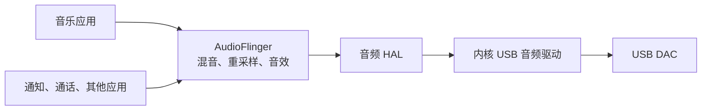
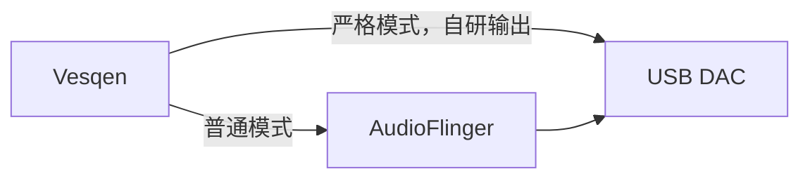
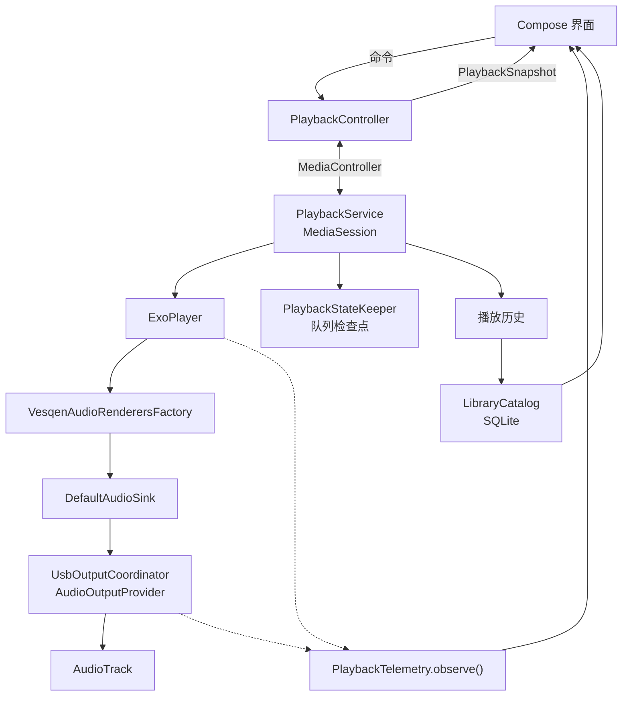
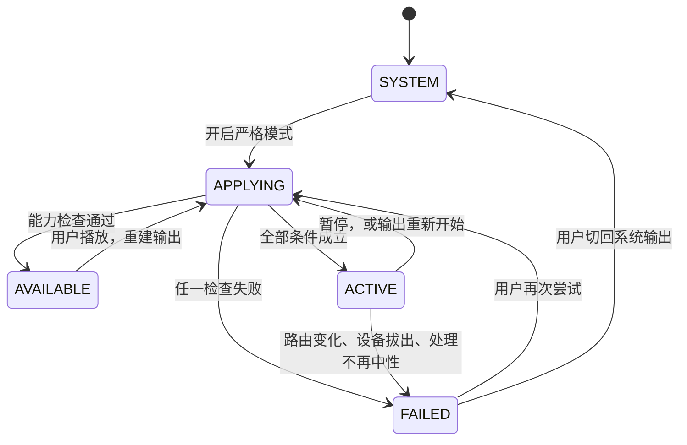
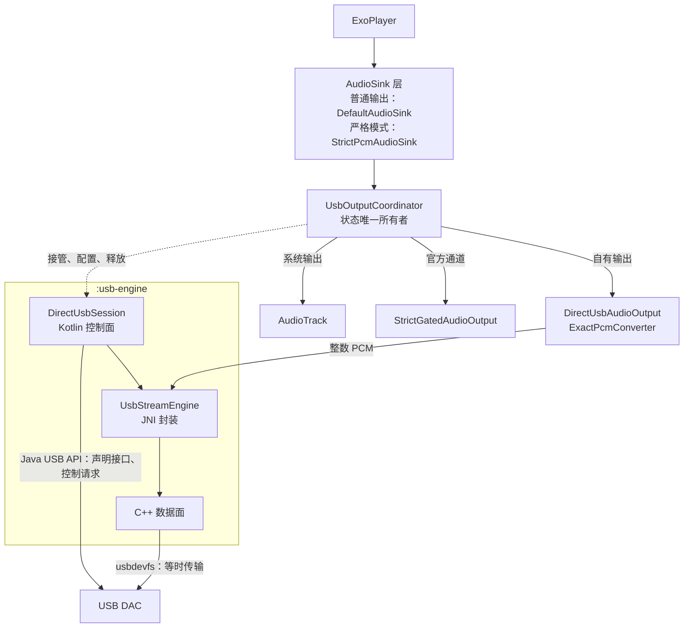
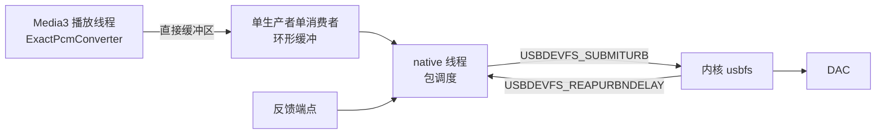
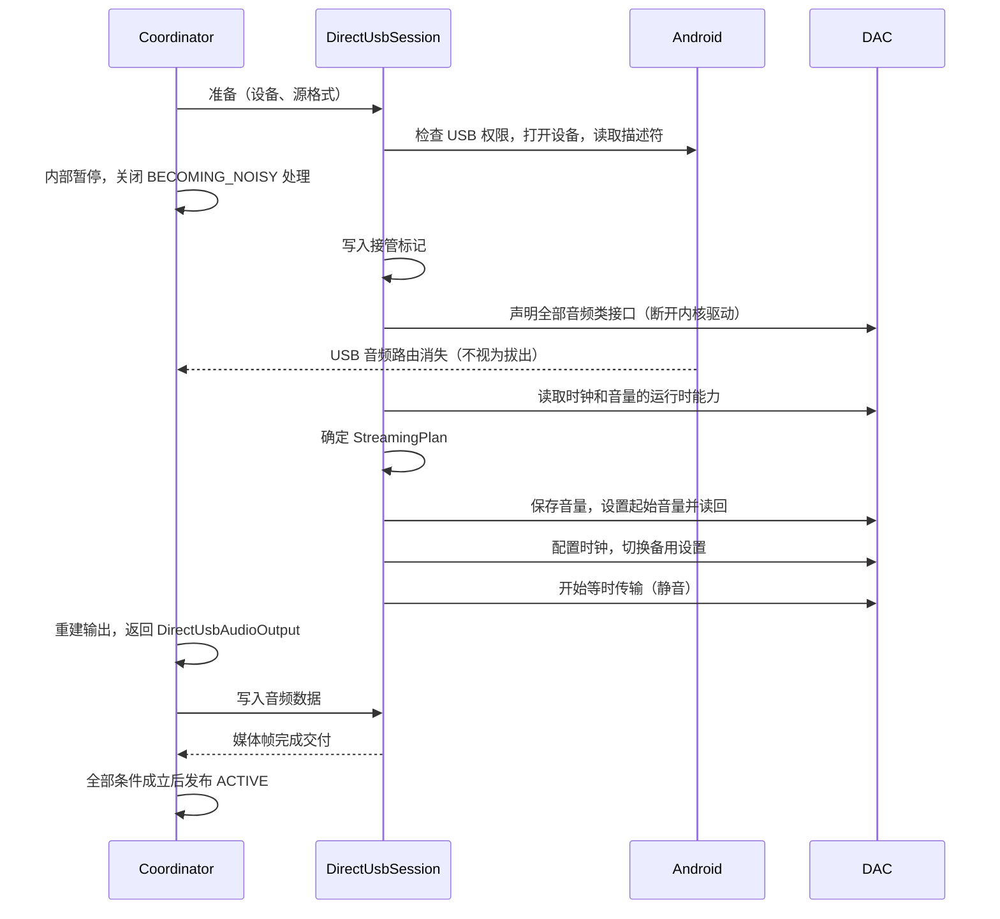

# Vesqen 技术说明：播放器与自研 USB 音频输出

2026-11-03。对应 `master` 的 `0881824`（版本号 1.1.1）和开发分支 `feature/usb-host-output`。

本文系统介绍 Vesqen 的播放器架构，以及正在开发的自研 USB 音频输出。其中的事实均来自代码和实测记录；尚未实现或尚未实测的内容，都明确标注。更详细的资料见文末的“参考文档”。

## 目录

1. [当前状态](#1-当前状态)
2. [要解决的问题](#2-要解决的问题)
3. [播放器整体架构](#3-播放器整体架构)
4. [输出声明与证据](#4-输出声明与证据)
5. [官方严格 USB 路径](#5-官方严格-usb-路径)
6. [USB 音频基础知识](#6-usb-音频基础知识)
7. [自研 USB 输出的总体设计](#7-自研-usb-输出的总体设计)
8. [描述符解析与 JBL Flip 7 实测](#8-描述符解析与-jbl-flip-7-实测)
9. [与 Media3 的衔接和样本完整性](#9-与-media3-的衔接和样本完整性)
10. [数据面](#10-数据面)
11. [设备接管、音量和权限](#11-设备接管音量和权限)
12. [测试与验证方法](#12-测试与验证方法)
13. [工程案例](#13-工程案例)
14. [隐私与网络](#14-隐私与网络)
15. [关键决策与取舍](#15-关键决策与取舍)
16. [技术问答](#16-技术问答)
17. [路线与风险](#17-路线与风险)
18. [术语表](#18-术语表)
19. [参考文档](#19-参考文档)

## 1. 当前状态

阅读后续内容之前，请先了解各部分的进度。本文使用四种状态：

| 状态 | 含义 |
| --- | --- |
| **已发布** | 已进入公开发布的版本 |
| **已实现** | 代码已写好并通过测试，但不在发布版本中 |
| **已实测** | 在真实手机或模拟器上有运行记录 |
| **设计** | 只有设计文档，尚未编写代码 |

| 部分 | 状态 | 说明 |
| --- | --- | --- |
| 播放、曲库、歌词、队列恢复 | 已发布 | Media3 播放内核，私有 SQLite 曲库 |
| Audio Proof 和链路页 | 已发布 | 展示证据及其来源 |
| 官方严格 USB 路径（Android 14 及以上） | 已发布 | 测过的 Android 14 及以上手机都没有开放这条通道，尚未在真实 DAC 上达到 `BIT-PERFECT ACTIVE` |
| Media3 到 PCM 的捕获测试 | 已实测 | 模拟器和 Honor，结果见第 9 节 |
| `UsbOutputCoordinator` 单元测试 | 已实现 | 保护现有状态机 |
| 严格 PCM Sink 原型 | 已实现 | 目前在测试代码中，尚未用于播放 |
| USB 描述符解析和读取入口 | 已实现 | 在开发分支上，不进入发布包 |
| JBL Flip 7 描述符 | 已实测 | iQOO 9，Android 15 |
| 等时传输、native 数据面、控制请求、设备接管、接入播放服务 | 设计 | 见第 7 至 11 节 |
| `BIT-PERFECT VERIFIED` | 尚无记录 | 需要外部数字采集设备 |

因此，“自研 USB 输出”目前完成的是设计、验证方法和第一步的设备识别。**Vesqen 还没有通过自研路径向 DAC 传输过音频。**

## 2. 要解决的问题

### 2.1 Bit-perfect 的含义

Bit-perfect 指送到 DAC 的每个样本值，都与原文件解码得到的 PCM 完全相同，中间没有混音、重采样、增益调整或抖动。它只描述数字路径，与 DAC 之后的音质好坏是两件事。

### 2.2 Android 的默认路径

Android 应用通常把音频交给 `AudioTrack`，再由系统的混音器 AudioFlinger 处理：

打个比方，所有应用的声音都先进同一个调音台，调音台按一个统一的格式输出。这样系统才能同时播放音乐和通知音，代价是音乐的样本值可能被改动。普通应用无法从这条路径上证明样本未被改动。

### 2.3 官方通道和它的局限

Android 14（API 34）提供了官方接口：`AudioManager.getSupportedMixerAttributes()` 查询设备支持的混音器配置，`setPreferredMixerAttributes()` 选择 `MIXER_BEHAVIOR_BIT_PERFECT` 配置。Vesqen 已经实现这条路径，但它依赖手机厂商开放这项能力。

实测结果是：iQOO 9（Android 15）、iQOO Neo9 和 vivo X100 Pro（Android 16）的音频策略里都没有 bit-perfect 输出。Android 13 及以下则没有这个接口。

所以只靠官方路径，主要用户的手机无法严格直出。这是开发自研 USB 输出的原因。

### 2.4 自研输出的思路

USB DAC 遵循公开的 USB 音频规范。应用取得用户授权后，可以接管设备并直接发送音频数据，绕过系统混音器：

这项工作在技术上是一个运行在应用内的**用户态 USB 音频驱动**。它不需要 root，也不修改内核。

### 2.5 设计原则

- **不夸大。** 无法证明的事情不声明。路径成立、流连续和外部验证是三种不同的说法。
- **失败关闭。** 严格模式的条件不成立时停止播放并说明原因，不悄悄回退到系统混音。
- **普通播放不受影响。** 不使用严格模式的用户不加载 native 库，也不调用 USB Host API。
- **以设备实测为准。** 设计中的假设都列出来，由实测确认或推翻。

## 3. 播放器整体架构

### 3.1 技术栈和规模

| 项目 | 内容 |
| --- | --- |
| 语言和界面 | Kotlin，Jetpack Compose |
| 播放内核 | Media3 1.11.0（ExoPlayer） |
| 最低和目标版本 | API 28（Android 9），API 36 |
| 构建 | AGP 9.3.2，Kotlin 2.4.10，JDK 25 |
| 产品代码 | 153 个 Kotlin 文件，约 43,000 行 |
| 测试 | JVM 单元测试约 785 项，设备测试约 470 项（按 `@Test` 注解统计） |
| 发布渠道 | `github` 和 `play` 两个 flavor；自更新和激活码只在 GitHub 版 |

主要的包：

| 包 | 职责 |
| --- | --- |
| `ui` | Compose 界面 |
| `library` | 曲库、MediaStore、SAF、封面 |
| `playback` | 播放服务、控制器、USB 输出协调 |
| `telemetry` | Audio Proof 证据采集 |
| `chain` | 判断 Vesqen 这一段是否改动音频 |
| `verification` | 外部验证记录的校验 |
| `diagnostics`、`reports` | 诊断录制和设备报告 |
| `lyrics` | 歌词来源 |
| `usage`、`service` | 使用统计和远程暂停开关 |

### 3.2 总体结构

### 3.3 播放服务

`PlaybackService` 持有 ExoPlayer，生命周期与界面分开，息屏和切后台后可以继续播放。配置要点：

- 音频属性为音乐，由 Media3 管理音频焦点。
- 开启 `setHandleAudioBecomingNoisy`，拔出耳机时暂停。
- 只有 MediaCodec 一个音频渲染器，开启 float 输出，高精度音源在解码后不被截断。
- 自定义 `AudioOutputProvider`，所有音频输出都经过 `UsbOutputCoordinator`，严格模式的路径切换由此实现。

媒体会话对受信任的控制器开放。USB 模式切换等自定义命令只接受应用自身的调用。

### 3.4 控制器和快照

界面不直接接触播放器。`PlaybackController` 在主线程封装 `MediaController`，断线时按 500 ms 到 10 秒退避重连。界面读取不可变的 `PlaybackSnapshot`，其中有播放状态、曲目、队列、进度、问题和 USB 输出状态。输出声明由 USB 状态和验证结果推导，不单独存储，因此不会与状态不一致。

### 3.5 队列恢复和播放历史

播放状态分两份保存：队列放在 `playback-state`，进度放在 `playback-progress`。进度每 5 秒更新一次，只写进度文件，避免频繁重写整个队列。暂停和跳转时立即保存。

服务启动时不自动恢复。恢复只在两种情况下发生：界面重新连接时恢复为暂停状态，或者 Media3 收到播放恢复请求。两者都会先核对曲目是否仍能播放，再恢复。

一首歌开始实际播放时记一次播放，同一次队列条目只记一次，暂停和重启都不会重复计数。写入由应用级的记录器经有界通道完成，不阻塞播放。

### 3.6 曲库

`LibraryCatalog` 负责 MediaStore 和 SAF 两种来源、私有 SQLite 元数据、扫描核对和来源授权。

**稳定的曲目 ID。** 曲目使用自增的 `track_id`，收藏和歌单都引用它。MediaStore 的 `_ID` 可能重新编号，因此要按文件身份匹配。无法确定时宁可新建一行，也不把用户数据挂到错误的曲目上。

**扫描核对。** 每次扫描递增一个 epoch 并标记见到的行。只有扫描完整结束才能处理未见到的行；暂停、让步、失败和数据库重建都不会删除任何内容。MediaStore 扫描还要求卷和数据库版本在扫描前后不变，未挂载的存储卷不参与判断。完整扫描之后，带有收藏或播放记录的行也只是隐藏，不会删除。

这样设计的原因是：手机的存储卡可能暂时不可用，系统媒体库也可能重建，这些情况都不应该让用户失去收藏和歌单。

**数据库损坏。** 损坏的数据库被改名保留，不直接删除，并清除与旧 ID 绑定的状态。

### 3.7 解码器的兼容处理

Vesqen 向解码器请求 float 输出，以保留 24 位音源的精度。但 Android 9 上的 OMX 解码器不能输出浮点，这样请求会让系统的 ACodec 崩溃（#107）。因此，名称不以 `c2.` 开头的解码器一律改回 16 位整数。

这项兼容处理有一个直接后果：在这些设备上，24 位音源解码后只有 16 位。普通播放可以接受，严格模式必须拒绝（第 9.4 节）。

## 4. 输出声明与证据

### 4.1 为什么要分级

播放器常常把“无损音源”“USB 输出”“bit-perfect”混为一谈。Vesqen 把它们分开，每一级都要有对应的证据，状态不会被提升。

| 声明 | 条件 |
| --- | --- |
| `SYSTEM MIXED` | 系统普通路径。系统可能混音、重采样或应用音效 |
| `BIT-PERFECT AVAILABLE` | 设备提供与音源兼容的 bit-perfect 配置，但严格输出尚未开始 |
| `BIT-PERFECT REQUESTED` | 正在准备，并检查混音器和路由 |
| `BIT-PERFECT ACTIVE` | 第 5.2 节的全部条件都成立。这是 Android 一侧的证据，不是外部测量 |
| `BIT-PERFECT VERIFIED` | 状态为 `ACTIVE`，且有外部测量的签名记录与当前组合完全匹配 |
| `STRICT OUTPUT STOPPED` | 严格输出无法维持，播放已停止 |

### 4.2 Audio Proof

`PlaybackTelemetry.observe()` 是 Audio Proof 的唯一入口，界面只消费证据快照，Android 和播放器的探针都在适配层之后。

每一项读数都带来源，分为四类：

| 类型 | 含义 | 附带信息 |
| --- | --- | --- |
| Measured | 直接读取 | 来源、两种时钟的观察时间 |
| Derived | 由读数计算 | 时间窗口、计算方法、输入指标和操作数 |
| Estimated | 估算 | 估算方法 |
| Unavailable | 无法取得 | 不可用原因，没有读数 |

例如“无法取得”和“数值为零”是两回事，界面不能把前者显示成后者。

**采样跟随观察者。** 只有链路页、播放页的链路注记、诊断录制或生成报告需要时才采样，观察者归零后采样器和输出探针随之停止。这样没有人看这些数据时，不会为此多耗电。

### 4.3 “Vesqen 这一段”的判断

`assessAppSegment()` 回答一个范围有限的问题：在 Vesqen 处理的这一段，音频是否被改动。它检查 13 个条件：速度、音调、音量、跳过静音、ReplayGain、均衡器、响度、交叉淡入淡出、应用内 DSP、采样率、声道、PCM 精度和曲目切换。

规则如下：

- 只有 Measured 和 Derived 的证据可以支撑结论，估算值不行。
- 出现改动时结论为已改动，优先于未知。
- 切歌后等待 2 秒，读数过期也不作结论。
- 结论不是输出声明。它只说明 Vesqen 这一段，系统之后的处理不在其中。
- Media3 的 20 ms 淡入不计入判断，文案中如实写明（第 9.1 节）。

### 4.4 外部验证记录

`VERIFIED` 只来自外部逐样本比对。流程是：用数字采集设备录下 DAC 接收的信号，与测试向量逐样本比较，再由独立的密钥签发记录。

应用校验记录时：

- 只接受内置公钥的签名，用的是专用的验证密钥，与应用签名密钥分开。
- JSON 严格解析，重复字段和未知字段都拒绝，大小不超过 256 KiB。
- 精确匹配：应用版本、已安装 APK 的 SHA-256、手机型号、API、ROM 指纹的 SHA-256、DAC 的 VID、PID 和描述符版本，以及源和输出的格式。任何一项变化都要重新验证。

目前没有任何组合取得这项记录。

## 5. 官方严格 USB 路径

状态：**已发布**。这部分已经在代码中完整实现，也是自研输出要接入的框架。

### 5.1 分层

| 组件 | 职责 |
| --- | --- |
| `MixerBitPerfectAdapter` | 隔离 API 34 的接口，低版本不会加载相关类 |
| `UsbOutputStrategyResolver` | 纯逻辑，依次判断 API、USB Host、权限、设备、音源和配置 |
| `UsbOutputCoordinator` | 状态机，唯一持有严格输出状态 |
| `StrictGatedAudioOutput` | PCM 写入门 |
| `MixerPreferenceCleanupTracker` | 记录需要撤销的混音器设置 |

### 5.2 达到 `ACTIVE` 的流程

发布 `ACTIVE` 之前，以下条件必须同时成立：

1. `AudioTrack` 的格式与所选配置完全相同。
2. 混音器设置已成功，并且读回一致。激活前还要再读回一次。
3. 实际路由的设备 ID 等于所选设备。路由 3 秒内未出现则失败。
4. 处理保持中性：音量为 1，没有变速，没有跳过静音。
5. 播放器处于播放状态，输出已经开始。

### 5.3 写入门

`StrictGatedAudioOutput` 包在真实输出外面。验证完成之前，`write()` 一律返回 `false`，一个 PCM 样本也不会写出。暂停时门立即关闭，恢复播放时重新验证。收到非 1 的音量时门永久关闭，并按 `PROCESSING_NOT_NEUTRAL` 失败。

这样做的好处是：即使某个检查和实际写入之间发生竞争，错误的音频也写不出去。

### 5.4 过期回调

配置请求和回调分布在主线程和播放线程上，先发起的操作可能后返回。Coordinator 用 `configurationGeneration` 解决这个问题：每次重新配置都递增，每个计划和失败回调都带着它产生时的 generation，不一致就丢弃。状态仓库还有一个独立的序号，拒绝较旧的状态。

### 5.5 失败关闭

失败时依次清除状态、撤销混音器设置、发布 `FAILED`，然后暂停并停止播放。系统输出只能由用户明确选择才恢复。目前有 20 种失败原因，并按来源区分：用户操作导致的失败弹窗说明，服务启动和恢复队列时发生的失败只显示在状态里，不打扰用户。

混音器设置撤销失败时，记录会保留，直到 Android 确认撤销成功。记录只保存异常类型，不保存异常消息，因为消息里可能有设备信息。

### 5.6 这条路径的已知限制

- 测过的 Android 14 及以上手机都没有开放通道，所以尚未在真实 DAC 上达到 `ACTIVE`。
- 即使开放了通道，多数文件也会停止：Vesqen 交给系统的是 float，而 USB 的 bit-perfect 配置是整数。这个问题随 M7-4 修复。
- 决策使用的源格式来自曲库元数据，属于估算证据。

## 6. USB 音频基础知识

本节介绍后续内容用到的概念。

### 6.1 描述符

USB 设备插入后，会向主机提供一组描述符，说明自己有哪些接口、支持什么格式、数据怎么传。可以把它理解为设备的说明书。Vesqen 的自研输出第一步就是读这份说明书。

结构是嵌套的：一个设备有若干配置（Configuration），一个配置有若干接口（Interface），一个接口有若干备用设置（Alternate Setting），一个备用设置有若干端点（Endpoint）。端点是实际传数据的通道。

### 6.2 UAC

UAC 是 USB Audio Class，USB 音频设备的通用规范。设备遵循这份规范，手机和电脑不用另装驱动就能使用。

音频设备通常分成两类接口：

- **AudioControl（控制接口）：** 描述内部结构，比如音量单元和时钟。
- **AudioStreaming（流接口）：** 传音频数据。备用设置 0 不占带宽，其他备用设置各对应一种格式。选择某种格式，就是切换到对应的备用设置。

主要有两个版本：

| | UAC1 | UAC2 |
| --- | --- | --- |
| 常见设备 | 较老或较简单的设备 | 大多数便携 DAC |
| 速度 | 通常是全速 USB | 高速 USB |
| 采样率 | 写在描述符里 | 接管后向时钟实体请求 |
| 时钟控制 | 由端点设置 | 有专门的时钟实体 |
| 音量控制 | 只声明是否存在 | 声明存在、只读或可写 |

### 6.3 等时传输

USB 有几种传输方式。音频使用等时传输（Isochronous）：总线为它保留带宽，按固定间隔发送，但出错不重传。

打个比方，它像准点发车的班车，每一班都会按时开，但货物出了问题也不会补发。音频要求时间准确，迟到的重传没有意义。所以软件必须自己检查每个包是否成功，并如实记录丢失。

全速 USB 每 1 ms 一个间隔，高速 USB 每 125 µs 一个间隔，端点的 `bInterval` 决定实际的服务间隔。

### 6.4 同步方式

手机和 DAC 各有自己的时钟，两者不可能完全一致。USB 音频有三种处理方式：

| 方式 | 时钟由谁决定 | 手机要做什么 |
| --- | --- | --- |
| 同步（Synchronous） | 跟随 USB 总线 | 按标称速率发送 |
| 自适应（Adaptive） | DAC 跟随收到的数据 | 按标称速率发送 |
| 异步（Asynchronous） | DAC 自己的时钟 | 按反馈调整发送量 |

异步方式下，DAC 经反馈端点告诉手机每个间隔要多少帧，好比水箱告诉水泵快一点或慢一点。很多便携 DAC 使用这种方式，时钟不受 USB 影响。第一版的范围包含它。

## 7. 自研 USB 输出的总体设计

状态：**设计**。描述符解析已实现，其余尚未编写代码。除特别注明的内容外，本节到第 11 节描述的都是设计，将由第 17 节的阶段逐步验证。

### 7.1 为什么必须有 native 代码

Android 的 Java USB API 可以打开设备、声明接口、切换备用设置和发送控制请求，但 `UsbEndpoint` 的文档注明不支持等时端点。而 USB 音频流正好使用等时端点。

Linux 提供 usbdevfs 接口。`UsbDeviceConnection.getFileDescriptor()` 给出的文件描述符可以直接用于 `USBDEVFS_SUBMITURB` 和 `USBDEVFS_REAPURB`。这件事只能在 native 层完成，所以有一小部分 C++ 代码。

### 7.2 三个部分

| 部分 | 运行位置 | 内容 |
| --- | --- | --- |
| 控制面 | Kotlin，专用线程 `usb-control` | 权限、打开设备、解析描述符、声明接口、切换备用设置、时钟和音量请求 |
| 格式转换 | Kotlin，Media3 播放线程 | 把 Media3 交来的 PCM 转为 DAC 格式并校验 |
| 数据面 | C++，专用线程，不附加到 JVM | 环形缓冲、URB 提交和回收、反馈、逐包错误和计数 |

数据面线程不附加到 JVM，垃圾回收的暂停不会影响它。

### 7.3 模块划分

| 组件 | 位置 | 职责 | 状态 |
| --- | --- | --- | --- |
| `UacDescriptorParser` | `:usb-engine` | 描述符解析为 `UsbAudioTopology`，纯函数 | 已实现 |
| `UacControlClient` | `:usb-engine` | 时钟和音量请求，带边界检查和超时 | 设计 |
| `StreamingPlanner` | `:usb-engine` | 由能力和源格式确定 `StreamingPlan`，纯函数 | 设计 |
| `DirectUsbSession` | `:usb-engine` | 从接管到释放的状态机和清理记录 | 设计 |
| `UsbStreamEngine` | `:usb-engine` | JNI 封装，第一次需要时才加载 native 库 | 设计 |
| native core | `:usb-engine` | 环形缓冲、包调度、反馈、计数，不依赖 Android | 设计 |
| native transport | `:usb-engine` | usbdevfs 的 `ioctl` 调用 | 设计 |
| `StrictPcmAudioSink` | `:app` | 严格模式下不经处理写入输出 | 原型在测试代码中 |
| `DirectUsbAudioOutput` | `:app` | 实现 Media3 的 `AudioOutput` | 设计 |
| `ExactPcmConverter` | `:app` | 转换并校验 | 设计 |

依赖方向是 `:app` 依赖 `:usb-engine`。`:usb-engine` 不依赖 Media3，USB 协议的细节也不进入 `:app`，这样协议部分可以脱离播放器单独测试。

### 7.4 路径选择

路径按 USB 连接选择，不按曲目切换：

1. 系统输出模式不进入严格路径。
2. API 34 及以上且系统提供 bit-perfect 配置时，优先使用官方通道。
3. 其余情况使用自有输出，要求设备支持 USB Host，且只连接了一台 USB 音频设备。
4. 描述符不受支持或没有匹配格式时，失败关闭并说明原因。

按连接选择的原因是：按曲目切换会让同一个队列反复接管和释放 DAC。结果在连接期间缓存，因为接管后系统的音频设备信息会消失，无法再次查询。

## 8. 描述符解析与 JBL Flip 7 实测

状态：**已实现，已实测**。代码在开发分支上，不进入发布包。

### 8.1 解析器的输出

`UacDescriptorParser.parse()` 接收 `getRawDescriptors()` 的字节，输出 `UsbAudioTopology`：

- UAC 版本和各配置下的音频功能。
- 流接口的备用设置：格式、位深、subslot、声道和 UAC1 的采样率。
- 端点：同步方式、用途、包长、`bInterval`、UAC1 的 `bRefresh` 和反馈端点。
- Feature Unit 和时钟实体，以及控制是否存在和是否可写。
- 从 USB 流到输出终端的路径，用于找到实际起作用的音量单元。

静态描述符回答不了的内容明确标为未知。例如 UAC2 的采样率要向时钟发请求才能知道，用 `SampleRates.RuntimeUnknown` 表示；UAC1 的音量只声明存在，用 `PRESENT_ACCESS_UNKNOWN` 表示。

### 8.2 把设备数据当作不可信输入

描述符来自外部设备，内容不一定合法，所以解析遵循以下规则：

- 使用任何长度之前都先检查，不符合声明结构的描述符使整个结果成为 `Malformed`，并给出位置和原因。
- 不认识的描述符按声明的长度跳过，HID 这类与音频无关的接口因此不影响解析。
- 设备可能声明出环形的单元连接，路径搜索用访问标记防止死循环。
- 控制数组除不尽时判为格式错误，不丢弃多余的字节。这比 Linux 内核严格，内核取整后忽略余数。
- 单元描述符缺少规范要求的尾部字段时，同样判为格式错误。Linux 内核只跳过这个单元。
- UAC2 规范禁止的控制取值视为不存在。

### 8.3 不支持的结构

`streamingBlockers` 列出第一版无法使用某个备用设置的原因：不是线性 PCM、不是双声道、样本布局异常、不是等时端点、高速多事务、`bInterval` 非法、包长为 0、隐式反馈、异步却没有反馈端点。

反馈端点存在也不等于可用。方向、传输类型、用途、包长、多事务、`bInterval`、UAC1 的 `bRefresh` 或地址引用不对时，该设置同样不可用。解析结果保留设备声明的原始值，不可用的原因单独列出。依赖实际总线速度的条件留给 `StreamingPlan`。

### 8.4 JBL Flip 7 的实测结果

在 iQOO 9（Android 15）上读取，原始描述符 203 字节。解析结果已对照十六进制逐项核对。

| 项目 | 结果 |
| --- | --- |
| USB 版本 | 2.00 |
| UAC 版本 | UAC1 |
| 接口 | 0 为 HID，1 为 AudioControl，2 为 AudioStreaming |
| 备用设置 1 | 双声道 PCM，16 位占 2 字节，48 kHz，端点 `0x03`，192 字节 |
| 备用设置 2 | 双声道 PCM，24 位占 3 字节，48 kHz，端点 `0x03`，288 字节 |
| 同步 | 自适应，`bInterval` 为 1，没有反馈端点 |
| 音量 | Feature Unit 9，声明主音量和静音，是否可写未知 |
| 麦克风 | 没有采集流 |

可以验算一下：48 kHz 双声道 24 位，每毫秒 48 帧，每帧 6 字节，正好是 288 字节，与端点声明一致。这也提示设备运行在全速 USB 上，实际速度要到下一阶段读取确认。

这次实测带来了三个结果：

1. 确定先实现 UAC1。
2. 更正了一条错误记录：此前认为这台设备只支持 24 位，实际还有 16 位。
3. 明确了它的局限：只有 48 kHz，没有异步反馈，不能验证 UAC2。这些要由参考 DAC 验证。

读取时没有声明接口，也没有传输音频。读取后系统仍能列出这台 USB 音频设备。

## 9. 与 Media3 的衔接和样本完整性

### 9.1 Media3 的淡入

状态：**已实测**。

要证明 bit-perfect，首先要知道 Media3 交给输出的内容是否等于源文件。为此写了捕获测试：用假的 `AudioOutput` 保存 `write()` 收到的内容，与源文件的 PCM 逐字节比较，全程不需要 DAC。

结果发现，`DefaultAudioSink` 在每次开始输出后，会对前 20 ms 做线性淡入，没有开关：

| 音源 | 交给输出的格式 | 被改动的帧数 |
| --- | --- | --- |
| WAV，44.1 kHz，16 位 | int16 | 882 |
| FLAC，44.1 kHz，16 位 | float | 882 |
| 48 kHz，24 位 | float | 960 |
| 96 kHz，24 位 | float | 1920 |

起播、seek、重新 prepare 和格式切换都会触发，同格式切歌不会。20 ms 之后逐字节一致。普通播放不要求样本恒等，所以这不算 Media3 的缺陷；对 bit-perfect 则是必须解决的问题，因为第一帧已被乘以零，输出端无法还原。

相关的文案也已更正，并单独发表了[研究报告](MEDIA3_FADE_IN_STUDY.zh-CN.md)。

### 9.2 两个方案的比较

两个方案都做了原型，跑同一套用例：

| 项 | A：静音前导 | B：严格 PCM Sink |
| --- | --- | --- |
| 做法 | 每段输出之前送入 20 ms 静音，让淡入落在静音上 | 实现范围受限的 `AudioSink`，PCM 不经处理写入 |
| 送到输出的内容 | 多出 20 ms 静音 | 只有源数据 |
| 输出卡住 | Media3 内部重建，真实样本被淡入（已实测） | 不经过这条路径 |
| 依赖 | 依赖 Media3 内部行为，变化时只有测试能发现 | 依赖公开接口，变化时编译报错 |
| 代价 | 约 60 行 | 约 180 行，时钟和流结束要自己负责 |

最终采用方案 B。它的代码更多，但严格模式的正确性不再依赖 Media3 的内部行为。普通输出继续使用 `DefaultAudioSink`。

没有采用的做法还有：修改 Media3 源码（升级成本高）、在输出端反向增益（第一帧已被乘以零）、`setAudioProcessors()`（只在 int16 路径上执行，float 路径不经过）。

### 9.3 `AudioOutput` 的实现要点

Media3 1.11 把音频输出抽象为 `AudioOutput`。有几个行为要特别注意：

| 方法 | 设计 |
| --- | --- |
| `write()` | 转换后写入环形缓冲；缓冲已满或上一个输出尚未退休时返回 `false` |
| `release()` | 幂等，结束这个输出的数据世代，不释放 USB 接口。Media3 通过它结束输出，并不调用 `flush()` |
| `isStalled()` | 始终返回 `false`。否则 Media3 会自行重建输出，传输停滞改由数据面报告并失败关闭 |
| `getPositionUs()` | 只统计媒体帧（第 10.4 节） |
| `setVolume()` | 由 Sink 转交。自有输出记录后忽略，不缩放 PCM |

### 9.4 格式和承诺

严格输出承诺的是**保持原文件的无损 PCM**。解码器产生的 PCM 精度低于源文件时拒绝播放，不靠补零提升声明。

每次配置都分别持有四层格式：文件元数据的源格式、解码器实际输出的格式、Sink 的输入格式，以及 USB 线路格式。

| 音源 | 处理 |
| --- | --- |
| 16 位无损 | 支持。解码输出可以是 int16 或 float |
| 24 位无损 | 支持。解码输出为 int16 时按 `DECODER_PRECISION_LOST` 拒绝 |
| 20 位、32 位、浮点 WAV | 拒绝。高精度整数转 float 后，32 位无法保持 |
| 有损格式、位深未知 | 拒绝 |
| encoder delay 或 padding 不为 0 | 拒绝，严格模式不裁剪样本 |

float 还原的规则：样本乘以 2^(N-1) 还原为 N 位整数，结果必须是整数且在范围内，否则按 `PCM_NOT_EXACT` 失败关闭。

这项校验是必要条件，不足以证明样本未被改动，因为被截断的数据和被淡入的整数样本都能通过。样本未改动要由捕获测试、解码格式判断和外部验证共同支撑。

### 9.5 音频焦点

继续使用 Media3 的焦点管理，不另建 `AudioFocusRequest`，以免出现两个焦点所有者。

| 事件 | 处理 |
| --- | --- |
| 长期失去焦点 | 立即释放 DAC，其他应用可以使用 |
| 暂时失去焦点（来电等） | 释放 DAC，并记录原因。系统重新添加路由时不会被抢回 |
| 重新获得焦点 | 重新接管，重建输出后恢复播放 |
| 可以压低音量 | 继续播放，样本不变，不暂停 |

## 10. 数据面

状态：**设计**。

### 10.1 URB 和缓冲

URB（USB Request Block）是交给内核的一批传输请求，可以理解为一张货单，一次写明接下来若干个包。

环形缓冲约 500 ms，相当于蓄水池，隔开播放线程和发送节奏。URB 的大小按时长计算，每个约 16 到 32 ms，单个 URB 不超过内核上限的 128 包，在途音频约 100 ms：

| 速度 | bInterval | 服务间隔 | 每个 URB | 在途 |
| --- | --- | --- | --- | --- |
| 全速 | 1 | 1 ms | 32 包，32 ms | 3 个，约 96 ms |
| 高速 | 1 | 125 µs | 128 包，16 ms | 6 个，约 96 ms |
| 高速 | 4 | 1 ms | 32 包，32 ms | 3 个，约 96 ms |

这些是初始参数，由下一阶段实测后调整。

### 10.2 StreamingPlan

包调度不能只按 UAC 版本或 `bcdUSB` 推定。`StreamingPlan` 显式持有：实际总线速度（`USBDEVFS_GET_SPEED`）、服务间隔、每间隔最大载荷、同步类型和反馈参数，以及线路格式。

运行时能力要在声明接口后才能取得，所以计划分两步确定：先按描述符预选，接管后再最终确定。

### 10.3 包长和反馈

用定点累加器计算每个服务间隔的帧数，结果不超过最大载荷，并按帧对齐。自适应和同步端点使用标称速率，异步端点按反馈调整。无论如何都不重采样。

定点累加器的作用是处理除不尽的情况。例如 44.1 kHz 全速传输时每毫秒 44.1 帧，不能发送小数帧，所以多数包 44 帧，每十个包有一个 45 帧。

全速和高速的反馈格式不同，都要换算为“每个实际服务间隔的帧数”。

反馈的更新周期按版本计算。UAC1 是 2^`bRefresh` ms，最慢 512 ms；UAC2 由 `bInterval` 决定。反馈超时的判断不能短于这个周期，否则更新较慢的设备会被误判为反馈中断。

### 10.4 媒体时钟

这是数据面最容易出错的地方。

静音也占 USB 帧，但没有消费歌曲。Media3 用写入帧数和 `getPositionUs()` 比较，判断是否还有待播放的数据，因此不能把 USB 总帧数当作播放进度，否则进度会在暂停时继续走。所以分开统计：

| 计数 | 含义 | 用途 |
| --- | --- | --- |
| `mediaFramesWritten` | 写入环形缓冲的媒体帧 | 流结束判断 |
| `mediaFramesSubmitted` | 已放入在途 URB 的媒体帧 | 插值的上界 |
| `mediaFramesProcessed` | 所在 URB 已完成的媒体帧，不论包是否成功 | 进度和流结束 |
| `mediaFramesDelivered` | 包成功且长度完整的媒体帧 | 诊断 |
| `mediaFramesLost` | 包失败或长度不足的媒体帧 | 连续性 |
| `silenceFramesInserted` | 预填充、暂停和欠载时补入的静音帧 | 诊断 |

几条规则：

- 进度等于已处理的媒体帧加单调时钟插值，插值不超过已提交的帧数。
- 暂停和欠载时进度不增长。
- 丢失的帧不会让流结束一直等下去，也不算作成功交付。
- 每个 `AudioOutput` 有独立的 epoch，计数从 0 开始。旧 epoch 的完成记录只回收，不计入新输出。
- USB 交付不等于 DAC 已经发声，DAC 内部的延迟无法测量，所以只说明 USB 交付的时刻。

### 10.5 错误和连续性

等时 URB 的总状态不能代替逐包状态，一次成功的回收不代表每个包都成功。

| 情况 | 处理 |
| --- | --- |
| 单包失败或长度不足 | 计入丢失，标记本次流不连续；超过阈值时失败关闭 |
| 反馈中断 | 按 `FEEDBACK_TIMEOUT` 失败关闭 |
| 反馈异常 | 持续超出合理范围时失败关闭 |
| 欠载 | 填充静音、计数、标记不连续 |
| 主动取消 | 不算错误，也不推进任何媒体计数 |
| 设备消失（`ENODEV`） | 按 `DEVICE_DISCONNECTED` 失败关闭 |

路径和连续性分开表达。`ACTIVE` 说明路径按原值传输，`streamContinuity` 说明本次流是否完整。插入静音或丢包后，不得写成完整的逐样本一致流，已有的验证记录也不能替代本次流的错误证据。

### 10.6 线程

- 只有 native 线程操作传输队列，控制命令经带 epoch 和完成确认的信箱传递。
- native 线程不回调 JVM，只发布原子计数和错误状态，由 Kotlin 读取。
- 线程请求 `THREAD_PRIORITY_URGENT_AUDIO`。普通应用不能使用 `SCHED_FIFO`，是否足够要靠实测。
- JNI 接口保持很小：`create`、`start`、`write`、`setRunning`、`retireOutput`、`markEndOfStream`、`readStats`、`destroy`。

### 10.7 输出退休

seek 时 Media3 释放旧输出、创建新输出，而旧输出的数据可能还在环形缓冲和 URB 里。如果处理不好，旧歌的声音会混进新位置。

这个过程好比换班，新人要等旧人交接完才能上岗：

1. `release()` 立即返回，旧写入口失效，开始新的 epoch。
2. native 取消并回收全部在途 URB，清空环形缓冲，然后确认。
3. 确认之前，新输出的 `write()` 返回 `false`。这一约束由会话保证，不依赖 Media3 等待。
4. 超过上限（默认 1 秒）仍未确认时失败关闭。

几个容易出错的细节：

- **被取消的 URB 仍然要回收。** `USBDEVFS_DISCARDURB` 之后，内核仍可能持有 URB 和缓冲区，停止线程不等于可以释放内存。
- **锁的范围。** 一把小锁只保护短调用，取消和回收的等待都在锁外的 `usb-control` 线程上进行，播放线程不会因此阻塞。
- **文件描述符的归属。** 它由 `UsbDeviceConnection` 持有，native 只是借用，所以必须先销毁 native 句柄再关闭连接。
- **超时不等于已回收。** 回收确认超时时，会话继续持有全部资源，不销毁也不关闭，也不允许下一次接管。否则内核可能写入已释放的内存。

## 11. 设备接管、音量和权限

状态：**设计**。

### 11.1 接管和释放

要点：

- **只声明音频类接口。** `claimInterface(interface, true)` 会断开内核驱动，系统的 USB 音频设备随之消失。HID 接口不声明，DAC 上的按键继续由系统处理。
- **接管期间系统路由消失。** 系统提示音和其他应用的声音改由手机扬声器输出，这一点要向用户说明。
- **`BECOMING_NOISY`。** AOSP 把 USB 设备列入这个广播的设备集合，接管造成的路由消失会让 Media3 自行暂停。所以接管前关闭这项处理，真实拔出改由 `ACTION_USB_DEVICE_DETACHED` 和 `ENODEV` 判断。
- **统一判定。** 所有 USB 和焦点事件都进入同一个幂等流程 `reconcile()`，它重新确认事实，不信任事件本身携带的参数。路由增加只更新事实，不能单独触发接管。
- **会话长于输出。** 格式变化时 Media3 重建输出，会话保持接管状态，只重新配置时钟和备用设置。
- **释放时机。** 切回系统输出、暂停超过约 30 秒、失去音频焦点、服务停止或发生失败。短暂暂停时持续发送静音，避免爆音。

### 11.2 进程异常退出

内核在文件描述符关闭时只释放接口，不重新绑定驱动，因此进程崩溃后 DAC 可能需要重新插拔才能被系统使用。设计的恢复方法是：接管前写入标记，下次启动发现标记且设备仍在时，重新声明再释放一次，由 `releaseInterface()` 触发驱动重新连接。这一点尚未实测。如果不可行，就在说明中提示重新插拔。

只有确认全部接口都已释放，才清除标记。

### 11.3 音量

直出时系统音量和系统的音量安全提示都不起作用，因此音量由 Vesqen 负责，并且不使用软件音量，因为缩放样本就不是 bit-perfect 了。

| 情况 | 处理 |
| --- | --- |
| 有可写的 Volume Control | 使用硬件音量 |
| 没有控制，或只有静音，或音量只读 | 第一次使用时说明输出为满幅，用户确认后以固定音量播放 |
| 控制可写，但读取、设置或读回失败 | 失败关闭，不以未知音量播放 |

第一个样本发出之前设置起始音量并读回：同一次连接内恢复之前的设置；重新插入后取记忆值和约 -30 dB 中较低的一个。-30 dB 只是相对增益，不代表对所有设备都安全。释放时恢复接管前的音量。

### 11.4 USB 权限

- 只有用户操作才弹出系统授权框，服务启动和恢复队列时只显示状态。
- `UsbAttachActivity` 带 `USB_DEVICE_ATTACHED` 过滤器，默认禁用，开启严格模式时才启用。系统要有这个过滤器才提供“始终使用”选项，而未开启严格模式的用户插入 DAC 时不应被打扰。
- 带麦克风输入的 DAC，在应用没有录音权限时系统不提供“始终使用”，每次插入都要授权。Vesqen 不为此申请录音权限。

### 11.5 失败原因

严格 USB 失败时必须说明卡在哪个环节，沿用官方路径的机制，并新增以下原因：

| 环节 | 新增的原因 |
| --- | --- |
| 权限和设备 | `USB_PERMISSION_DENIED`、`DIRECT_DEVICE_AMBIGUOUS`、`USB_OPEN_FAILED`、`INTERFACE_CLAIM_FAILED` |
| 描述符和格式 | `DESCRIPTOR_UNSUPPORTED`、`NO_MATCHING_DIRECT_FORMAT`、`SAMPLE_RATE_SET_FAILED`、`SAMPLE_RATE_READBACK_MISMATCH`、`DECODER_PRECISION_LOST` |
| 音量 | `VOLUME_CONTROL_FAILED` |
| 传输和校验 | `USB_TRANSFER_FAILED`、`PCM_NOT_EXACT` |
| 反馈 | `FEEDBACK_UNSUPPORTED`、`FEEDBACK_TIMEOUT`、`FEEDBACK_OUT_OF_RANGE` |
| 其他 | `DEVICE_NOT_SUPPORTED`、`USB_ENGINE_UNAVAILABLE` |

## 12. 测试与验证方法

### 12.1 测试分层

没有硬件的部分也能测试，这是模块划分的主要目的之一。

| 层 | 方式 | 状态 |
| --- | --- | --- |
| 描述符解析 | JVM 单元测试，含真实设备样本 | 已实现，61 项 |
| Media3 到 PCM | 设备测试，假的输出，不需要 DAC | 已实现，模拟器和 Honor |
| `UsbOutputCoordinator` | JVM 单元测试，真实 ExoPlayer 加 Robolectric 模拟平台 | 已实现，62 项 |
| native core | 主机上的 C++ 单元测试，假传输 | 设计 |
| `DirectUsbSession`、`UacControlClient` | JVM 单元测试，假 USB 传输 | 设计 |
| 真机 | [M7 设备验收](M7_DEVICE_ACCEPTANCE.md) | 已有描述符记录 |
| 外部验证 | 数字采集后逐样本比对 | 工具已有，缺设备 |

native core 最重要的一条测试是：各种反馈序列下，所有媒体包的载荷按顺序拼接后，必须与输入逐字节一致。

### 12.2 证明测试有效

测试通过本身说明不了多少，所以对关键测试做变异检查：把产品代码的保护逻辑逐条改坏，确认有测试失败。

- 协调器测试：破坏 37 处逻辑，全部被发现。第一轮漏了 2 处，补了用例。
- 描述符解析：破坏 42 处逻辑，全部被发现。第一轮漏了 4 处，其中包括“只有静音、没有音量”这种会影响音量决策的情况。
- 捕获测试：修改原型和淡入常量共 6 处，全部被发现。

变异检查还发现过测试本身的问题。例如一个用例在没有 Looper 的线程上创建输出，一直抛异常却仍然通过，它并没有测到想测的路径。

### 12.3 防止基线失效

捕获测试保留为 Media3 升级时的回归测试。一次独立审查发现，原来的断言只要求淡入不超过 20 ms，15 ms 也能通过，这和“升级改变淡入时测试会失败”的说法不符。现在要求首帧、末帧和变化帧数都与 20 ms 完全一致，并有专门的用例证明这个断言会拒绝 15 ms、25 ms 和只改首帧的结果。收紧后的版本在模拟器上连续 3 轮通过，没有在 Honor 上重跑。

### 12.4 CI 和代码审查

- CI 在 JDK 25 上运行工具测试、单元测试、lint，并构建 Debug、设备测试包、Profile、Release 和 Play bundle。CI 只编译设备测试，不在设备上运行。
- 发布工作流构建未签名产物，在受保护环境中签名，并创建草稿。
- 自动 PR 审查由两个模型分别独立审查，再交叉验证，有分歧时交给人判断。审查只发表评论，不会批准或合并。
- 设备测试运行器 `tools/run_device_tests.py` 严格解析结果，有单项超时，不重试失败的断言。

### 12.5 跑通与不能证明的

| 证据 | 能说明 | 不能说明 |
| --- | --- | --- |
| 捕获测试 | Media3 交给输出的数据 | DAC 收到的数据 |
| 描述符 | 设备声明的能力 | 设备实际的行为 |
| `ACTIVE` | Android 一侧的路径条件 | 外部测量结果 |
| DAC 屏幕的采样率、听感 | 无 | 不能作为 `VERIFIED` 的依据 |
| 外部逐样本比对 | 该组合下的实际样本 | 其他手机、DAC 或版本 |

## 13. 工程案例

### 13.1 解码器崩溃（#107）

在 Honor（Android 9）上，只要开始解码 MP3，系统的 ACodec 就会崩溃。第一轮长测在从 FLAC 切到 MP3 时崩溃。原因是向不能输出浮点的 OMX 解码器请求了浮点 PCM。修复方法是按解码器名称判断，OMX 解码器改回 16 位整数。这也决定了 Android 9 上 24 位音源在严格模式下要被拒绝。

### 13.2 静音后自动暂停（#51）

iQOO 在关屏长测时，静音约 3 分钟后播放暂停。按相同步骤两次复现，都是 183 秒。用 atrace 追踪 binder 调用，发现是 vivo 系统直接向 Vesqen 的媒体会话发送媒体按键，问题不在应用代码。

### 13.3 MediaStore 的 `_ID` 被复用（#159）

MediaStore 重建后，`_ID` 可能指向另一个文件。曲库如果只信任 `_ID`，用户的收藏和播放次数会挂到错误的歌曲上。修复后，只有在数据库未变化时才信任复用的 `_ID`，其他情况按文件身份匹配，无法确定就新建一行。

### 13.4 曲库滑动卡顿（#50）

Honor 上曲库快速滑动时约 14% 的帧超过 16.7 ms。用按位开关的分析构建和 atrace 逐项拆解，发现缺省封面的线条每帧在每一行都重新描边，每行的图标各画一张位图。改为共用预先画好的位图和共用的 Painter，并推迟创建波纹效果。

| 设备 | 指标 | 修复前 | 修复后 |
| --- | --- | --- | --- |
| Honor，2,106 首 | 超过 16.7 ms 的帧（编译后） | 13.7% | 2.8% |
| iQOO，2,112 首 | RenderThread p99（60 Hz 下） | 17.25 ms | 4.46 ms |

### 13.5 Baseline Profile

Baseline Profile 让 iQOO 编译后的冷启动中位数从 303 ms 降到 288 ms。这个改善并不大，同一组测试也说明编译状态的影响更大。因此性能记录都要注明 ART 编译状态，交替运行 A、B 两个版本，不只报告最好的一轮。

### 13.6 长时间播放

Honor（Android 9，有线耳机）连续普通播放 7.98 小时，曲库包含 FLAC、MP3 和 WAV，换曲 142 次。全程没有崩溃、重启或 ANR，AudioFlinger 欠载计数全部为 0，内存没有增长趋势。严格模式的长测要等真实 DAC。

## 14. 隐私与网络

播放和曲库不依赖网络。曲库、收藏、歌单、历史、队列和歌词都只保存在本机，并排除在系统备份之外。

| 网络功能 | 内容 |
| --- | --- |
| 使用统计 | 每个 UTC 日最多一次，只有版本、渠道、系统版本、型号、ROM 构建和 USB 能力等字段，没有任何标识符。欧盟、欧洲经济区、英国、中国、韩国以及读不到国家时，要先征得同意 |
| 设备报告 | 用户主动发起，先预览再发送。文字按指标逐项过滤，文件名默认不包含 |
| 更新检查（GitHub 版） | 读取版本清单，下载后校验 SHA-256、包名、版本和签名 |
| 远程开关 | 发送统计或报告之前读取，只能停止发送。读取失败时不发送 |

自研 USB 输出不新增网络传输，只在本机新增按 VID/PID 保存的音量偏好和接管标记。

## 15. 关键决策与取舍

| 决策 | 选择 | 理由 | 代价 |
| --- | --- | --- | --- |
| 等时传输层 | 自写 usbdevfs 层 | 只需要等时 URB，控制部分用 Java API；不引入 libusb，也就没有 LGPL-2.1 义务 | 要自己处理 URB 生命周期。遇到无法解决的问题时再评估 libusb |
| 第一版范围 | UAC1 和 UAC2 双声道 PCM，含异步反馈 | 大多数便携 DAC 是 UAC2 异步设备 | DSD 和多声道留到之后 |
| 样本完整性 | 严格 PCM Sink | 不依赖 Media3 内部行为 | 代码更多，要自己负责时钟 |
| 失败处理 | 失败关闭 | 严格模式的承诺不能悄悄失效 | 部分设备无法播放，要给出清楚的原因 |
| 官方通道优先 | 可用时优先官方 | 由系统支持，其他应用不受影响 | 官方通道格式少时，无法利用自有输出的更多格式 |
| 音量 | 硬件音量，不用软件音量 | 软件缩放会改动样本 | 无硬件音量的设备只能固定音量 |
| 精度 | 低于源文件时拒绝 | 不靠补零提升声明 | Android 9 的 OMX 设备不能严格播放 24 位音源 |
| 打包 | native 库打入 APK，按需加载 | 普通播放不依赖它，加载失败也不影响 | APK 体积增加，要实测后确定预算 |
| 开发分支 | 技术验证通过前不进主线 | 风险最高的阶段不影响 1.x 发布 | 要定期合并主线 |

比其他实现更严格、以后可能调整的判断，集中记录在[开发清单](M7_IMPLEMENTATION_PLAN.md#有意从严的判断)。

## 16. 技术问答

**自研 USB 驱动是内核驱动吗？**

不是。它是运行在应用进程里的用户态驱动，不需要 root。控制部分使用 Android 的 Java USB API，等时传输通过 `UsbDeviceConnection` 提供的文件描述符调用 usbdevfs。接管时内核的 USB 音频驱动被断开，释放后重新连接。

**为什么不直接用 Android 官方的 bit-perfect 接口？**

已经实现了，并且可用时优先使用。但它依赖厂商开放，测过的 Android 14 及以上手机都没有，Android 13 及以下也没有这个接口。

**Java USB API 为什么不够？**

文档注明 `UsbEndpoint` 不支持等时端点，而 USB 音频流使用等时端点。设备打开、接口声明和控制请求仍然用 Java API，所以 native 部分只负责提交和回收等时 URB。

**为什么不用 libusb？**

需要的只是 usbdevfs 上很小的一部分功能，而且 libusb 有 LGPL-2.1 义务。如果实测遇到无法解决的问题，libusb 可以经 `libusb_wrap_sys_device` 在未 root 的手机上使用，这是后备方案。

**如何保证样本没有被改动？**

分几层，每层说明的范围不同。严格 Sink 避开 Media3 的淡入，捕获测试确认交给输出的内容，解码格式判断拒绝精度损失，float 还原校验拒绝非整数样本，最终由外部数字采集逐样本比对。其中任何单独一层都不足以证明，所以 `ACTIVE` 和 `VERIFIED` 是两个不同的声明。

**等时传输丢包怎么办？**

等时传输不重传。逐包检查 `status` 和 `actual_length`，丢失的帧计入 `mediaFramesLost`，标记本次流不连续，并显示在链路页。超过阈值时失败关闭。路径声明和流的连续性分开表达，不把出过错的流说成完整的逐样本一致流。

**如何避免垃圾回收造成爆音？**

数据面运行在 C++ 线程上，不附加到 JVM。约 500 ms 的环形缓冲也吸收了播放线程的抖动。是否足够，要由实测的欠载计数确认。

**seek 时怎么保证旧音频不混入？**

每个输出有独立的 epoch。`release()` 让旧写入口失效，native 取消并回收所有在途 URB、清空缓冲后确认，新输出在确认之前不能写入。已经发到总线上的数据无法撤回，确认点就是切换的生效点。

**播放进度怎么计算？**

只统计媒体帧，不统计 USB 总帧，因为静音也占 USB 帧。进度等于已处理的媒体帧加单调时钟插值。如果用 USB 总帧，暂停时进度会继续走，流结束的判断也会出错。

**设备拔出或进程崩溃怎么办？**

拔出由 `ACTION_USB_DEVICE_DETACHED` 和 URB 的 `ENODEV` 判断，随后失败关闭。进程崩溃时内核只释放接口，不重新绑定驱动，所以设计了接管标记，下次启动时重新声明再释放。这一点待实测。

**描述符不合法怎么办？**

描述符是外部输入，解析时检查每个长度，不符合结构就返回 `Malformed`，不会崩溃。测试覆盖了每一种截断和 4 万组损坏或随机数据。native 层还会再次校验配置。

**音量安全怎么处理？**

直出时系统的音量保护不起作用。第一个样本发出之前设置较低的起始音量并读回，读回失败就停止。没有硬件音量的设备必须由用户确认。

**没有硬件怎么测试？**

把协议逻辑写成不依赖 Android 的纯函数和小接口，用假传输在电脑上测试。Media3 这一层用假的 `AudioOutput` 捕获数据。再用变异检查确认测试真的有效。真机只用来验证假实现替代不了的部分。

**目前最大的风险是什么？**

手机系统是否允许强制声明接口并提交等时 URB，这决定了整个方案能否成立。其次，手上的 JBL Flip 7 只是 UAC1、48 kHz 和自适应同步，无法验证 UAC2 和异步反馈，这要等参考 DAC。

**现在不能宣称什么？**

- Vesqen 已经能通过自研路径播放音频。
- 任何手机和 DAC 的组合已达到 `BIT-PERFECT VERIFIED`。
- 支持 UAC2 或异步反馈（只有规范构造的解析测试）。
- 官方路径已在真实 DAC 上达到 `ACTIVE`。

## 17. 路线与风险

| 阶段 | 内容 | 状态 |
| --- | --- | --- |
| M7-0 准备 | 决策、架构、捕获测试、协调器测试、验收矩阵 | 完成 |
| M7-1 描述符读取 | 解析器、读取入口、JBL Flip 7 记录 | 完成，代码在开发分支 |
| M7-2 技术验证 | 最小 native 传输和完整 Media3 链路（关卡 G1） | 未开始 |
| M7-3 USB 引擎 | 等时传输、格式切换、欠载计数 | 未开始 |
| M7-4 接入播放服务 | 严格 Sink 进入产品代码，修复官方路径 | 未开始 |
| M7-5 音量和界面 | 硬件音量、授权、链路页、失败原因 | 未开始 |
| M7-6 验收 | 真实 DAC 矩阵和外部验证（关卡 G2） | 未开始 |

**G1：** JBL Flip 7 在 iQOO 上经 Media3 完整链路连续播放 30 分钟无欠载；暂停、seek 和流结束时进度正确；暂时失去焦点时释放 DAC，恢复后重新接管；释放后系统可正常使用该设备。结论不支持继续时，重新评估范围。

**G2：** iQOO 接参考 DAC，实测达到 `BIT-PERFECT ACTIVE`。

待实测的主要假设：

| 假设 | 不成立时 |
| --- | --- |
| iQOO 的系统允许强制声明接口并提交等时 URB | G1 不通过，重新评估范围 |
| 释放接口后系统恢复使用该设备 | G1 不通过 |
| 关闭 `BECOMING_NOISY` 处理后，接管不会导致暂停 | 接管完成后再恢复播放 |
| 高优先级和当前缓冲参数足以避免欠载 | 增大 URB 数量和环形缓冲 |
| 接管期间没有系统音频，息屏后系统不会冻结进程 | 评估另开一条送往手机扬声器的静音 `AudioTrack` |
| 进程被结束后可以经重新声明和释放恢复驱动 | 在说明中提示重新插拔 |

设备风险：

- 不同手机的系统可能限制 USB Host 行为，有问题的型号列入兼容表并失败关闭。
- DAC 种类很多，以参考 DAC 为准，不在支持范围内的结构失败关闭并说明原因。
- Media3 升级可能改变内部行为，捕获测试作为回归测试保留。

## 18. 术语表

| 术语 | 含义 |
| --- | --- |
| Bit-perfect | 送到 DAC 的样本值与原文件的 PCM 完全相同 |
| DAC | 数字模拟转换器，把数字音频转成模拟信号 |
| PCM | 脉冲编码调制，未压缩的数字音频样本 |
| 帧（Frame） | 同一时刻所有声道的样本。双声道 24 位一帧为 6 字节 |
| Subslot | 一个样本在 USB 数据中占的字节数 |
| UAC | USB Audio Class，USB 音频设备规范 |
| 描述符 | 设备提供的、说明自身结构和能力的数据 |
| 备用设置 | 同一接口的不同配置，音频设备用它区分格式 |
| 端点 | USB 上实际传数据的通道 |
| 等时传输 | 保留带宽、按时发送、出错不重传的传输方式 |
| URB | 交给内核的一批 USB 传输请求 |
| usbdevfs | Linux 提供给用户态程序的 USB 访问接口 |
| Feature Unit | UAC 中控制音量和静音的单元 |
| 欠载 | 缓冲区没有数据可发 |
| Duck | 其他声音出现时临时压低音量 |
| Epoch | 一个输出的数据世代，用于区分新旧数据 |

## 19. 参考文档

- [M7 架构设计](M7_USB_ARCHITECTURE.md)：自研输出的完整设计
- [M7 开发清单](M7_IMPLEMENTATION_PLAN.md)：阶段、决定事项和已核实的平台事实
- [M7 设备验收](M7_DEVICE_ACCEPTANCE.md)：真机记录和矩阵
- [Media3 淡入研究](MEDIA3_FADE_IN_STUDY.zh-CN.md)：捕获测试的方法和数据
- [M7 架构审查](M7_USB_ARCHITECTURE_REVIEW.md)、[二次审查](M7_USB_ARCHITECTURE_REVIEW_2.md)：外部审查及处理结果
- [M4 设备验收](M4_DEVICE_ACCEPTANCE.md)：验证记录流程和早期真机结果
- [工程案例集](ENGINEERING_CASEBOOK.md)：问题和修复的详细记录
